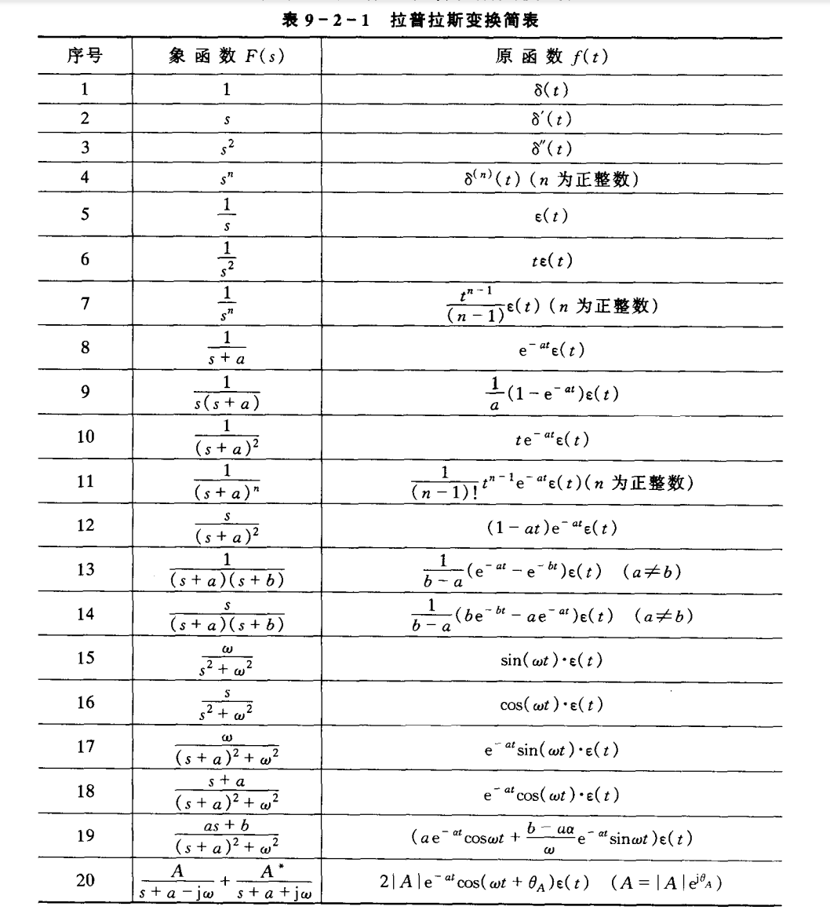

1. [拉普拉斯变换](#拉普拉斯变换)

# 拉普拉斯变换
**拉普拉斯变换**（Laplace transform）是计算函数的变换，将函数从**连续域**转换到**离散域**。

## 

拉普拉斯变换的原理？

 
好的，我们从一个直观且循序渐进的方式来理解拉普拉斯变换的原理。我会尽量避免过于复杂的数学推导，着重于其核心思想、物理意义以及它为何如此有用。

### 1. 核心思想：从“难处理”的领域到“易处理”的领域

拉普拉斯变换的基本原理，与它的“前辈”傅里叶变换非常相似：**将一个在时域（t-域）中难以直接处理的问题（比如求解微分方程），转换到另一个域（s-域，或称复频域）中。在这个新域里，原本复杂的运算（如微分、积分、卷积）会变成简单的代数运算（如乘法、除法）。**

*   **时域 (Time Domain)**：我们通常观察世界的维度。信号随时间变化，描述的是系统在**每个时间点**的行为。例如，一个电路中的电压 \( v(t) \)。
*   **复频域 (Complex Frequency Domain)**：拉普拉斯变换后所在的维度。它描述的是信号的**频率成分和衰减/增长特性**的整体模式。

**类比：**
想象一下，你用中文（时域）写了一段非常复杂的文章，直接分析它的语法结构很困难。拉普拉斯变换就像是一个神奇的翻译器，把它翻译成世界语（s-域）。在世界语中，文章的语法结构变得极其简单明了。你可以在世界语中轻松地分析和修改这篇文章，完成之后，再用“逆拉普拉斯变换”这个翻译器，把它翻译回中文，得到你想要的最终结果。

### 2. 数学定义：它到底在做什么？

一个函数 \( f(t) \) （在 \( t \ge 0 \) 时定义，这是工程中的常见情况）的拉普拉斯变换 \( F(s) \) 定义为：

\[
F(s) = \mathcal{L}\{f(t)\} = \int_{0}^{\infty} f(t) e^{-st}  dt
\]

这里：
*   \( t \) 是实变量（时间）。
*   \( s \) 是一个**复数**变量， \( s = \sigma + j\omega \) （其中 \( \sigma \) 是实部， \( \omega \) 是虚部， \( j \) 是虚数单位）。
*   \( e^{-st} \) 被称为**核函数**。

**这个公式在做什么？**
它是在计算函数 \( f(t) \) 与无数个不同“频率”和“衰减率”的指数函数 \( e^{-st} \) 的**相关性**或**投影**。

*   \( e^{-st} = e^{-(\sigma + j\omega)t} = e^{-\sigma t} \cdot e^{-j\omega t} \)
*   \( e^{-j\omega t} \) 部分代表了角频率为 \( \omega \) 的等幅振荡（根据欧拉公式，它实际上是正弦和余弦函数的组合）。
*   \( e^{-\sigma t} \) 部分代表了一个指数衰减（如果 \( \sigma > 0 \)）或增长（如果 \( \sigma < 0 \)）的包络。

所以，整个积分过程就是在问：“函数 \( f(t) \) 中，包含了多少成分为 \( e^{-\sigma t} \cdot \cos(\omega t) \) 和 \( e^{-\sigma t} \cdot \sin(\omega t) \) 的信号？” 对于每一个不同的复频率 \( s \)，我们都会得到一个答案 \( F(s) \)，这个答案就是该成分的“强度”。

### 3. 为什么它能简化微分方程？（关键原理）

这是拉普拉斯变换最强大的地方。让我们看看它对导数做了什么。

假设 \( F(s) \) 是 \( f(t) \) 的拉普拉斯变换，即 \( \mathcal{L}\{f(t)\} = F(s) \)。那么，\( f(t) \) 的导数 \( f'(t) \) 的拉普拉斯变换是：

\[
\mathcal{L}\{f'(t)\} = sF(s) - f(0)
\]

其中 \( f(0) \) 是初始条件。

看！**在时域中求导的操作，在s-域中变成了乘以 \( s \) 再减去初始条件的简单代数运算！**

类似地，对于二阶导数：
\[
\mathcal{L}\{f''(t)\} = s^2F(s) - sf(0) - f'(0)
\]

**这意味着什么？**
一个包含导数（即微分方程）的复杂关系，在通过拉普拉斯变换后，会变成一个只包含 \( s \), \( F(s) \)，以及初始条件的**代数方程**。而解代数方程比解微分方程要容易得多！

**过程简化如下：**
1.  **变换**：将时域的微分方程，通过拉普拉斯变换，转化为s-域的代数方程。
2.  **求解**：在s-域中求解这个简单的代数方程，得到 \( F(s) \)。
3.  **逆变换**：将求得的 \( F(s) \) 通过**逆拉普拉斯变换**，变回时域的 \( f(t) \)。这个 \( f(t) \) 就是原微分方程的解。

### 4. 与傅里叶变换的关系

*   **傅里叶变换**可以看作是拉普拉斯变换的一个特例。当你把拉普拉斯变换中的 \( s \) 的实部 \( \sigma \) 设为0，即 \( s = j\omega \)，那么 \( e^{-st} \) 就变成了 \( e^{-j\omega t} \)，拉普拉斯变换的公式就退化成了傅里叶变换的公式。
*   **核心区别**：傅里叶变换只关注**纯正弦波**（永恒振荡），而拉普拉斯变换同时关注**正弦波和指数衰减/增长**的信号。这使得拉普拉斯变换能处理更广泛的信号，特别是那些不满足绝对可积条件（比如发散的信号）的信号，只要选择合适的 \( \sigma \) 值（这关系到“收敛域”的概念）。

### 5. 总结：拉普拉斯变换的“原理”精华

1.  **域变换**：核心原理是空间转换，从复杂的时域转换到便于运算的复频域。
2.  **核函数 \( e^{-st} \)**：变换的工具，用于探测信号中不同衰减率和频率的指数信号成分。
3.  **微分变代数**：这是其应用价值的核心。它将时域中的微分/积分运算转化为s-域中的乘/除运算，并自动包含初始条件，极大地简化了动态系统（尤其是由微分方程描述的系统）的分析和求解过程。
4.  **系统视角**：在控制理论和信号处理中，拉普拉斯变换导出了**传递函数**的概念。传递函数 \( H(s) \) 是系统输出与输入的拉普拉斯变换之比，它完整地描述了线性时不变系统的特性，与输入无关。通过分析 \( H(s) \) 的极点（使分母为零的 \( s \) 值），我们可以直接判断系统的稳定性、响应速度等关键性能。

希望这个解释能帮助你从原理上理解拉普拉斯变换，而不仅仅是把它看作一个冰冷的数学公式。

## 

拉普拉斯变换简表

 

