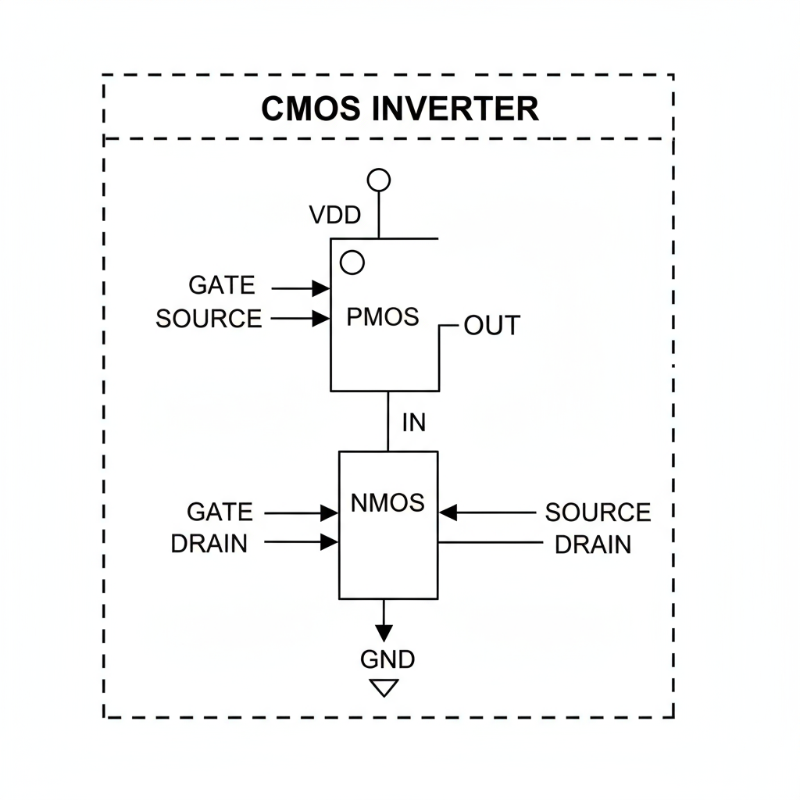
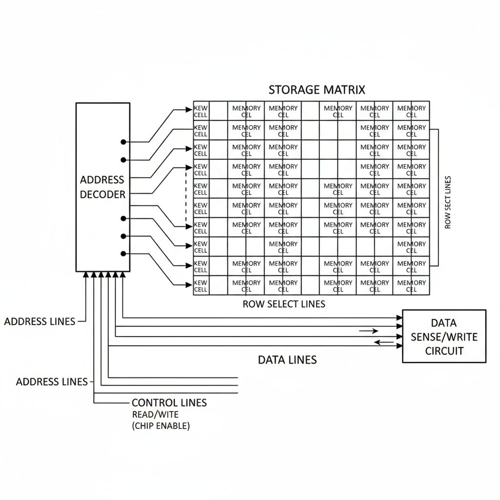
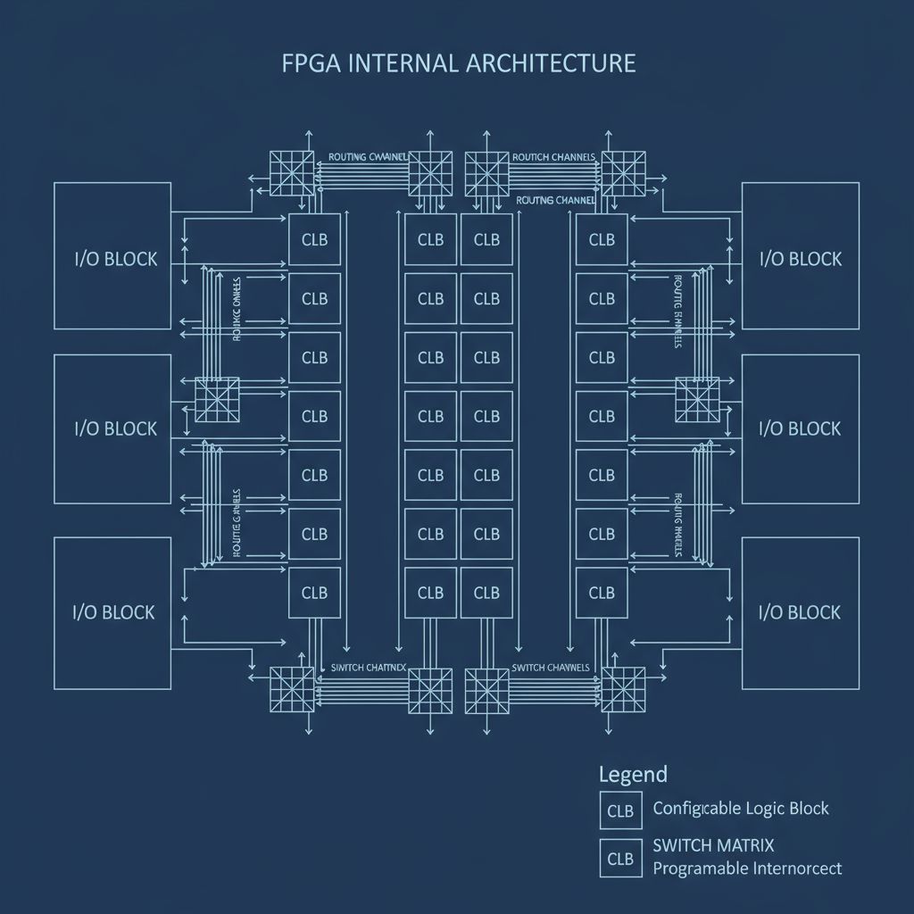

# 数字电子技术课程笔记总结

## 目录
1. [数制与编码](#1-数制与编码)
2. [逻辑代数基础](#2-逻辑代数基础)
3. [逻辑门电路](#3-逻辑门电路)
4. [组合逻辑电路](#4-组合逻辑电路)
5. [触发器](#5-触发器)
6. [时序逻辑电路](#6-时序逻辑电路)
7. [存储器](#7-存储器)
8. [可编程逻辑器件](#8-可编程逻辑器件)
9. [数字系统设计](#9-数字系统设计)

---

## 1. 数制与编码

### 1.1 常用数制

| 数制 | 基数 | 数码 | 权值 | 表示方法 |
|------|------|------|------|----------|
| 十进制(D) | 10 | 0-9 | 10^n | 123.45D |
| 二进制(B) | 2 | 0-1 | 2^n | 1011.01B |
| 八进制(O) | 8 | 0-7 | 8^n | 567.2O |
| 十六进制(H) | 16 | 0-9,A-F | 16^n | 1A3.FH |

### 1.2 数制转换

#### 1.2.1 十进制转其他进制
**整数部分：除基取余，逆序排列**
**小数部分：乘基取整，顺序排列**

<details>
<parameter name="details>
<summary>例题：十进制25.625转二进制</summary>

**整数部分25转二进制：**
```
25 ÷ 2 = 12 余 1
12 ÷ 2 = 6 余 0
6 ÷ 2 = 3 余 0
3 ÷ 2 = 1 余 1
1 ÷ 2 = 0 余 1
```
余数逆序：11001

**小数部分0.625转二进制：**
```
0.625 × 2 = 1.25 取整1
0.25 × 2 = 0.5 取整0
0.5 × 2 = 1.0 取整1
```
顺序：101

**结果：25.625D = 11001.101B**
</details>

#### 1.2.2 其他进制转十进制
**按权展开求和**

$$N = \sum_{i=-m}^{n-1} d_i \times R^i$$

其中：$d_i$为各位数码，$R$为基数，$i$为位权

### 1.3 编码

#### 1.3.1 BCD码（8421码）

| 十进制数 | 8421码 | 余3码 | 格雷码 |
|----------|--------|--------|--------|
| 0 | 0000 | 0011 | 0000 |
| 1 | 0001 | 0100 | 0001 |
| 2 | 0010 | 0101 | 0011 |
| 3 | 0011 | 0110 | 0010 |
| 4 | 0100 | 0111 | 0110 |
| 5 | 0101 | 1000 | 0111 |
| 6 | 0110 | 1001 | 0101 |
| 7 | 0111 | 1010 | 0100 |
| 8 | 1000 | 1011 | 1100 |
| 9 | 1001 | 1100 | 1101 |

#### 1.3.2 格雷码特点
- **相邻两个代码只有一位不同**
- **循环码特性**
- **用于避免竞争冒险**

---

## 2. 逻辑代数基础

### 2.1 基本逻辑运算

| 运算 | 逻辑表达式 | 逻辑门符号 | 真值表特点 |
|------|------------|------------|------------|
| 与(AND) | $F = A \cdot B$ | 与门 | 全1出1 |
| 或(OR) | $F = A + B$ | 或门 | 有1出1 |
| 非(NOT) | $F = \overline{A}$ | 非门 | 入1出0 |
| 与非(NAND) | $F = \overline{A \cdot B}$ | 与非门 | 全1出0 |
| 或非(NOR) | $F = \overline{A + B}$ | 或非门 | 有1出0 |
| 异或(XOR) | $F = A \oplus B$ | 异或门 | 不同出1 |
| 同或(XNOR) | $F = A \odot B$ | 同或门 | 相同出1 |

### 基本逻辑门符号图

*图1-1: 基本逻辑门符号图*

### 2.2 逻辑代数基本定律

#### 2.2.1 基本定律
| 定律名称 | 表达式 |
|----------|--------|
| 交换律 | $A + B = B + A$<br>$A \cdot B = B \cdot A$ |
| 结合律 | $(A + B) + C = A + (B + C)$<br>$(A \cdot B) \cdot C = A \cdot (B \cdot C)$ |
| 分配律 | $A + B \cdot C = (A + B) \cdot (A + C)$<br>$A \cdot (B + C) = A \cdot B + A \cdot C$ |
| 互补律 | $A + \overline{A} = 1$<br>$A \cdot \overline{A} = 0$ |
| 重叠律 | $A + A = A$<br>$A \cdot A = A$ |
| 还原律 | $\overline{\overline{A}} = A$ |

#### 2.2.2 摩根定律（德·摩根定律）
$$\overline{A + B} = \overline{A} \cdot \overline{B}$$
$$\overline{A \cdot B} = \overline{A} + \overline{B}$$

<details>
<parameter name="details>
<summary>摩根定律证明</summary>

**证明：$\overline{A + B} = \overline{A} \cdot \overline{B}$**

构造真值表：

| A | B | A+B | $\overline{A+B}$ | $\overline{A}$ | $\overline{B}$ | $\overline{A} \cdot \overline{B}$ |
|---|---|-----|-----------------|---------------|---------------|-------------------|
| 0 | 0 | 0   | 1               | 1             | 1             | 1                 |
| 0 | 1 | 1   | 0               | 1             | 0             | 0                 |
| 1 | 0 | 1   | 0               | 0             | 1             | 0                 |
| 1 | 1 | 1   | 0               | 0             | 0             | 0                 |

可见$\overline{A+B} = \overline{A} \cdot \overline{B}$成立。
</details>

### 2.3 逻辑函数表示方法

#### 2.3.1 逻辑函数的标准形式

**最小项（标准与项）**
- 包含所有变量的乘积项
- 每个变量以原变量或反变量形式出现一次
- $n$变量有$2^n$个最小项

**最大项（标准或项）**
- 包含所有变量的和项
- 每个变量以原变量或反变量形式出现一次
- $n$变量有$2^n$个最大项

#### 2.3.2 逻辑函数化简

**代数化简法**
1. 并项法：$AB + A\overline{B} = A$
2. 吸收法：$A + AB = A$
3. 消项法：$AB + \overline{A}C + BC = AB + \overline{A}C$
4. 配项法：$A + \overline{A}B = A + B$

**卡诺图化简法**

### 卡诺图示例

<details>
<parameter name="details>
<summary>卡诺图化简步骤</summary>

1. **画出卡诺图**：根据变量数选择相应卡诺图
2. **填入函数值**：在对应位置填入函数值
3. **画包围圈**：2、4、8...个相邻的1画包围圈
4. **读出化简结果**：每个包围圈读出一个化简项
5. **写出最简表达式**：所有化简项相或

**画包围圈原则：**
- 包围圈要尽可能大
- 每个1至少被一个圈包含
- 圈可以重叠
- 圈必须是矩形或正方形
- 边界可以相邻（循环相邻）
</details>

---

## 3. 逻辑门电路

### 3.1 基本逻辑门

#### 3.1.1 TTL逻辑门电路

**TTL与非门电路分析**

### TTL与非门电路图

<details>
<parameter name="details>
<summary>TTL与非门工作原理</summary>

**电路结构：**
- 输入级：多发射极晶体管
- 中间级：倒相级
- 输出级：推拉式输出级

**工作原理：**
1. **输入全高电平（3.6V）时：**
   - 所有发射结反偏，集电结正偏
   - T1工作在倒置放大状态
   - T2、T4导通，输出低电平

2. **输入有低电平（0.3V）时：**
   - 对应发射结正偏，T1饱和
   - T2、T4截止，输出高电平

**电压传输特性：**
- 截止区：输入<0.6V，输出高电平
- 线性区：输入0.6V-1.3V，放大区工作
- 饱和区：输入>1.3V，输出低电平
</details>

#### 3.1.2 CMOS逻辑门电路

**CMOS反相器分析**

### CMOS反相器电路图


*图3-2: CMOS反相器电路结构*

<details>
<parameter name="details>
<summary>CMOS反相器工作原理</summary>

**电路结构：**
- NMOS管作为驱动管
- PMOS管作为负载管
- 两管栅极相连作为输入
- 两管漏极相连作为输出

**工作原理：**

1. **输入高电平（$V_{DD}$）时：**
   - NMOS管导通，PMOS管截止
   - 输出低电平（接近0V）

2. **输入低电平（0V）时：**
   - NMOS管截止，PMOS管导通
   - 输出高电平（接近$V_{DD}$）

**主要参数：**
- 阈值电压：$V_{TH} \approx V_{DD}/2$
- 噪声容限：$V_{NH} = V_{OH(min)} - V_{IH(min)}$
- 功耗：静态功耗极低，动态功耗为主
- 扇出：较大（>50）
</details>

### 3.2 复合逻辑门

#### 3.2.1 CMOS传输门

**传输门结构与特性**

<details>
<parameter name="details">
<summary>CMOS传输门工作原理</summary>

**电路结构：**
- NMOS管和PMOS管并联
- 栅极加互补控制信号

**工作原理：**
1. **控制信号C=1，$\overline{C}$=0时：**
   - 两管均导通
   - 信号可以双向传输

2. **控制信号C=0，$\overline{C}$=1时：**
   - 两管均截止
   - 开关断开

**应用：**
- 模拟开关
- 数据选择器
- 寄存器传输
</details>

### 3.3 逻辑门电路参数

| 参数 | TTL | CMOS | 单位 |
|------|-----|------|------|
| 供电电压 | 5 | 3-15 | V |
| 功耗 | 中等 | 极低 | mW |
| 速度 | 快 | 中等 | ns |
| 扇出 | 10-20 | >50 | 个 |
| 噪声容限 | 0.4-1.0 | 0.3-0.8×Vdd | V |

---

## 4. 组合逻辑电路

### 4.1 组合逻辑电路分析

#### 4.1.1 分析步骤
1. **写出各输出逻辑表达式**
2. **化简逻辑表达式**
3. **列出真值表**
4. **说明电路功能**

#### 4.1.2 竞争冒险现象

**竞争**：门电路的两个输入信号同时向相反方向变化

**冒险**：由于竞争引起的输出端出现尖峰脉冲

**消除方法：**
1. **修改逻辑设计**：增加冗余项
2. **滤波**：RC低通滤波器
3. **选通**：使用时钟控制

<details>
<parameter name="details>
<parameter name="summary>竞争冒险实例分析</summary>

**电路：$F = A\overline{C} + AC$**

当A=1，C从0→1变化时：
- 第一项：$A\overline{C}$ 从1→0
- 第二项：$AC$ 从0→1
- 理论上F应该保持1，但实际可能出现0

**解决方案：增加冗余项**
$F = A\overline{C} + AC + BC$（其中B为无关项）

或者使用选通脉冲：
$F = (A\overline{C} + AC) \cdot G$
其中G为选通信号
</details>

### 4.2 常用组合逻辑电路

#### 4.2.1 编码器

**8线-3线优先编码器74LS148**

| 输入 | 输出 | 说明 |
|------|------|------|
| $\overline{I_7}$ | 最高优先级 | 7优先级最高 |
| $\overline{I_0}$ | 最低优先级 | 0优先级最低 |
| $\overline{EI}$ | 使能输入 | 0有效 |
| $\overline{EO}$ | 使能输出 | 1表示无输入 |
| $\overline{GS}$ | 编码输出 | 0表示有编码输出 |

**逻辑表达式：**
$$Y_2 = \overline{\overline{I_4} + \overline{I_5} + \overline{I_6} + \overline{I_7}}$$
$$Y_1 = \overline{\overline{I_2}\overline{I_3} + \overline{I_6}\overline{I_7} + \overline{I_4}\overline{I_5}}$$
$$Y_0 = \overline{\overline{I_1}\overline{I_3}\overline{I_5}\overline{I_7} + \overline{I_2}\overline{I_3}\overline{I_6}\overline{I_7}}$$

#### 4.2.2 译码器

**3线-8线译码器74LS138**

| 使能端 | 输入 | 输出 |
|--------|------|------|
| $G_1=1, \overline{G_2A}=0, \overline{G_2B}=0$ | A2A1A0 | $\overline{Y_0}-\overline{Y_7}$ |

**逻辑表达式：**
$$\overline{Y_i} = \overline{E} \cdot \overline{m_i}$$
其中$m_i$为第$i$个最小项

**应用：**
- 存储器地址译码
- 指令译码
- 数据分配器

#### 4.2.3 数据选择器

**8选1数据选择器74LS151**

**逻辑表达式：**
$$Y = \sum_{i=0}^{7} D_i \cdot m_i$$

其中$m_i$为地址码对应的最小项

**应用：**
- 并行转串行
- 函数发生器
- 多路分配器

#### 4.2.4 加法器

**半加器**

| A | B | S | C |
|---|---|---|---|
| 0 | 0 | 0 | 0 |
| 0 | 1 | 1 | 0 |
| 1 | 0 | 1 | 0 |
| 1 | 1 | 0 | 1 |

**逻辑表达式：**
$$S = A \oplus B$$
$$C = A \cdot B$$

**全加器**

| A | B | Ci | S | Co |
|---|---|----|----|----|
| 0 | 0 | 0  | 0 | 0  |
| 0 | 0 | 1  | 1 | 0  |
| 0 | 1 | 0  | 1 | 0  |
| 0 | 1 | 1  | 0 | 1  |
| 1 | 0 | 0  | 1 | 0  |
| 1 | 0 | 1  | 0 | 1  |
| 1 | 1 | 0  | 0 | 1  |
| 1 | 1 | 1  | 1 | 1  |

**逻辑表达式：**
$$S = A \oplus B \oplus C_i$$
$$C_o = AB + (A \oplus B)C_i$$

**超前进位加法器**

<details>
<parameter name="details>
<summary>超前进位原理</summary>

**进位产生函数：**
$G_i = A_i B_i$

**进位传递函数：**
$P_i = A_i \oplus B_i$

**进位输出：**
$C_{i+1} = G_i + P_i C_i$

**超前进位表达式：**
$C_1 = G_0 + P_0 C_0$
$C_2 = G_1 + P_1 G_0 + P_1 P_0 C_0$
$C_3 = G_2 + P_2 G_1 + P_2 P_1 G_0 + P_2 P_1 P_0 C_0$
$C_4 = G_3 + P_3 G_2 + P_3 P_2 G_1 + P_3 P_2 P_1 G_0 + P_3 P_2 P_1 P_0 C_0$

**优点：** 各进位同时产生，速度快
**缺点：** 电路复杂
</details>

#### 4.2.5 数值比较器

**4位数值比较器74LS85**

**逻辑表达式：**

**大于输出：**
$F_{A>B} = A_3\overline{B_3} + (A_3 \odot B_3)A_2\overline{B_2} + (A_3 \odot B_3)(A_2 \odot B_2)A_1\overline{B_1} + (A_3 \odot B_3)(A_2 \odot B_2)(A_1 \odot B_1)A_0\overline{B_0}$

**等于输出：**
$F_{A=B} = (A_3 \odot B_3)(A_2 \odot B_2)(A_1 \odot B_1)(A_0 \odot B_0)$

**小于输出：**
$F_{A<B} = \overline{F_{A>B} + F_{A=B}}$

---

## 5. 触发器

### 触发器电路结构图

### 5.1 基本RS触发器

#### 5.1.1 电路结构

**与非门构成的RS触发器**

| R | S | Q | $\overline{Q}$ | 说明 |
|---|---|-----|---------------|------|
| 0 | 0 | 1 | 1 | 不允许 |
| 0 | 1 | 0 | 1 | 置0 |
| 1 | 0 | 1 | 0 | 置1 |
| 1 | 1 | 保持 | 保持 | 保持原状态 |

**约束条件：$\overline{R} + \overline{S} = 1$**

#### 5.1.2 特性方程

$$Q^{n+1} = S + \overline{R}Q^n$$

**约束条件：$RS = 0$**

### 5.2 同步触发器

#### 5.2.1 同步RS触发器

**电路特点：**
- 当时钟CP=0时，输入信号被阻塞
- 当时钟CP=1时，输入信号起作用

**特性方程：**
$$Q^{n+1} = S + \overline{R}Q^n \quad (CP=1)$$

**约束条件：$RS = 0$**

#### 5.2.2 主从RS触发器

**工作原理：**
1. **CP=1时：** 主触发器工作，从触发器保持
2. **CP下降沿：** 主触发器状态传入从触发器

**特点：**
- 解决空翻现象
- 一次翻转问题

### 5.3 JK触发器

#### 5.3.1 主从JK触发器

**特性方程：**
$$Q^{n+1} = J\overline{Q^n} + \overline{K}Q^n$$

**状态转换表：**

| J | K | $Q^n$ | $Q^{n+1}$ | 功能 |
|---|---|-------|-----------|------|
| 0 | 0 | 0 | 0 | 保持 |
| 0 | 0 | 1 | 1 | 保持 |
| 0 | 1 | 0 | 0 | 置0 |
| 0 | 1 | 1 | 0 | 置0 |
| 1 | 0 | 0 | 1 | 置1 |
| 1 | 0 | 1 | 1 | 置1 |
| 1 | 1 | 0 | 1 | 翻转 |
| 1 | 1 | 1 | 0 | 翻转 |

#### 5.3.2 边沿JK触发器

**工作特点：**
- 在CP上升沿或下降沿触发
- 避免空翻和一次翻转问题
- 抗干扰能力强

### 5.4 D触发器

#### 5.4.1 维持阻塞D触发器

**特性方程：**
$$Q^{n+1} = D$$

**状态转换表：**

| D | $Q^n$ | $Q^{n+1}$ | 功能 |
|---|---|-----------|------|
| 0 | 0 | 0 | 置0 |
| 0 | 1 | 0 | 置0 |
| 1 | 0 | 1 | 置1 |
| 1 | 1 | 1 | 置1 |

**特点：**
- 边沿触发
- 数据锁存
- 抗干扰能力强

#### 5.4.2 边沿D触发器

**应用：**
- 数据存储
- 移位寄存器
- 计数器

### 5.5 T触发器

**特性方程：**
$$Q^{n+1} = T\overline{Q^n} + \overline{T}Q^n = T \oplus Q^n$$

**状态转换表：**

| T | $Q^n$ | $Q^{n+1}$ | 功能 |
|---|---|-----------|------|
| 0 | 0 | 0 | 保持 |
| 0 | 1 | 1 | 保持 |
| 1 | 0 | 1 | 翻转 |
| 1 | 1 | 0 | 翻转 |

### 5.6 触发器转换

#### 5.6.1 JK→D触发器

**转换公式：**
$$D = J\overline{Q^n} + \overline{K}Q^n$$

#### 5.6.2 JK→T触发器

**转换公式：**
$$T = J\overline{Q^n} + \overline{K}Q^n$$

#### 5.6.3 D→JK触发器

**转换公式：**
$$J = D, \quad K = \overline{D}$$

---

## 6. 时序逻辑电路

### 计数器状态转换图

### 6.1 时序电路基本概念

#### 6.1.1 时序电路分类

| 分类依据 | 类型 | 特点 |
|----------|------|------|
| 触发方式 | 同步时序电路 | 所有触发器同时动作 |
| | 异步时序电路 | 触发器动作有先后 |
| 输出方式 | 米里型 | 输出与当前状态和输入有关 |
| | 摩尔型 | 输出仅与当前状态有关 |

#### 6.1.2 时序电路分析步骤

1. **写时钟方程**
2. **写驱动方程（激励方程）**
3. **写状态方程**
4. **写输出方程**
5. **列状态表**
6. **画状态图**
7. **画时序图**
8. **说明功能**

### 6.2 寄存器

#### 6.2.1 基本寄存器

**4位D寄存器74LS175**

**功能表：**

| $\overline{CLR}$ | CP | D3 D2 D1 D0 | Q3 Q2 Q1 Q0 | 说明 |
|------------------|----|-------------|-------------|------|
| 0 | × | ×××× | 0000 | 异步清零 |
| 1 | ↑ | d3 d2 d1 d0 | d3 d2 d1 d0 | 同步置数 |
| 1 | 0 | ×××× | 保持 | 保持 |

#### 6.2.2 移位寄存器

**4位右移寄存器74LS194**

**功能表：**

| $\overline{CLR}$ | S1 | S0 | CP | 功能 |
|------------------|----|----|----|------|
| 0 | × | × | × | 清零 |
| 1 | 0 | 0 | ↑ | 保持 |
| 1 | 0 | 1 | ↑ | 右移 |
| 1 | 1 | 0 | ↑ | 左移 |
| 1 | 1 | 1 | ↑ | 并行置数 |

**移位规律：**
- 右移：$Q_0 \leftarrow D_{SR}, Q_1 \leftarrow Q_0, Q_2 \leftarrow Q_1, Q_3 \leftarrow Q_2$
- 左移：$Q_3 \leftarrow D_{SL}, Q_2 \leftarrow Q_3, Q_1 \leftarrow Q_2, Q_0 \leftarrow Q_1$

### 6.3 计数器

#### 6.3.1 同步计数器

**同步二进制计数器74LS161**

**状态转换表：**

| 计数脉冲 | Q3 | Q2 | Q1 | Q0 | 十进制 |
|----------|----|----|----|----|--------|
| 0 | 0 | 0 | 0 | 0 | 0 |
| 1 | 0 | 0 | 0 | 1 | 1 |
| 2 | 0 | 0 | 1 | 0 | 2 |
| 3 | 0 | 0 | 1 | 1 | 3 |
| ... | ... | ... | ... | ... | ... |
| 15 | 1 | 1 | 1 | 1 | 15 |
| 16 | 0 | 0 | 0 | 0 | 0 |

**驱动方程：**
$$D_0 = T_0 = 1$$
$$D_1 = T_1 = Q_0$$
$$D_2 = T_2 = Q_0 Q_1$$
$$D_3 = T_3 = Q_0 Q_1 Q_2$$

**进位输出：**
$$C = Q_0 Q_1 Q_2 Q_3$$

#### 6.3.2 异步计数器

**4位异步二进制计数器74LS90**

**计数原理：**
- Q0：CP0触发，2分频
- Q1：Q0下降沿触发，4分频  
- Q2：Q1下降沿触发，8分频
- Q3：Q2下降沿触发，16分频

**时序特点：**
- 触发延迟时间长
- 计数速度较慢
- 电路简单

#### 6.3.3 十进制计数器

**同步十进制计数器74LS160**

**状态转换表：**

| 计数脉冲 | Q3 | Q2 | Q1 | Q0 | 十进制 |
|----------|----|----|----|----|--------|
| 0 | 0 | 0 | 0 | 0 | 0 |
| 1 | 0 | 0 | 0 | 1 | 1 |
| ... | ... | ... | ... | ... | ... |
| 9 | 1 | 0 | 0 | 1 | 9 |
| 10 | 0 | 0 | 0 | 0 | 0 |

**驱动方程：**
$$D_0 = T_0 = 1$$
$$D_1 = T_1 = \overline{Q_3} Q_0$$
$$D_2 = T_2 = Q_1 Q_0$$
$$D_3 = T_3 = Q_2 Q_1 Q_0 + Q_3 Q_0$$

#### 6.3.4 可逆计数器

**4位同步可逆计数器74LS191**

**功能：**
- 加法计数：$\overline{U/D} = 0$
- 减法计数：$\overline{U/D} = 1$

**驱动方程：**
加法：$D_i = T_i = Q_0 Q_1 ... Q_{i-1}$
减法：$D_i = T_i = \overline{Q_0} \overline{Q_1} ... \overline{Q_{i-1}}$

### 6.4 顺序脉冲发生器

#### 6.4.1 计数器型

**环形计数器**

**状态转换表：**

| 计数脉冲 | Q3 | Q2 | Q1 | Q0 | 输出 |
|----------|----|----|----|----|------|
| 0 | 1 | 0 | 0 | 0 | Y0 |
| 1 | 0 | 1 | 0 | 0 | Y1 |
| 2 | 0 | 0 | 1 | 0 | Y2 |
| 3 | 0 | 0 | 0 | 1 | Y3 |
| 4 | 1 | 0 | 0 | 0 | Y0 |

**特点：**
- $n$位触发器产生$n$个顺序脉冲
- 无需译码电路
- 状态利用率低

#### 6.4.2 移位寄存器型

**扭环形计数器**

**特点：**
- $n$位触发器产生$2n$个顺序脉冲
- 状态利用率提高一倍
- 需要译码电路

### 6.5 序列信号发生器

#### 6.5.1 计数器型

**设计步骤：**
1. 确定序列长度$n$
2. 设计模$n$计数器
3. 设计译码电路

#### 6.5.2 移位寄存器型

**设计步骤：**
1. 确定移位寄存器位数$n$
2. 确定反馈函数
3. 设计反馈电路

---

## 7. 存储器

### 存储器结构图


*图7-1: 存储器基本结构框图*

### 7.1 存储器分类

| 分类 | 特点 | 典型产品 |
|------|------|----------|
| RAM | 易失性，读写方便 | SRAM, DRAM |
| ROM | 非易失性，只读 | PROM, EPROM, EEPROM |
| Flash | 非易失性，可擦写 | NOR Flash, NAND Flash |

### 7.2 RAM存储器

#### 7.2.1 SRAM

**静态随机存取存储器**

**结构特点：**
- 6管CMOS存储单元
- 触发器存储数据
- 无需刷新

**工作原理：**

<details>
<parameter name="details>
<summary>SRAM存储单元分析</summary>

**存储单元结构：**
- M1, M3：负载管
- M2, M4：驱动管
- M5, M6：传输管

**读写过程：**

**读操作：**
1. 字线WL=1，传输管导通
2. 位线BL和$\overline{BL}$通过存储单元耦合
3. 读出放大器检测电位差

**写操作：**
1. 字线WL=1，传输管导通
2. 在位线上加写入数据
3. 通过传输管改变触发器状态
</details>

**主要参数：**
- 容量：$2^m \times n$位
- 存取时间：$t_{AA}$
- 功耗：静态功耗+动态功耗
- 扇出：驱动能力

#### 7.2.2 DRAM

**动态随机存取存储器**

**存储原理：**
- 电容存储电荷表示数据
- 电荷泄漏需要定期刷新

**存储单元：**

| 类型 | 结构 | 特点 |
|------|------|------|
| 三管单元 | 3T1C | 读出非破坏性 |
| 单管单元 | 1T1C | 集成度高，读出破坏性 |

**刷新方式：**

1. **集中刷新**：集中一段时间刷新所有行
2. **分散刷新**：每行分散刷新
3. **异步刷新**：按一定周期刷新

**刷新周期：**
$$T_{REF} = \frac{t_{max}}{N_{row}}$$

其中：$t_{max}$为最大刷新间隔，$N_{row}$为行数

### 7.3 ROM存储器

#### 7.3.1 只读存储器结构

**ROM基本结构：**
- 地址译码器
- 存储矩阵
- 输出缓冲器

**存储矩阵表示：**

| 地址 | 数据线 | 存储内容 |
|------|--------|----------|
| A1 A0 | D3 D2 D1 D0 | |
| 00 | ×××× | 0000 |
| 01 | ×××× | 1100 |
| 10 | ×××× | 1010 |
| 11 | ×××× | 0101 |

#### 7.3.2 可编程ROM

**PROM（可编程只读存储器）**
- 熔丝结构
- 一次编程
- 编程后不可更改

**EPROM（可擦除可编程只读存储器）**
- 浮动栅雪崩注入MOS管
- 紫外线擦除
- 可重复编程

**EEPROM（电可擦除可编程只读存储器）**
- 隧道效应
- 电擦除
- 字节擦除

#### 7.3.3 Flash存储器

**NOR Flash**
- 随机访问
- 代码存储
- 读取速度快

**NAND Flash**
- 块访问
- 数据存储
- 集成度高

### 7.4 存储器容量扩展

#### 7.4.1 位扩展

**方法：**
- 地址线并联
- 控制线并联
- 数据线扩展

**4片1K×4位 → 1K×16位**

#### 7.4.2 字扩展

**方法：**
- 数据线并联
- 控制线并联
- 地址线扩展（片选）

**4片1K×8位 → 4K×8位**

#### 7.4.3 字位同时扩展

**方法：**
- 先位扩展成字长
- 再字扩展成容量

**8片1K×4位 → 4K×8位**

---

## 8. 可编程逻辑器件

### FPGA内部结构图


*图8-1: FPGA内部结构示意图*

### 8.1 PLD基本概念

#### 8.1.1 PLD分类

| 分类 | 特点 | 典型产品 |
|------|------|----------|
| SPLD | 简单可编程逻辑器件 | PLA, PAL, GAL |
| CPLD | 复杂可编程逻辑器件 | ispLSI, MAX7000 |
| FPGA | 现场可编程门阵列 | XC4000, EP1C3 |

#### 8.1.2 PLD表示方法

**基本符号：**
- 固定连接：×
- 可编程连接：·
- 无连接：空格
- 输入：→
- 输出：○

### 8.2 SPLD

#### 8.2.1 PLA（可编程逻辑阵列）

**结构特点：**
- 与阵列可编程
- 或阵列可编程
- 灵活性高

**设计方法：**
1. 列出真值表
2. 找到最小项
3. 合并最小项
4. 编程实现

#### 8.2.2 PAL（可编程阵列逻辑）

**结构特点：**
- 与阵列可编程
- 或阵列固定
- 结构简单

#### 8.2.3 GAL（通用阵列逻辑）

**结构特点：**
- 与阵列可编程
- 或阵列可编程（OLMC）
- 可重复编程

**OLMC输出模式：**
1. 专用输出
2. 专用输入
3. 组合输出
4. 寄存器输出

### 8.3 CPLD

#### 8.3.1 CPLD结构

**基本组成：**
- 逻辑块（LAB）
- 可编程互连阵列（PIA）
- I/O控制块

**ispLSI系列结构：**
- 通用逻辑块（GLB）
- 输入输出块（IOB）
- 全局布线池（GRP）

#### 8.3.2 CPLD特点

**优点：**
- 集成度高
- 速度快
- 功耗低
- 设计灵活

**应用：**
- 接口电路
- 控制电路
- 数据处理

### 8.4 FPGA

#### 8.4.1 FPGA结构

**基本组成：**
- 可配置逻辑块（CLB）
- 输入输出块（IOB）
- 可编程互连资源（PIR）

**XC4000系列结构：**
- CLB：组合逻辑+触发器
- IOB：输入输出缓冲器
- 互连：开关矩阵

#### 8.4.2 FPGA设计流程

**设计步骤：**
1. 设计输入（原理图/HDL）
2. 综合
3. 布局布线
4. 下载配置

**设计工具：**
- Xilinx ISE
- Altera Quartus
- Synplify Pro

#### 8.4.3 FPGA配置

**配置方式：**
1. 主模式：从外部存储器加载
2. 从模式：由外部控制器加载
3. 边界扫描：JTAG接口

**配置数据：**
- 比特流文件（.bit）
- 器件配置数据

---

## 9. 数字系统设计

### 9.1 数字系统设计方法

#### 9.1.1 自顶向下设计

**设计步骤：**
1. **系统级设计**：确定系统功能
2. **功能级设计**：分解为子系统
3. **逻辑级设计**：设计具体电路
4. **电路级设计**：选择器件

#### 9.1.2 硬件描述语言

**VHDL基本结构：**

```vhdl
entity entity_name is
    port (
        signal_name : in std_logic;
        signal_name : out std_logic
    );
end entity_name;

architecture architecture_name of entity_name is
    -- 信号声明
    signal internal_signal : std_logic;
begin
    -- 逻辑描述
    process(clk, reset)
    begin
        if reset = '1' then
            output <= '0';
        elsif rising_edge(clk) then
            output <= input;
        end if;
    end process;
end architecture_name;
```

**Verilog HDL基本结构：**

```verilog
module module_name(
    input clk,
    input reset,
    input [3:0] data_in,
    output reg [3:0] data_out
);

always @(posedge clk or posedge reset) begin
    if (reset)
        data_out <= 4'b0;
    else
        data_out <= data_in;
end

endmodule
```

### 9.2 数字系统设计实例

#### 9.2.1 交通灯控制器

**系统功能：**
- 东西向绿灯30秒
- 南北向绿灯20秒
- 黄灯闪烁5秒
- 紧急情况处理

**系统结构：**
1. 计数器模块
2. 状态控制器
3. 译码显示模块

**状态机设计：**

| 状态 | 东西向 | 南北向 | 持续时间 |
|------|--------|--------|----------|
| S0 | 绿 | 红 | 30s |
| S1 | 黄 | 红 | 5s |
| S2 | 红 | 绿 | 20s |
| S3 | 红 | 黄 | 5s |

#### 9.2.2 数字钟设计

**系统功能：**
- 时分秒显示
- 闹钟功能
- 调时功能
- 12/24小时制切换

**模块设计：**
1. 秒脉冲发生器
2. 60进制计数器（秒、分）
3. 24/12进制计数器（时）
4. 译码显示电路
5. 闹钟控制电路

#### 9.2.3 数字频率计

**系统功能：**
- 频率测量
- 周期测量
- 占空比测量

**测量原理：**

**频率测量：**
$$f = \frac{N}{T}$$

其中：$N$为计数脉冲数，$T$为门控时间

**周期测量：**
$$T = \frac{N}{f_{ref}}$$

其中：$f_{ref}$为参考时钟频率

**系统结构：**
1. 闸门电路
2. 计数器
3. 锁存器
4. 显示电路

### 9.3 系统仿真与测试

#### 9.3.1 功能仿真

**仿真工具：**
- ModelSim
- Active-HDL
- ISE Simulator

**仿真步骤：**
1. 编写测试文件
2. 设置激励信号
3. 观察输出波形
4. 验证功能正确性

#### 9.3.2 时序仿真

**时序分析：**
- 最高工作频率
- 建立时间检查
- 保持时间检查
- 时钟偏移

**时序约束：**
```vhdl
-- 时钟约束
create_clock -name clk -period 10 -waveform {0 5} [get_ports clk]

-- 输入延迟约束
set_input_delay -clock clk -max 2 [get_ports data_in]

-- 输出延迟约束
set_output_delay -clock clk -max 3 [get_ports data_out]
```

### 9.4 系统优化

#### 9.4.1 速度优化

**方法：**
1. 流水线技术
2. 并行处理
3. 资源复用
4. 时钟平衡

#### 9.4.2 面积优化

**方法：**
1. 资源共享
2. 逻辑优化
3. 资源合并
4. 参数化设计

#### 9.4.3 功耗优化

**方法：**
1. 时钟门控
2. 电源管理
3. 工艺选择
4. 电压调节

---

## 总结

本笔记涵盖了数字电子技术的全部核心内容，包括：

1. **基础理论**：数制编码、逻辑代数
2. **基本器件**：逻辑门、触发器
3. **功能电路**：组合逻辑、时序逻辑
4. **存储器**：RAM、ROM、Flash
5. **可编程器件**：PLD、CPLD、FPGA
6. **系统设计**：设计方法、实例分析

**学习要点：**
- 掌握基本概念和原理
- 熟练运用分析方法
- 注重理论与实践结合
- 关注新技术发展

**考试重点：**
- 数制转换和编码
- 逻辑函数化简
- 组合电路分析设计
- 触发器特性
- 时序电路分析
- 存储器应用
- PLD设计基础

通过系统学习这些内容，能够全面掌握数字电子技术的理论基础和实际应用能力。