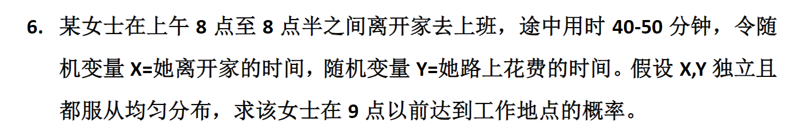

# 第三章
## 

题解

我们来一步步解这道题：

---

## 📌 题目重述：

> 某女士在上午 **8点至8点半之间** 离开家去上班，途中用时 **40–50分钟**。  
> 令随机变量：
> - \( X \) = 她离开家的时间（单位：分钟，从8:00开始计时）  
> - \( Y \) = 她路上花费的时间（单位：分钟）

> 假设 \( X, Y \) **独立**，且都服从**均匀分布**。  
> **求该女士在9点以前到达工作地点的概率。**

---

## ✅ 第一步：设定变量范围

- 由于她是在 **8:00 到 8:30** 之间出门 → \( X \sim U[0, 30] \)（以8:00为时间零点）
- 路上花费时间是 **40到50分钟** → \( Y \sim U[40, 50] \)
- 到达时间 = 出发时间 + 路上时间 = \( X + Y \)
- 9点 = 8:00 + 60分钟 → 所以要求：
  \[
  P(X + Y < 60)
  \]

---

## ✅ 第二步：联合概率密度函数

因为 \( X \) 和 \( Y \) 独立，所以联合密度函数是各自密度的乘积：

- \( f_X(x) = \frac{1}{30}, \quad 0 \le x \le 30 \)
- \( f_Y(y) = \frac{1}{10}, \quad 40 \le y \le 50 \)

→ 联合密度：
\[
f_{X,Y}(x,y) = f_X(x) \cdot f_Y(y) = \frac{1}{30} \cdot \frac{1}{10} = \frac{1}{300}, \quad (x,y) \in [0,30] \times [40,50]
\]

---

## ✅ 第三步：计算 \( P(X + Y < 60) \)

我们需要在矩形区域 \( R = [0,30] \times [40,50] \) 上，对满足 \( x + y < 60 \) 的部分积分。

即：
\[
P(X + Y < 60) = \iint_{x+y < 60} f_{X,Y}(x,y)\, dx\,dy = \frac{1}{300} \cdot \text{Area of } \{(x,y) \in [0,30]\times[40,50] : x+y < 60\}
\]

---

## ✅ 第四步：画图找积分区域（几何法最直观）

我们在平面直角坐标系中画出矩形区域：

- \( x \in [0,30] \)，\( y \in [40,50] \)
- 直线 \( x + y = 60 \) 是一条斜率为 -1 的直线，过点 (10,50) 和 (20,40)

我们关心的是矩形内位于这条直线**下方**的部分。

### 分析交点：

- 当 \( y=50 \)，\( x = 60 - 50 = 10 \)
- 当 \( y=40 \)，\( x = 60 - 40 = 20 \)

所以在矩形区域内，满足 \( x + y < 60 \) 的区域是一个**梯形或三角形？**

实际上，这是一个**直角三角形**！

看图形：

- 在 \( y \in [40,50] \)，对于每个 \( y \)，\( x \) 的上限是 \( \min(30, 60 - y) \)
- 但注意：当 \( y > 50 \) 时超出范围，而 \( y \le 50 \)，且 \( 60 - y \ge 10 \)，而 \( x \) 最大是30，但 \( 60 - y \le 20 \)（当 \( y=40 \)），所以实际上：
  - 对于所有 \( y \in [40,50] \)，\( x \) 的上限是 \( 60 - y \)，且 \( 60 - y \in [10,20] \subset [0,30] \)，所以没有截断！

因此，积分区域是：

\[
0 \le x \le 60 - y, \quad 40 \le y \le 50
\]

或者也可以写成：

\[
40 \le y \le 50, \quad 0 \le x \le 60 - y
\]

---

## ✅ 第五步：计算面积

我们计算这个区域的面积：

\[
A = \int_{y=40}^{50} \int_{x=0}^{60-y} dx\, dy = \int_{40}^{50} (60 - y)\, dy
\]

计算积分：

\[
\int_{40}^{50} (60 - y)\, dy = \left[60y - \frac{1}{2}y^2\right]_{40}^{50}
\]

代入上下限：

- 上限 \( y=50 \)：\( 60 \cdot 50 - \frac{1}{2} \cdot 2500 = 3000 - 1250 = 1750 \)
- 下限 \( y=40 \)：\( 60 \cdot 40 - \frac{1}{2} \cdot 1600 = 2400 - 800 = 1600 \)

→ 差值：\( 1750 - 1600 = 150 \)

所以面积 = 150

---

## ✅ 第六步：求概率

联合密度是常数 \( \frac{1}{300} \)，所以：

\[
P(X + Y < 60) = \frac{1}{300} \times 150 = \frac{1}{2}
\]

---

## ✅ 最终答案：

\[
\boxed{\frac{1}{2}}
\]

---

## 💡 验证与直观理解：

- 女士最早8:00出发，最快40分钟到 → 8:40到
- 最晚8:30出发，最慢50分钟到 → 9:20到
- 9点前到达，意味着“早出发+短路程”组合。
- 由于 \( X \) 和 \( Y \) 均匀独立，整个样本空间是矩形 \( 30 \times 10 = 300 \)
- 满足条件的区域是三角形（或梯形？其实是直角三角形），面积150 → 占一半 → 概率 0.5，合理！

---

✅ **答：该女士在9点以前到达工作地点的概率为 \( \boxed{\dfrac{1}{2}} \)**。

