# 线性代数课程笔记总结

## 📚 目录

1. [第一章：向量与矩阵基础](#第一章向量与矩阵基础)
2. [第二章：线性方程组](#第二章线性方程组)
3. [第三章：行列式](#第三章行列式)
4. [第四章：向量空间](#第四章向量空间)
5. [第五章：线性变换](#第五章线性变换)
6. [第六章：特征值与特征向量](#第六章特征值与特征向量)
7. [第七章：二次型](#第七章二次型)

---

## 第一章：向量与矩阵基础

### 1.1 向量的定义与运算

#### 1.1.1 向量的基本概念

**定义1.1.1（向量）**  
在 $\mathbb{R}^n$ 中，$n$ 个有序实数组成的数组称为 $n$ 维向量，记为：
$$\vec{a} = \begin{pmatrix} a_1 \\ a_2 \\ \vdots \\ a_n \end{pmatrix} = (a_1, a_2, \ldots, a_n)$$

其中 $a_i$ 称为向量的第 $i$ 个分量。

**定义1.1.2（零向量）**  
所有分量都为零的向量称为零向量，记为 $\vec{0}$。

#### 1.1.2 向量的运算

**向量加法**：$\vec{a} + \vec{b} = (a_1 + b_1, a_2 + b_2, \ldots, a_n + b_n)$

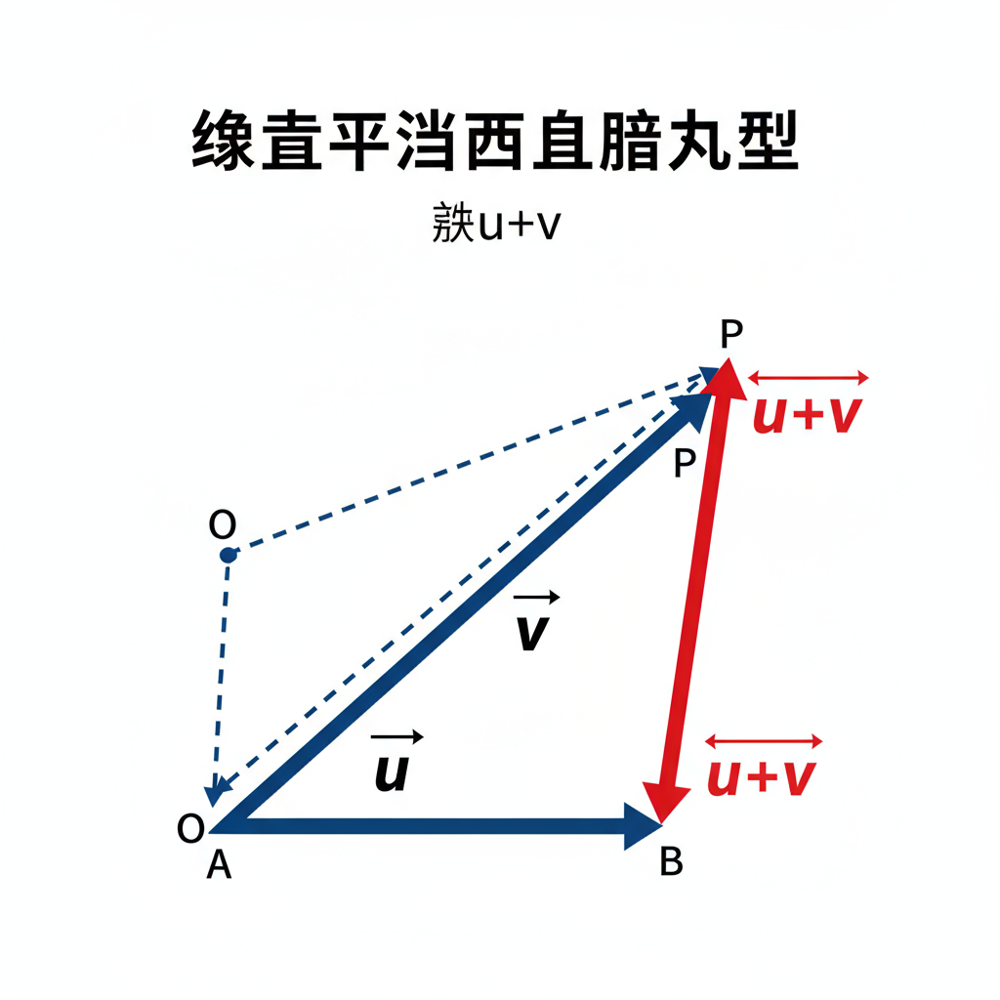
*图1.3：向量加法的平行四边形法则，几何直观展示向量相加的过程*

**数量乘法**：$k\vec{a} = (ka_1, ka_2, \ldots, ka_n)$，其中 $k \in \mathbb{R}$

**向量内积**：$\vec{a} \cdot \vec{b} = a_1b_1 + a_2b_2 + \ldots + a_nb_n$

**向量长度（范数）**：$\|\vec{a}\| = \sqrt{\vec{a} \cdot \vec{a}} = \sqrt{a_1^2 + a_2^2 + \ldots + a_n^2}$

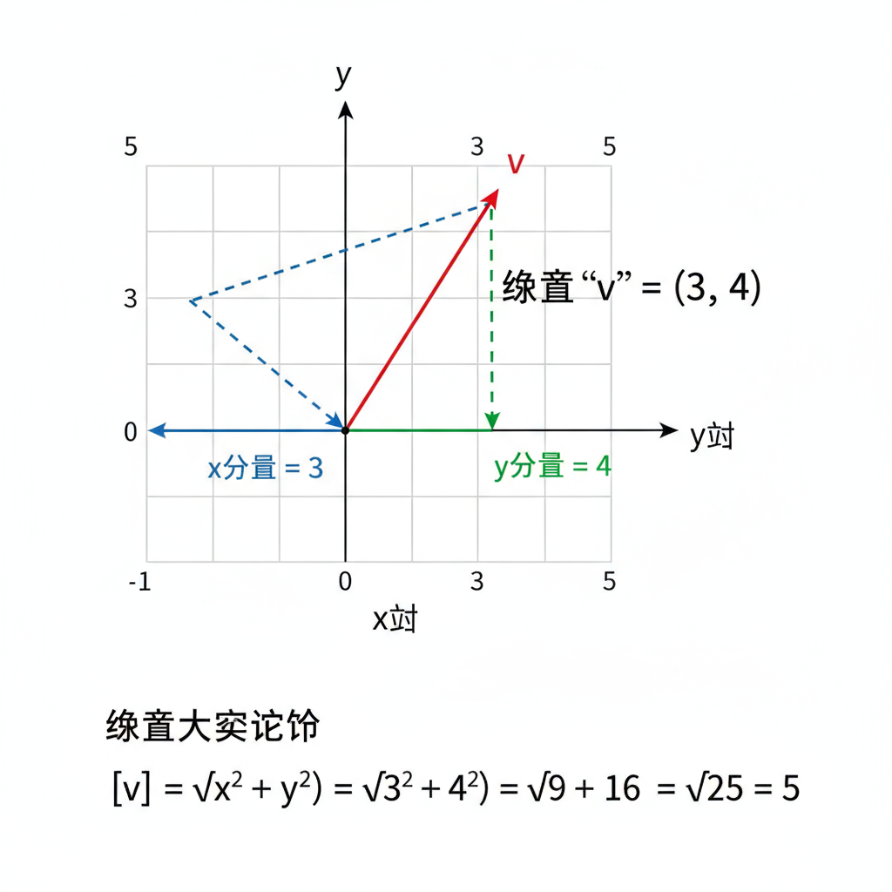
*图1.1：二维向量的几何表示，包含分量、长度计算和坐标系统*

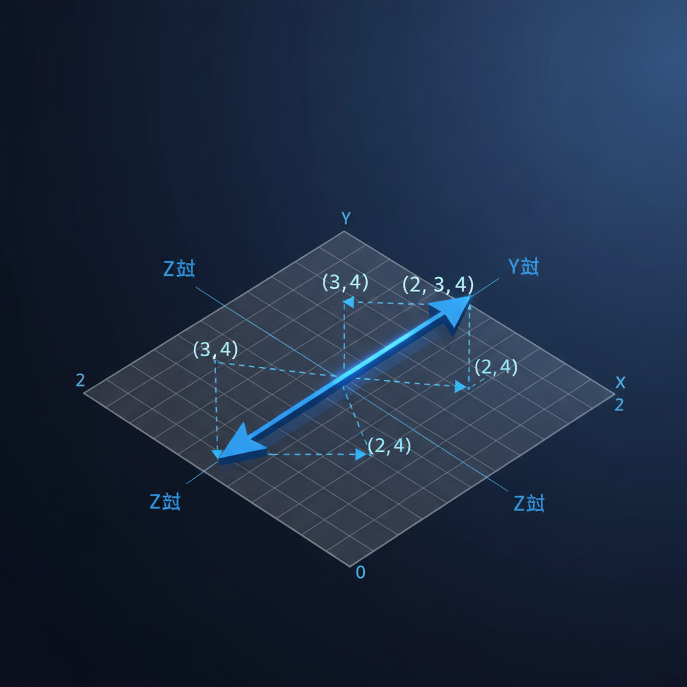
*图1.2：三维向量的空间表示及其在各坐标平面上的投影*

#### 1.1.3 向量运算的性质

| 性质 | 表达式 |
|------|--------|
| 交换律 | $\vec{a} + \vec{b} = \vec{b} + \vec{a}$ |
| 结合律 | $(\vec{a} + \vec{b}) + \vec{c} = \vec{a} + (\vec{b} + \vec{c})$ |
| 分配律 | $k(\vec{a} + \vec{b}) = k\vec{a} + k\vec{b}$ |
| 内积交换律 | $\vec{a} \cdot \vec{b} = \vec{b} \cdot \vec{a}$ |
| 内积线性性 | $(\vec{a} + \vec{b}) \cdot \vec{c} = \vec{a} \cdot \vec{c} + \vec{b} \cdot \vec{c}$ |

### 1.2 矩阵的定义与运算

#### 1.2.1 矩阵的基本概念

**定义1.2.1（矩阵）**  
由 $m \times n$ 个数排成的 $m$ 行 $n$ 列的矩形数表称为 $m \times n$ 矩阵，记为：
$$A = \begin{pmatrix}
a_{11} & a_{12} & \cdots & a_{1n} \\
a_{21} & a_{22} & \cdots & a_{2n} \\
\vdots & \vdots & \ddots & \vdots \\
a_{m1} & a_{m2} & \cdots & a_{mn}
\end{pmatrix}$$

其中 $a_{ij}$ 称为矩阵 $A$ 的第 $i$ 行第 $j$ 列元素。

#### 1.2.2 特殊矩阵类型

| 矩阵类型 | 定义 | 记号 |
|----------|------|------|
| **零矩阵** | 所有元素都为0 | $O_{m \times n}$ |
| **单位矩阵** | 主对角线元素为1，其余为0 | $I_n$ |
| **对角矩阵** | 非主对角线元素都为0 | $\text{diag}(d_1, d_2, \ldots, d_n)$ |
| **上三角矩阵** | 主对角线下方元素都为0 | - |
| **下三角矩阵** | 主对角线上方元素都为0 | - |
| **对称矩阵** | $a_{ij} = a_{ji}$ 对所有 $i,j$ 成立 | $A^T = A$ |
| **反对称矩阵** | $a_{ij} = -a_{ji}$ 对所有 $i,j$ 成立 | $A^T = -A$ |

#### 1.2.3 矩阵运算

**矩阵加法**：$C = A + B$，其中 $c_{ij} = a_{ij} + b_{ij}$

**数量乘法**：$kA$，其中 $(kA)_{ij} = k \cdot a_{ij}$

**矩阵乘法**：$C = AB$，其中 $c_{ij} = \sum_{k=1}^p a_{ik}b_{kj}$

**矩阵转置**：$A^T$，其中 $(A^T)_{ij} = a_{ji}$

#### 1.2.4 矩阵运算的性质

矩阵运算性质证明

**性质1（加法交换律）**：$A + B = B + A$

*证明*：对于任意元素 $(A + B)_{ij} = a_{ij} + b_{ij} = b_{ij} + a_{ij} = (B + A)_{ij}$

**性质2（乘法结合律）**：$(AB)C = A(BC)$

*证明*：设 $D = AB$，$E = BC$，则
$$[(AB)C]_{ij} = \sum_{k=1}^p d_{ik}c_{kj} = \sum_{k=1}^p \left(\sum_{l=1}^q a_{il}b_{lk}\right)c_{kj}$$
$$= \sum_{l=1}^q a_{il} \left(\sum_{k=1}^p b_{lk}c_{kj}\right) = \sum_{l=1}^q a_{il}(BC)_{lj} = [A(BC)]_{ij}$$

**性质3（分配律）**：$A(B + C) = AB + AC$

*证明*：$[(A(B + C))]_{ij} = \sum_{k=1}^p a_{ik}(B + C)_{kj} = \sum_{k=1}^p a_{ik}(b_{kj} + c_{kj})$
$$= \sum_{k=1}^p a_{ik}b_{kj} + \sum_{k=1}^p a_{ik}c_{kj} = (AB)_{ij} + (AC)_{ij} = (AB + AC)_{ij}$$

**性质4（转置性质）**：$(AB)^T = B^T A^T$

*证明*：$[(AB)^T]_{ij} = (AB)_{ji} = \sum_{k=1}^p a_{jk}b_{ki}$
$$= \sum_{k=1}^p b_{ki}a_{jk} = \sum_{k=1}^p (B^T)_{ik}(A^T)_{kj} = (B^T A^T)_{ij}$$

### 1.3 矩阵的逆

#### 1.3.1 逆矩阵的定义

**定义1.3.1（逆矩阵）**  
对于 $n \times n$ 矩阵 $A$，如果存在矩阵 $B$ 使得：
$$AB = BA = I_n$$
则称 $A$ 为可逆矩阵，$B$ 为 $A$ 的逆矩阵，记为 $B = A^{-1}$。

#### 1.3.2 逆矩阵的性质

逆矩阵性质证明

**性质1**：若 $A$ 可逆，则 $A^{-1}$ 也可逆，且 $(A^{-1})^{-1} = A$

*证明*：由定义 $AA^{-1} = A^{-1}A = I$，这说明 $A$ 是 $A^{-1}$ 的逆矩阵。

**性质2**：若 $A$ 可逆，则 $A^T$ 也可逆，且 $(A^T)^{-1} = (A^{-1})^T$

*证明*：$A^T(A^{-1})^T = (A^{-1}A)^T = I^T = I$
且 $(A^{-1})^TA^T = (AA^{-1})^T = I^T = I$

**性质3**：若 $A$ 和 $B$ 都可逆，则 $AB$ 也可逆，且 $(AB)^{-1} = B^{-1}A^{-1}$

*证明*：$(AB)(B^{-1}A^{-1}) = A(BB^{-1})A^{-1} = AIA^{-1} = AA^{-1} = I$
同理 $(B^{-1}A^{-1})(AB) = I$

#### 1.3.3 逆矩阵的求法

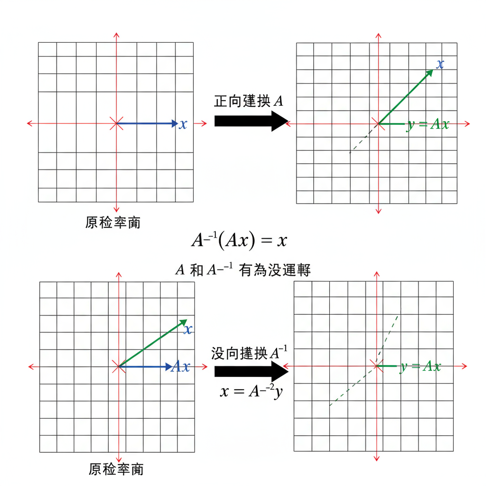
*图1.4：矩阵变换与逆变换的几何意义，展示变换的可逆性*

**方法1：伴随矩阵法**
$$A^{-1} = \frac{1}{\det(A)} \text{adj}(A)$$

其中 $\text{adj}(A)$ 为 $A$ 的伴随矩阵。

**方法2：初等变换法**
通过行初等变换将 $[A | I]$ 化为 $[I | A^{-1}]$

### 1.4 矩阵变换的几何意义

矩阵乘法实际上对应着向量空间的线性变换。不同的矩阵代表不同的几何变换：

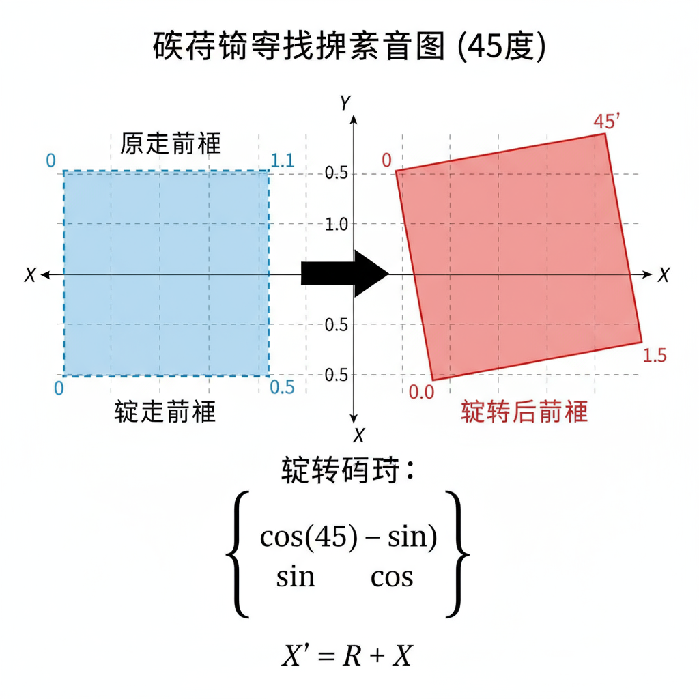
*图1.5：矩阵旋转变换，展示单位正方形绕原点旋转45度的效果*

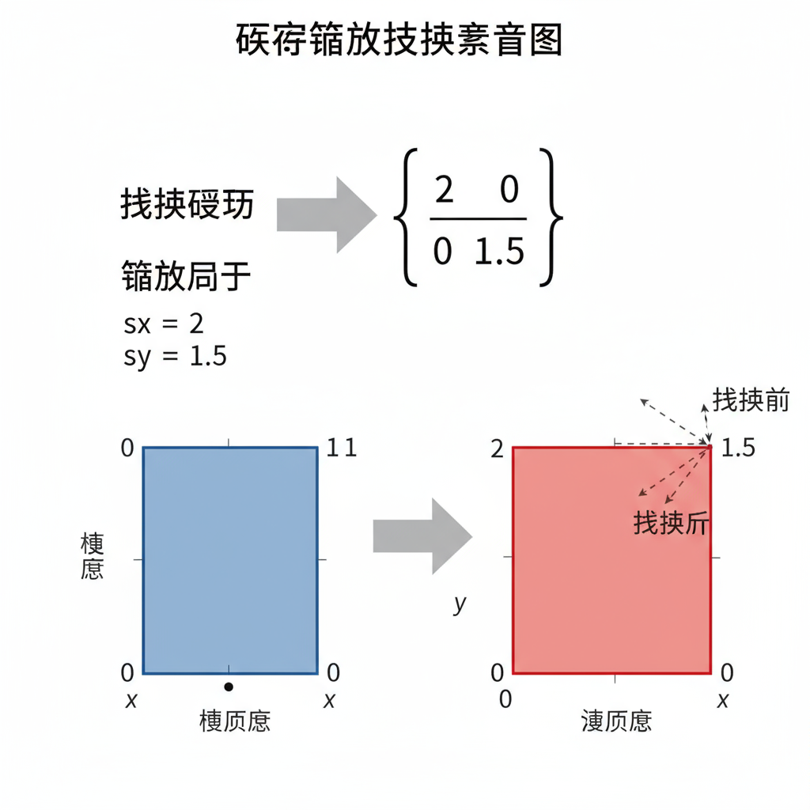
*图1.6：矩阵缩放变换，展示矩形在x、y方向的缩放效果*

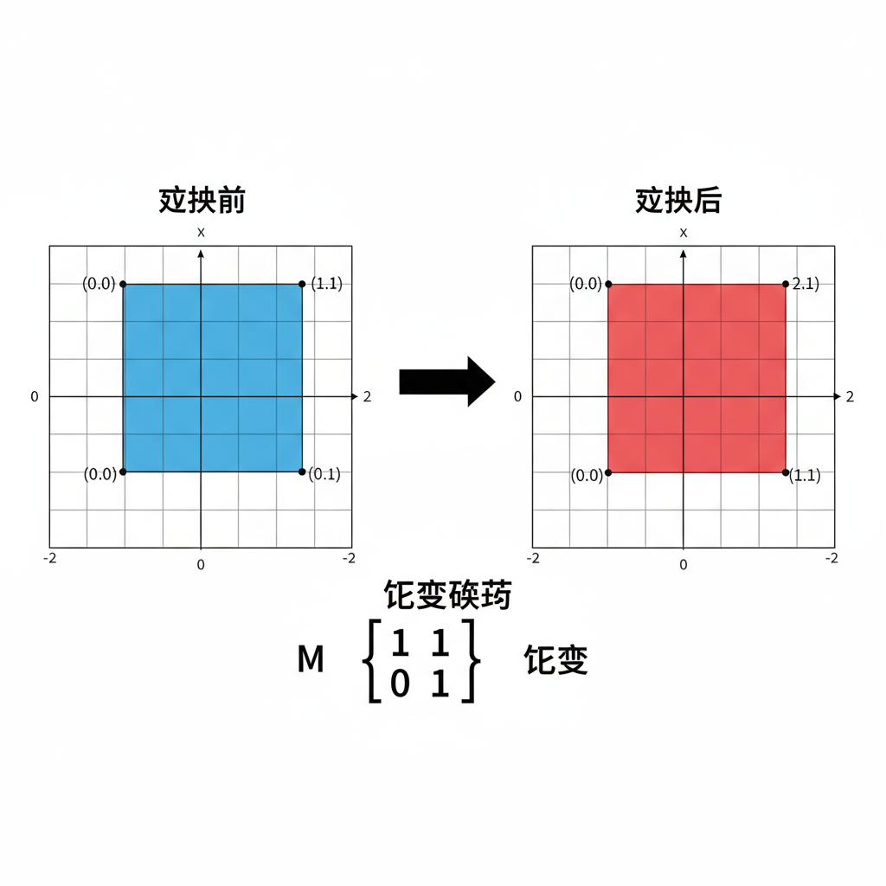
*图1.7：矩阵剪切变换，展示单位正方形发生剪切变形的过程*

### 📝 考点总结

**重点内容**：
1. 向量和矩阵的基本运算及其性质
2. 特殊矩阵的识别和性质
3. 矩阵乘法的条件和性质
4. 逆矩阵的存在条件和求法

**常考题型**：
- 矩阵运算的计算题
- 证明矩阵运算性质的题目
- 判断矩阵类型的选择题
- 求逆矩阵的计算题

---

## 第二章：线性方程组

### 2.1 线性方程组的表示

#### 2.1.1 线性方程组的标准形式

$n$ 元线性方程组的一般形式为：
$$\begin{cases}
a_{11}x_1 + a_{12}x_2 + \cdots + a_{1n}x_n = b_1 \\
a_{21}x_1 + a_{22}x_2 + \cdots + a_{2n}x_n = b_2 \\
\cdots \\
a_{m1}x_1 + a_{m2}x_2 + \cdots + a_{mn}x_n = b_m
\end{cases}$$

**矩阵形式**：$A\vec{x} = \vec{b}$

其中：
- $A = \begin{pmatrix} a_{11} & a_{12} & \cdots & a_{1n} \\ a_{21} & a_{22} & \cdots & a_{2n} \\ \vdots & \vdots & \ddots & \vdots \\ a_{m1} & a_{m2} & \cdots & a_{mn} \end{pmatrix}$ 为系数矩阵
- $\vec{x} = \begin{pmatrix} x_1 \\ x_2 \\ \vdots \\ x_n \end{pmatrix}$ 为未知数向量
- $\vec{b} = \begin{pmatrix} b_1 \\ b_2 \\ \vdots \\ b_m \end{pmatrix}$ 为常数向量

**增广矩阵**：$[A | \vec{b}]$

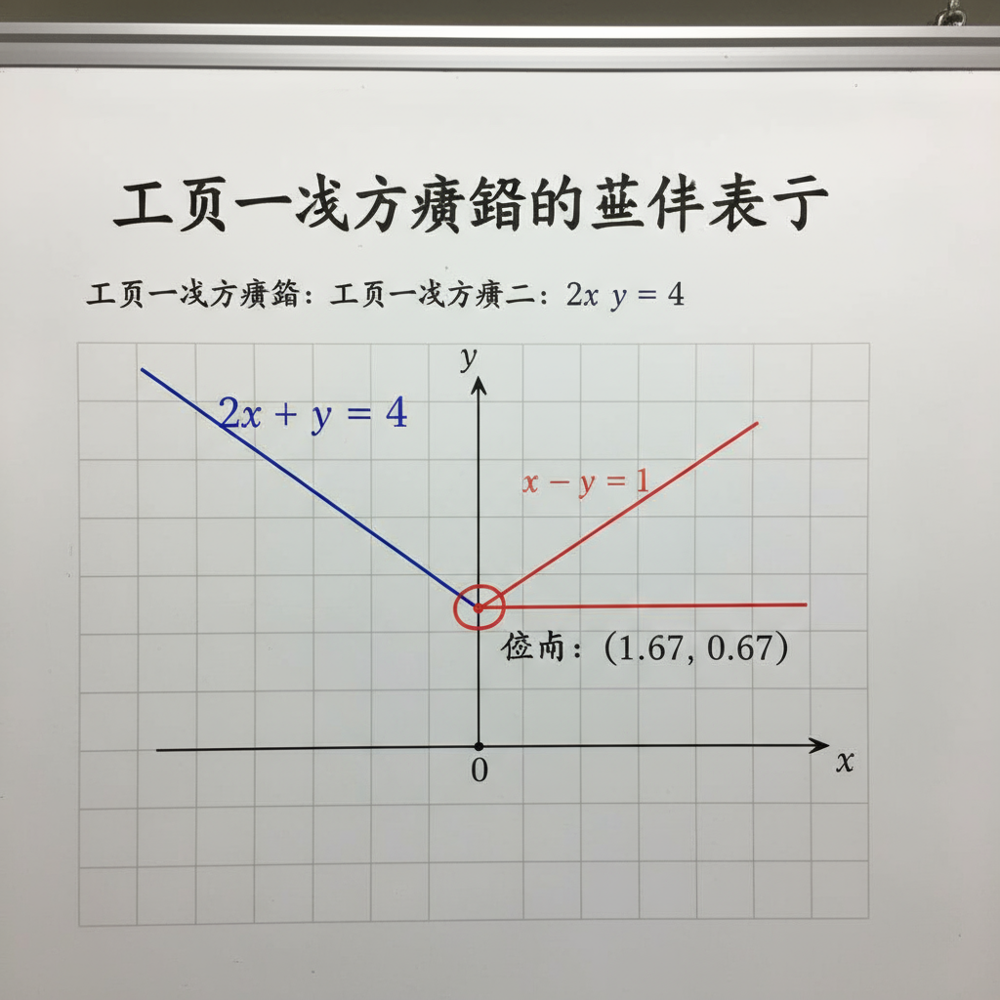
*图2.1：线性方程组的几何表示，每个方程对应一条直线，交点为方程组的解*

### 2.2 高斯消元法

#### 2.2.1 行初等变换

**定义2.2.1（行初等变换）**  
对矩阵的行进行以下三种变换：
1. 交换两行：$R_i \leftrightarrow R_j$
2. 用非零数乘某一行：$R_i \rightarrow kR_i$ $(k \neq 0)$
3. 将一行的倍数加到另一行：$R_i \rightarrow R_i + kR_j$

#### 2.2.2 高斯消元法步骤

**步骤1**：用行初等变换将增广矩阵化为行阶梯形矩阵

**步骤2**：根据行阶梯形矩阵判断解的情况

**步骤3**：回代求解

#### 2.2.3 行阶梯形矩阵和行最简形矩阵

**行阶梯形矩阵**的特征：
1. 所有零行位于矩阵下方
2. 每个非零行的第一个非零元素（主元）的列标随行标增大而增大

**行最简形矩阵**的特征：
1. 是行阶梯形矩阵
2. 每个主元都是1
3. 每个主元上方和下方的元素都是0

### 2.3 线性方程组的解

#### 2.3.1 解的存在性和唯一性定理

**定理2.3.1（克拉默定理）**  
对于 $n$ 元线性方程组 $A\vec{x} = \vec{b}$，如果 $\det(A) \neq 0$，则方程组有唯一解：
$$x_j = \frac{\det(A_j)}{\det(A)}$$
其中 $A_j$ 是将 $A$ 的第 $j$ 列替换为 $\vec{b}$ 得到的矩阵。

**定理2.3.2（一般解的存在性）**  
线性方程组 $A\vec{x} = \vec{b}$ 有解的充要条件是 $\text{rank}(A) = \text{rank}([A|\vec{b}])$。

#### 2.3.2 齐次线性方程组

**定义2.3.1（齐次线性方程组）**  
形如 $A\vec{x} = \vec{0}$ 的方程组称为齐次线性方程组。

**定理2.3.3**  
齐次线性方程组 $A\vec{x} = \vec{0}$ 总有零解，且当 $\text{rank}(A) < n$ 时有非零解。

**通解结构**：若 $\vec{\eta}_1, \vec{\eta}_2, \ldots, \vec{\eta}_k$ 是齐次方程组的一个基础解系，则通解为：
$$\vec{x} = c_1\vec{\eta}_1 + c_2\vec{\eta}_2 + \cdots + c_k\vec{\eta}_k$$

其中 $c_1, c_2, \ldots, c_k$ 为任意常数。

#### 2.3.3 非齐次线性方程组

**通解结构**：非齐次线性方程组 $A\vec{x} = \vec{b}$ 的通解为：
$$\vec{x} = \vec{x}_0 + c_1\vec{\eta}_1 + c_2\vec{\eta}_2 + \cdots + c_k\vec{\eta}_k$$

其中：
- $\vec{x}_0$ 是非齐次方程组的一个特解
- $\vec{\eta}_1, \vec{\eta}_2, \ldots, \vec{\eta}_k$ 是对应齐次方程组的基础解系

通解结构定理证明

**定理**：设 $\vec{x}_0$ 是非齐次方程组 $A\vec{x} = \vec{b}$ 的一个特解，$\vec{\eta}_1, \vec{\eta}_2, \ldots, \vec{\eta}_k$ 是对应齐次方程组 $A\vec{x} = \vec{0}$ 的基础解系，则非齐次方程组的全部解为：
$$\vec{x} = \vec{x}_0 + c_1\vec{\eta}_1 + c_2\vec{\eta}_2 + \cdots + c_k\vec{\eta}_k$$

*证明*：
1. **充分性**：若 $\vec{x} = \vec{x}_0 + \sum_{i=1}^k c_i\vec{\eta}_i$，则
$$A\vec{x} = A(\vec{x}_0 + \sum_{i=1}^k c_i\vec{\eta}_i) = A\vec{x}_0 + \sum_{i=1}^k c_iA\vec{\eta}_i = \vec{b} + \vec{0} = \vec{b}$$

2. **必要性**：设 $\vec{x}$ 是任意解，则 $\vec{x} - \vec{x}_0$ 满足：
$$A(\vec{x} - \vec{x}_0) = A\vec{x} - A\vec{x}_0 = \vec{b} - \vec{b} = \vec{0}$$
所以 $\vec{x} - \vec{x}_0$ 是齐次方程组的解，可表示为 $\sum_{i=1}^k c_i\vec{\eta}_i$，即 $\vec{x} = \vec{x}_0 + \sum_{i=1}^k c_i\vec{\eta}_i$。

### 📝 考点总结

**重点内容**：
1. 高斯消元法的应用
2. 线性方程组解的存在性和唯一性判断
3. 齐次和非齐次方程组通解的求法
4. 基础解系的构造

**常考题型**：
- 用高斯消元法求解线性方程组
- 判断线性方程组解的情况
- 求齐次方程组的基础解系和通解
- 求非齐次方程组的特解和通解

---

## 第三章：行列式

### 3.1 行列式的定义

#### 3.1.1 2阶和3阶行列式

**2阶行列式**：
$$\begin{vmatrix} a & b \\ c & d \end{vmatrix} = ad - bc$$

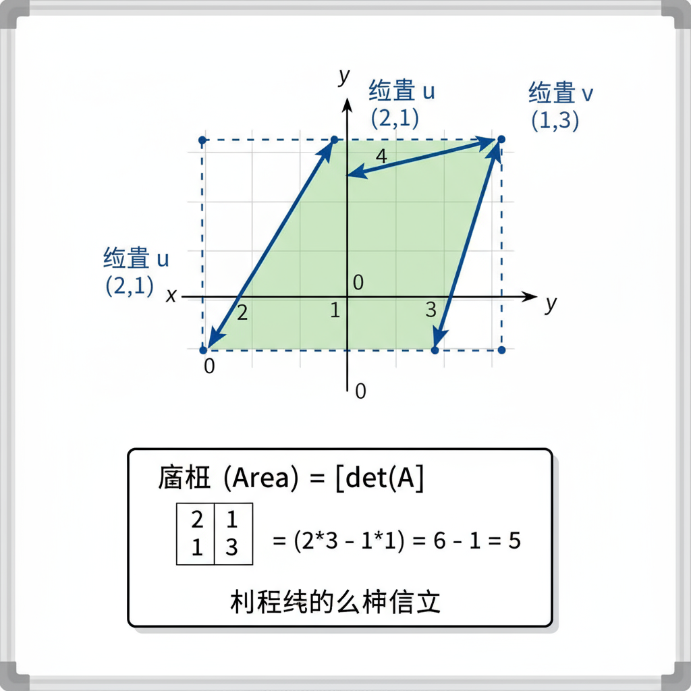
*图3.1：行列式的几何意义 - 两个二维向量构成的平行四边形的面积*

**3阶行列式**：
$$\begin{vmatrix} a_{11} & a_{12} & a_{13} \\ a_{21} & a_{22} & a_{23} \\ a_{31} & a_{32} & a_{33} \end{vmatrix} = a_{11}\begin{vmatrix} a_{22} & a_{23} \\ a_{32} & a_{33} \end{vmatrix} - a_{12}\begin{vmatrix} a_{21} & a_{23} \\ a_{31} & a_{33} \end{vmatrix} + a_{13}\begin{vmatrix} a_{21} & a_{22} \\ a_{31} & a_{32} \end{vmatrix}$$

#### 3.1.2 $n$ 阶行列式的定义

**定义3.1.1（排列与逆序）**  
由 $1, 2, \ldots, n$ 组成的有序数组称为一个 $n$ 阶排列。
在一个排列中，如果较大的数排在较小的数前面，则称这两个数构成一个逆序。
一个排列中逆序的总数称为该排列的逆序数，记为 $\tau(j_1j_2\ldots j_n)$。

**定义3.1.2（$n$ 阶行列式）**  
$n$ 阶方阵 $A = (a_{ij})_{n \times n}$ 的行列式定义为：
$$\det(A) = \sum_{j_1j_2\ldots j_n} (-1)^{\tau(j_1j_2\ldots j_n)} a_{1j_1}a_{2j_2}\ldots a_{nj_n}$$

其中求和遍历所有 $n$ 阶排列。

### 3.2 行列式的性质

#### 3.2.1 基本性质

**性质1**：转置不变性 $\det(A^T) = \det(A)$

**性质2**：行（列）互换，行列式变号

**性质3**：某行（列）有公因子 $k$，可提到行列式外面：
$$\det(A) = k \cdot \det(B)$$

**性质4**：若两行（列）成比例，则行列式为0

**性质5**：行列式对行（列）具有线性性

行列式性质证明

**性质1证明**：转置不变性
$$\det(A^T) = \sum_{j_1j_2\ldots j_n} (-1)^{\tau(j_1j_2\ldots j_n)} a_{j_11}a_{j_22}\ldots a_{j_nn}$$
令 $i_k = j_k$，则当 $j$ 遍历所有排列时，$i$ 也遍历所有排列：
$$\det(A^T) = \sum_{i_1i_2\ldots i_n} (-1)^{\tau(i_1i_2\ldots i_n)} a_{i_11}a_{i_22}\ldots a_{i_nn} = \det(A)$$

**性质2证明**：行互换变号
设 $B$ 是 $A$ 交换第 $i$ 行和第 $j$ 行得到的矩阵，则
$$\det(B) = \sum_{j_1j_2\ldots j_n} (-1)^{\tau(j_1j_2\ldots j_n)} b_{1j_1}\ldots b_{nj_n}$$
在排列 $j_1j_2\ldots j_n$ 中，位置 $i$ 和 $j$ 的元素互换，这相当于在排列中交换两个位置，逆序数改变奇偶性，所以
$$\det(B) = -\sum_{j_1j_2\ldots j_n} (-1)^{\tau(j_1j_2\ldots j_n)} a_{1j_1}\ldots a_{nj_n} = -\det(A)$$

#### 3.2.2 行列式计算方法

| 方法 | 适用情况 | 步骤 |
|------|----------|------|
| **按行（列）展开** | 零元素较多的行列式 | 选择零元素最多的行（列）展开 |
| **化为三角形** | 一般行列式 | 用行变换化为主对角线行列式 |
| **拆分法** | 某行（列）有多个非零项 | 将行列式拆分为几个行列式之和 |
| **加边法** | 需要构造特殊形式 | 添加一行一列使计算简化 |

### 3.3 克拉默法则

#### 3.3.1 克拉默法则

**定理3.3.1（克拉默法则）**  
对于 $n$ 元线性方程组 $A\vec{x} = \vec{b}$，如果 $\det(A) \neq 0$，则方程组有唯一解：
$$x_j = \frac{\det(A_j)}{\det(A)} \quad (j = 1, 2, \ldots, n)$$

其中 $A_j$ 是将 $A$ 的第 $j$ 列替换为 $\vec{b}$ 得到的矩阵。

#### 3.3.2 克拉默法则的证明

克拉默法则证明

**证明**：设 $A = (\vec{a}_1, \vec{a}_2, \ldots, \vec{a}_n)$，其中 $\vec{a}_j$ 是 $A$ 的第 $j$ 列。
方程组 $A\vec{x} = \vec{b}$ 等价于：
$$x_1\vec{a}_1 + x_2\vec{a}_2 + \cdots + x_n\vec{a}_n = \vec{b}$$

两边取行列式：
$$\det(x_1\vec{a}_1 + x_2\vec{a}_2 + \cdots + x_n\vec{a}_n) = \det(\vec{b})$$

根据行列式的线性性：
$$x_1\det(\vec{a}_1, \vec{a}_2, \ldots, \vec{a}_n) + x_2\det(\vec{a}_2, \vec{a}_1, \ldots, \vec{a}_n) + \cdots + x_n\det(\vec{a}_1, \vec{a}_2, \ldots, \vec{a}_{n-1}) = \det(\vec{b})$$

注意到 $\det(\vec{a}_1, \vec{a}_2, \ldots, \vec{a}_n) = \det(A)$，而当交换两列时行列式变号，所以：
$$x_1\det(A) = \det(A_1)$$
$$x_2\det(A) = \det(A_2)$$
$$\vdots$$
$$x_n\det(A) = \det(A_n)$$

因此：
$$x_j = \frac{\det(A_j)}{\det(A)} \quad (j = 1, 2, \ldots, n)$$

### 3.4 行列式的应用

#### 3.4.1 矩阵可逆性的判定

**定理3.4.1**  
$n$ 阶方阵 $A$ 可逆的充要条件是 $\det(A) \neq 0$。

#### 3.4.2 矩阵秩的判定

**定理3.4.2**  
对于 $n$ 阶方阵 $A$，$\text{rank}(A) = n$ 的充要条件是 $\det(A) \neq 0$。

#### 3.4.3 特征值与行列式

**定理3.4.3**  
矩阵 $A$ 的所有特征值的乘积等于 $\det(A)$：
$$\det(A) = \lambda_1\lambda_2\cdots\lambda_n$$

### 📝 考点总结

**重点内容**：
1. 行列式的定义和计算方法
2. 行列式的基本性质及其应用
3. 克拉默法则及其应用
4. 行列式与矩阵可逆性的关系

**常考题型**：
- 计算各种类型的行列式
- 利用行列式性质简化计算
- 用克拉默法则求解线性方程组
- 证明行列式相关的等式或不等式

---

## 第四章：向量空间

### 4.1 向量空间的定义

#### 4.1.1 向量空间公理

**定义4.1.1（向量空间）**  
设 $V$ 是一个非空集合，$\mathbb{F}$ 是一个数域。在 $V$ 上定义两种运算：
1. 加法：$+ : V \times V \to V$
2. 数量乘法：$\cdot : \mathbb{F} \times V \to V$

如果对任意 $\vec{u}, \vec{v}, \vec{w} \in V$ 和任意 $k, l \in \mathbb{F}$，以下公理成立，则称 $V$ 为数域 $\mathbb{F}$ 上的向量空间：

**加法公理**：
1. $\vec{u} + \vec{v} = \vec{v} + \vec{u}$（交换律）
2. $(\vec{u} + \vec{v}) + \vec{w} = \vec{u} + (\vec{v} + \vec{w})$（结合律）
3. 存在零向量 $\vec{0} \in V$，使得 $\vec{v} + \vec{0} = \vec{v}$
4. 对每个 $\vec{v} \in V$，存在负向量 $-\vec{v} \in V$，使得 $\vec{v} + (-\vec{v}) = \vec{0}$

**数量乘法公理**：
5. $k(\vec{u} + \vec{v}) = k\vec{u} + k\vec{v}$（分配律1）
6. $(k + l)\vec{v} = k\vec{v} + l\vec{v}$（分配律2）
7. $k(l\vec{v}) = (kl)\vec{v}$（结合律）
8. $1 \cdot \vec{v} = \vec{v}$（单位律）

#### 4.1.2 常见向量空间

| 向量空间 | 定义 | 记号 |
|----------|------|------|
| **几何向量空间** | 所有几何向量的集合 | $\mathbb{R}^2, \mathbb{R}^3$ |
| **矩阵空间** | 所有 $m \times n$ 矩阵的集合 | $M_{m \times n}(\mathbb{F})$ |
| **多项式空间** | 所有次数小于 $n$ 的多项式的集合 | $\mathbb{P}_n$ |
| **函数空间** | 所有连续函数的集合 | $C[a,b]$ |
| **序列空间** | 所有收敛序列的集合 | $l^p$ |

### 4.2 线性相关与线性无关

#### 4.2.1 线性组合

**定义4.2.1（线性组合）**  
设 $V$ 是数域 $\mathbb{F}$ 上的向量空间，$\vec{v}_1, \vec{v}_2, \ldots, \vec{v}_k \in V$。如果存在 $\mathbb{F}$ 中的数 $c_1, c_2, \ldots, c_k$，使得：
$$\vec{v} = c_1\vec{v}_1 + c_2\vec{v}_2 + \cdots + c_k\vec{v}_k$$
则称 $\vec{v}$ 是 $\vec{v}_1, \vec{v}_2, \ldots, \vec{v}_k$ 的线性组合。

#### 4.2.2 线性相关与线性无关

**定义4.2.2（线性相关）**  
向量组 $\vec{v}_1, \vec{v}_2, \ldots, \vec{v}_k$ 称为线性相关，如果存在不全为零的数 $c_1, c_2, \ldots, c_k \in \mathbb{F}$，使得：
$$c_1\vec{v}_1 + c_2\vec{v}_2 + \cdots + c_k\vec{v}_k = \vec{0}$$

**定义4.2.3（线性无关）**  
向量组 $\vec{v}_1, \vec{v}_2, \ldots, \vec{v}_k$ 称为线性无关，如果：
$$c_1\vec{v}_1 + c_2\vec{v}_2 + \cdots + c_k\vec{v}_k = \vec{0}$$
仅当 $c_1 = c_2 = \cdots = c_k = 0$ 时成立。

#### 4.2.3 线性相关性的判定

**定理4.2.1（线性相关判定定理）**  
向量组 $\vec{v}_1, \vec{v}_2, \ldots, \vec{v}_k$ 线性相关的充要条件是其中至少有一个向量可以表示为其余向量的线性组合。

线性相关判定定理证明

**证明**：
1. **必要性**：设 $\vec{v}_1, \vec{v}_2, \ldots, \vec{v}_k$ 线性相关，则存在不全为零的 $c_1, c_2, \ldots, c_k$，使得：
   $$c_1\vec{v}_1 + c_2\vec{v}_2 + \cdots + c_k\vec{v}_k = \vec{0}$$
   不妨设 $c_1 \neq 0$，则：
   $$\vec{v}_1 = -\frac{c_2}{c_1}\vec{v}_2 - \frac{c_3}{c_1}\vec{v}_3 - \cdots - \frac{c_k}{c_1}\vec{v}_k$$
   即 $\vec{v}_1$ 是其余向量的线性组合。

2. **充分性**：设某个向量（如 $\vec{v}_1$）可以表示为：
   $$\vec{v}_1 = a_2\vec{v}_2 + a_3\vec{v}_3 + \cdots + a_k\vec{v}_k$$
   则：
   $$\vec{v}_1 - a_2\vec{v}_2 - a_3\vec{v}_3 - \cdots - a_k\vec{v}_k = \vec{0}$$
   即 $1 \cdot \vec{v}_1 + (-a_2)\vec{v}_2 + \cdots + (-a_k)\vec{v}_k = \vec{0}$，其中系数不全为零，所以向量组线性相关。

**定理4.2.2（替换定理）**  
设向量组 $S = \{\vec{v}_1, \vec{v}_2, \ldots, \vec{v}_k\}$ 线性无关，$T = \{\vec{u}_1, \vec{u}_2, \ldots, \vec{u}_m\}$ 是线性相关组，且 $T$ 中每个向量都可表示为 $S$ 的线性组合，则 $m \leq k$。

### 4.3 基与维数

#### 4.3.1 生成子空间

**定义4.3.1（生成子空间）**  
设 $S = \{\vec{v}_1, \vec{v}_2, \ldots, \vec{v}_k\}$ 是向量空间 $V$ 中的向量组，所有 $S$ 的线性组合组成的集合称为 $S$ 的生成子空间，记为：
$$\text{span}(S) = \{c_1\vec{v}_1 + c_2\vec{v}_2 + \cdots + c_k\vec{v}_k \mid c_i \in \mathbb{F}\}$$

#### 4.3.2 基的定义

**定义4.3.2（基）**  
向量空间 $V$ 的子集 $B$ 称为 $V$ 的一组基，如果：
1. $B$ 线性无关
2. $\text{span}(B) = V$

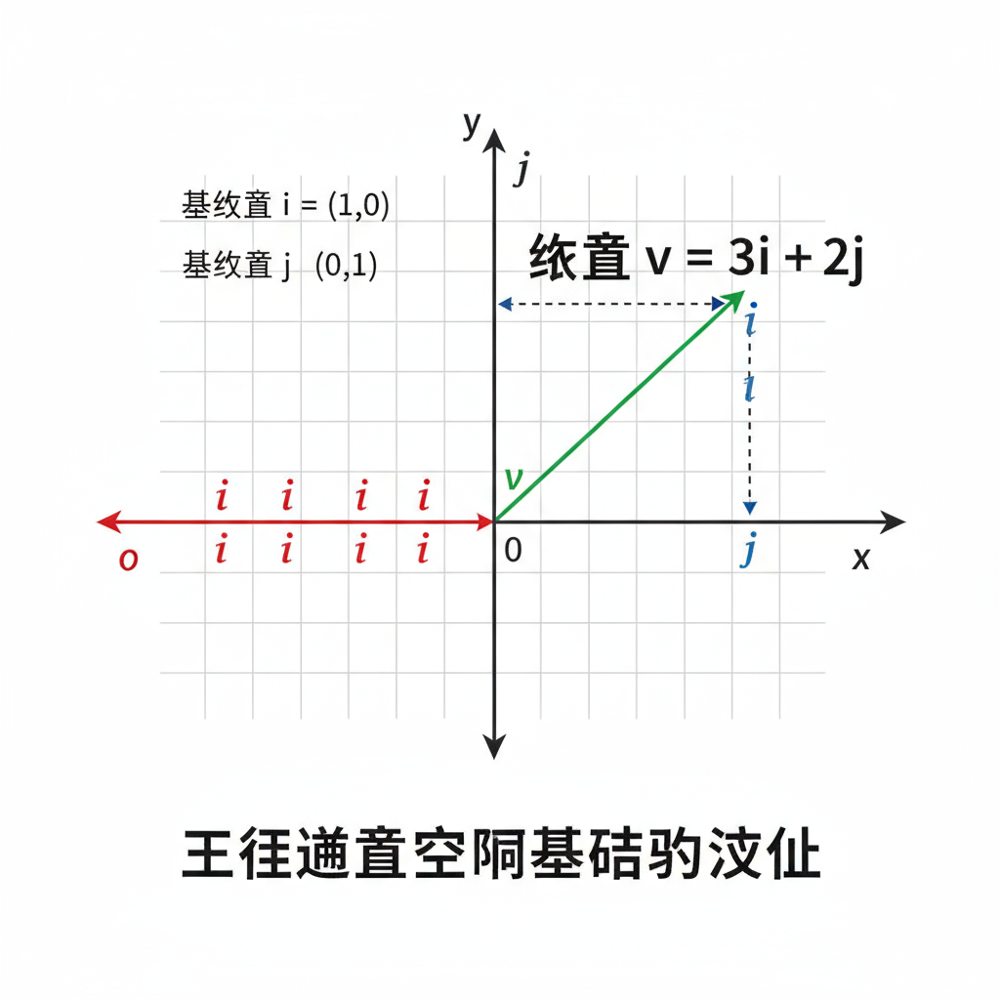
*图4.1：向量空间的基概念，展示标准基向量和任意向量的线性组合表示*

#### 4.3.3 维数

**定义4.3.3（维数）**  
向量空间 $V$ 的基中向量的个数称为 $V$ 的维数，记为 $\dim(V)$。

**定理4.3.1（维数不变性）**  
向量空间 $V$ 的任意两组基所含向量的个数相同。

维数不变性证明

**证明**：设 $B_1 = \{\vec{u}_1, \vec{u}_2, \ldots, \vec{u}_n\}$ 和 $B_2 = \{\vec{v}_1, \vec{v}_2, \ldots, \vec{v}_m\}$ 是 $V$ 的两组基。

1. 由于 $B_1$ 是基，$B_2$ 中的每个向量都可表示为 $B_1$ 的线性组合，且 $B_2$ 线性无关。
2. 根据替换定理，$m \leq n$。

同理，由于 $B_2$ 是基，$B_1$ 中的每个向量都可表示为 $B_2$ 的线性组合，且 $B_1$ 线性无关，可得 $n \leq m$。

因此 $m = n$，即维数是唯一确定的。

#### 4.3.4 坐标

**定义4.3.4（坐标）**  
设 $B = \{\vec{b}_1, \vec{b}_2, \ldots, \vec{b}_n\}$ 是向量空间 $V$ 的一组基，对于任意 $\vec{v} \in V$，存在唯一的数 $c_1, c_2, \ldots, c_n$，使得：
$$\vec{v} = c_1\vec{b}_1 + c_2\vec{b}_2 + \cdots + c_n\vec{b}_n$$
则称 $(c_1, c_2, \ldots, c_n)$ 为 $\vec{v}$ 在基 $B$ 下的坐标。

### 4.4 子空间

#### 4.4.1 子空间的定义

**定义4.4.1（子空间）**  
设 $W$ 是向量空间 $V$ 的非空子集，如果 $W$ 对 $V$ 中的加法和数量乘法也构成向量空间，则称 $W$ 为 $V$ 的子空间。

**定理4.4.1（子空间判定定理）**  
向量空间 $V$ 的非空子集 $W$ 是子空间的充要条件是：
1. 对任意 $\vec{u}, \vec{v} \in W$，有 $\vec{u} + \vec{v} \in W$
2. 对任意 $\vec{v} \in W$ 和任意 $k \in \mathbb{F}$，有 $k\vec{v} \in W$

#### 4.4.2 子空间的运算

| 运算 | 定义 | 性质 |
|------|------|------|
| **交集** | $W_1 \cap W_2 = \{\vec{v} \mid \vec{v} \in W_1 \text{ 且 } \vec{v} \in W_2\}$ | 仍是子空间 |
| **和** | $W_1 + W_2 = \{\vec{w}_1 + \vec{w}_2 \mid \vec{w}_1 \in W_1, \vec{w}_2 \in W_2\}$ | 仍是子空间 |
| **直和** | $W_1 \oplus W_2$ 当且仅当 $W_1 \cap W_2 = \{\vec{0}\}$ | 维数公式：$\dim(W_1 + W_2) = \dim(W_1) + \dim(W_2)$ |

#### 4.4.3 维数公式

**定理4.4.2（维数公式）**  
设 $W_1$ 和 $W_2$ 是向量空间 $V$ 的子空间，则：
$$\dim(W_1 + W_2) = \dim(W_1) + \dim(W_2) - \dim(W_1 \cap W_2)$$

维数公式证明

**证明**：设 $\dim(W_1) = r$，$\dim(W_2) = s$，$\dim(W_1 \cap W_2) = t$。

1. 取 $W_1 \cap W_2$ 的一组基 $\{\vec{u}_1, \vec{u}_2, \ldots, \vec{u}_t\}$
2. 将其扩充为 $W_1$ 的基：$\{\vec{u}_1, \ldots, \vec{u}_t, \vec{v}_1, \ldots, \vec{v}_{r-t}\}$
3. 将其扩充为 $W_2$ 的基：$\{\vec{u}_1, \ldots, \vec{u}_t, \vec{w}_1, \ldots, \vec{w}_{s-t}\}$

则 $W_1 + W_2$ 由向量组：
$$\{\vec{u}_1, \ldots, \vec{u}_t, \vec{v}_1, \ldots, \vec{v}_{r-t}, \vec{w}_1, \ldots, \vec{w}_{s-t}\}$$
生成。

可以证明这个向量组线性无关，因此：
$$\dim(W_1 + W_2) = t + (r-t) + (s-t) = r + s - t$$

### 📝 考点总结

**重点内容**：
1. 向量空间的定义和基本性质
2. 线性相关与线性无关的判定
3. 基和维数的概念及计算
4. 子空间的判定和运算

**常考题型**：
- 验证向量空间和子空间
- 判断向量组的线性相关性
- 求向量空间的基和维数
- 计算子空间的交与和

---

## 第五章：线性变换

### 5.1 线性变换的定义

#### 5.1.1 线性变换的基本概念

**定义5.1.1（线性变换）**  
设 $V$ 和 $W$ 是数域 $\mathbb{F}$ 上的向量空间，映射 $T: V \to W$ 称为线性变换，如果对任意 $\vec{u}, \vec{v} \in V$ 和任意 $k \in \mathbb{F}$，都有：
1. $T(\vec{u} + \vec{v}) = T(\vec{u}) + T(\vec{v})$
2. $T(k\vec{v}) = kT(\vec{v})$

等价地：$T(a\vec{u} + b\vec{v}) = aT(\vec{u}) + bT(\vec{v})$

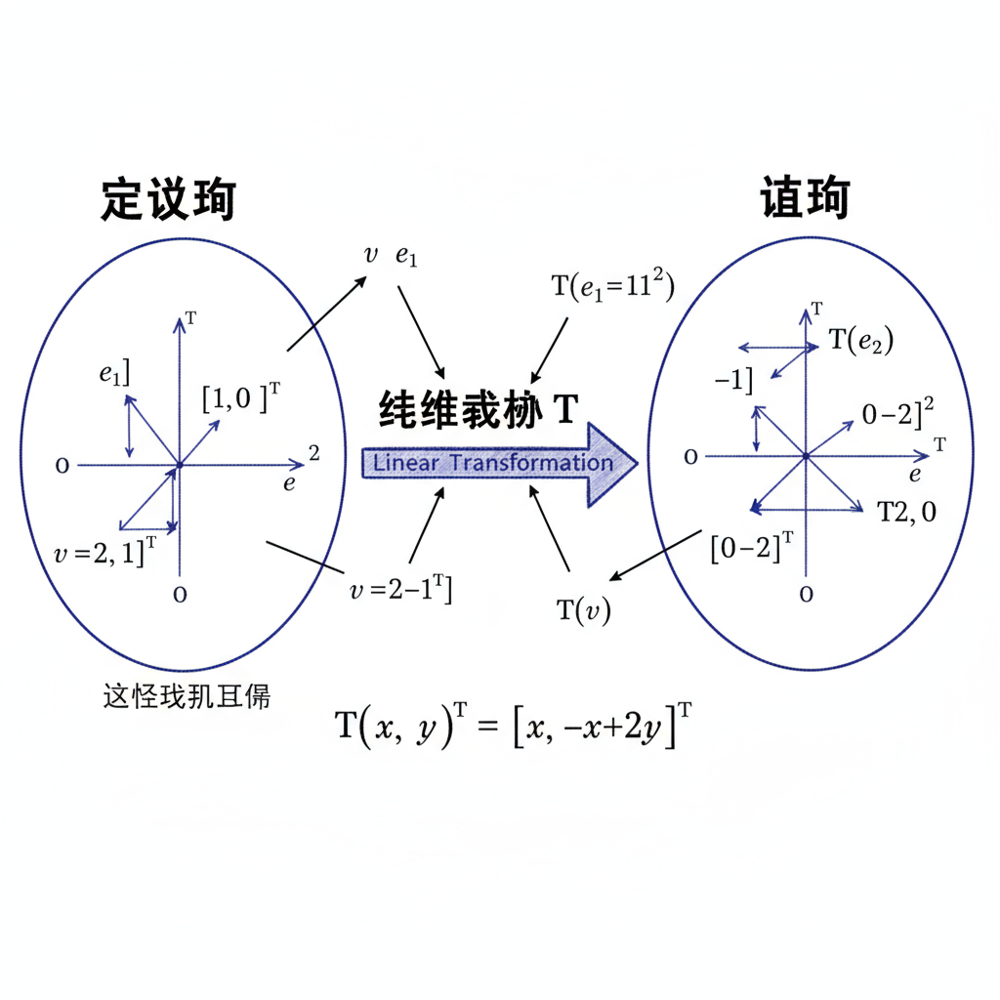
*图5.1：线性变换的几何表示，展示向量从定义域到值域的映射关系*

#### 5.1.2 线性变换的性质

线性变换性质证明

**性质1**：$T(\vec{0}_V) = \vec{0}_W$

*证明*：$T(\vec{0}_V) = T(0 \cdot \vec{v}) = 0 \cdot T(\vec{v}) = \vec{0}_W$

**性质2**：$T(-\vec{v}) = -T(\vec{v})$

*证明*：$T(-\vec{v}) = T((-1) \cdot \vec{v}) = (-1) \cdot T(\vec{v}) = -T(\vec{v})$

**性质3**：$T(\sum_{i=1}^n c_i\vec{v}_i) = \sum_{i=1}^n c_iT(\vec{v}_i)$

*证明*：由数学归纳法可得

**性质4**：若 $\vec{v}_1, \vec{v}_2, \ldots, \vec{v}_k$ 线性相关，则 $T(\vec{v}_1), T(\vec{v}_2), \ldots, T(\vec{v}_k)$ 也线性相关

*证明*：若 $\sum_{i=1}^k c_i\vec{v}_i = \vec{0}$，则：
$$T\left(\sum_{i=1}^k c_i\vec{v}_i\right) = \sum_{i=1}^k c_iT(\vec{v}_i) = T(\vec{0}) = \vec{0}$$

### 5.2 线性变换的矩阵表示

#### 5.2.1 坐标映射

设 $V$ 和 $W$ 分别是 $n$ 维和 $m$ 维向量空间，$B_V = \{\vec{v}_1, \vec{v}_2, \ldots, \vec{v}_n\}$ 是 $V$ 的基，$B_W = \{\vec{w}_1, \vec{w}_2, \ldots, \vec{w}_m\}$ 是 $W$ 的基。

**定义5.2.1（坐标映射）**  
对于任意 $\vec{v} \in V$，存在唯一的坐标向量 $[\vec{v}]_{B_V} \in \mathbb{F}^n$，使得：
$$\vec{v} = \sum_{i=1}^n [\vec{v}]_{B_V,i} \vec{v}_i$$

#### 5.2.2 线性变换的矩阵表示

**定理5.2.1**  
设 $T: V \to W$ 是线性变换，$B_V$ 和 $B_W$ 分别是 $V$ 和 $W$ 的基，则存在唯一的 $m \times n$ 矩阵 $A$，使得对任意 $\vec{v} \in V$：
$$[T(\vec{v})]_{B_W} = A[\vec{v}]_{B_V}$$

矩阵 $A$ 称为线性变换 $T$ 在基 $B_V$ 和 $B_W$ 下的矩阵表示。

**构造方法**：$A$ 的第 $j$ 列是 $T(\vec{v}_j)$ 在基 $B_W$ 下的坐标向量。

#### 5.2.3 线性变换的运算

设 $T_1, T_2: V \to W$ 是线性变换，$S: W \to U$ 是线性变换：

**加法**：$(T_1 + T_2)(\vec{v}) = T_1(\vec{v}) + T_2(\vec{v})$

**数量乘法**：$(kT)(\vec{v}) = kT(\vec{v})$

**复合**：$(S \circ T)(\vec{v}) = S(T(\vec{v}))$

### 5.3 线性变换的核与像

#### 5.3.1 核与像的定义

**定义5.3.1（核）**  
线性变换 $T: V \to W$ 的核定义为：
$$\ker(T) = \{\vec{v} \in V \mid T(\vec{v}) = \vec{0}_W\}$$

**定义5.3.2（像）**  
线性变换 $T: V \to W$ 的像定义为：
$$\text{im}(T) = \{T(\vec{v}) \mid \vec{v} \in V\}$$

#### 5.3.2 核与像的性质

**定理5.3.1**  
设 $T: V \to W$ 是线性变换，则：
1. $\ker(T)$ 是 $V$ 的子空间
2. $\text{im}(T)$ 是 $W$ 的子空间

核与像的子空间性质证明

**证明**：
1. **$\ker(T)$ 是子空间**：
   - $\vec{0}_V \in \ker(T)$，因为 $T(\vec{0}_V) = \vec{0}_W$
   - 若 $\vec{u}, \vec{v} \in \ker(T)$，则 $T(\vec{u} + \vec{v}) = T(\vec{u}) + T(\vec{v}) = \vec{0}_W + \vec{0}_W = \vec{0}_W$，所以 $\vec{u} + \vec{v} \in \ker(T)$
   - 若 $\vec{v} \in \ker(T)$，$k \in \mathbb{F}$，则 $T(k\vec{v}) = kT(\vec{v}) = k \cdot \vec{0}_W = \vec{0}_W$，所以 $k\vec{v} \in \ker(T)$

2. **$\text{im}(T)$ 是子空间**：
   - $\vec{0}_W = T(\vec{0}_V) \in \text{im}(T)$
   - 若 $\vec{w}_1, \vec{w}_2 \in \text{im}(T)$，则存在 $\vec{v}_1, \vec{v}_2 \in V$ 使得 $T(\vec{v}_1) = \vec{w}_1$，$T(\vec{v}_2) = \vec{w}_2$，所以 $\vec{w}_1 + \vec{w}_2 = T(\vec{v}_1) + T(\vec{v}_2) = T(\vec{v}_1 + \vec{v}_2) \in \text{im}(T)$
   - 若 $\vec{w} \in \text{im}(T)$，$k \in \mathbb{F}$，则存在 $\vec{v} \in V$ 使得 $T(\vec{v}) = \vec{w}$，所以 $k\vec{w} = kT(\vec{v}) = T(k\vec{v}) \in \text{im}(T)$

#### 5.3.3 维数定理

**定理5.3.2（维数定理）**  
设 $T: V \to W$ 是线性变换，$V$ 是有限维向量空间，则：
$$\dim(V) = \dim(\ker(T)) + \dim(\text{im}(T))$$

维数定理证明

**证明**：设 $\dim(V) = n$，$\dim(\ker(T)) = r$，$\dim(\text{im}(T)) = s$。

1. 取 $\ker(T)$ 的一组基 $\{\vec{u}_1, \vec{u}_2, \ldots, \vec{u}_r\}$
2. 将其扩充为 $V$ 的基：$\{\vec{u}_1, \ldots, \vec{u}_r, \vec{v}_1, \ldots, \vec{v}_{n-r}\}$

则 $\text{im}(T)$ 由 $\{T(\vec{v}_1), T(\vec{v}_2), \ldots, T(\vec{v}_{n-r})\}$ 生成。

可以证明这个向量组线性无关，因此 $s = n - r$，即：
$$n = r + s = \dim(\ker(T)) + \dim(\text{im}(T))$$

### 5.4 可逆线性变换

#### 5.4.1 可逆性的判定

**定义5.4.1（可逆线性变换）**  
线性变换 $T: V \to W$ 称为可逆的，如果存在线性变换 $S: W \to V$，使得：
$$S \circ T = I_V, \quad T \circ S = I_W$$

其中 $I_V$ 和 $I_W$ 分别是 $V$ 和 $W$ 上的恒等变换。

**定理5.4.1**  
线性变换 $T: V \to W$ 可逆的充要条件是：
1. $T$ 是单射（$\ker(T) = \{\vec{0}\}$）
2. $T$ 是满射（$\text{im}(T) = W$）

#### 5.4.2 同构

**定义5.4.2（同构）**  
如果存在可逆线性变换 $T: V \to W$，则称 $V$ 和 $W$ 同构，记为 $V \cong W$。

**定理5.4.2（同构基本定理）**  
有限维向量空间 $V$ 和 $W$ 同构的充要条件是 $\dim(V) = \dim(W)$。

### 📝 考点总结

**重点内容**：
1. 线性变换的定义和基本性质
2. 线性变换的矩阵表示
3. 核与像的概念及维数定理
4. 可逆线性变换的判定

**常考题型**：
- 验证映射是否为线性变换
- 求线性变换在给定基下的矩阵
- 计算线性变换的核与像
- 判断线性变换的可逆性

---

## 第六章：特征值与特征向量

### 6.1 特征值与特征向量的定义

#### 6.1.1 基本概念

**定义6.1.1（特征值与特征向量）**  
设 $A$ 是 $n \times n$ 矩阵，如果存在数 $\lambda$ 和非零向量 $\vec{v}$，使得：
$$A\vec{v} = \lambda\vec{v}$$
则称 $\lambda$ 为 $A$ 的特征值，$\vec{v}$ 为 $A$ 对应于 $\lambda$ 的特征向量。

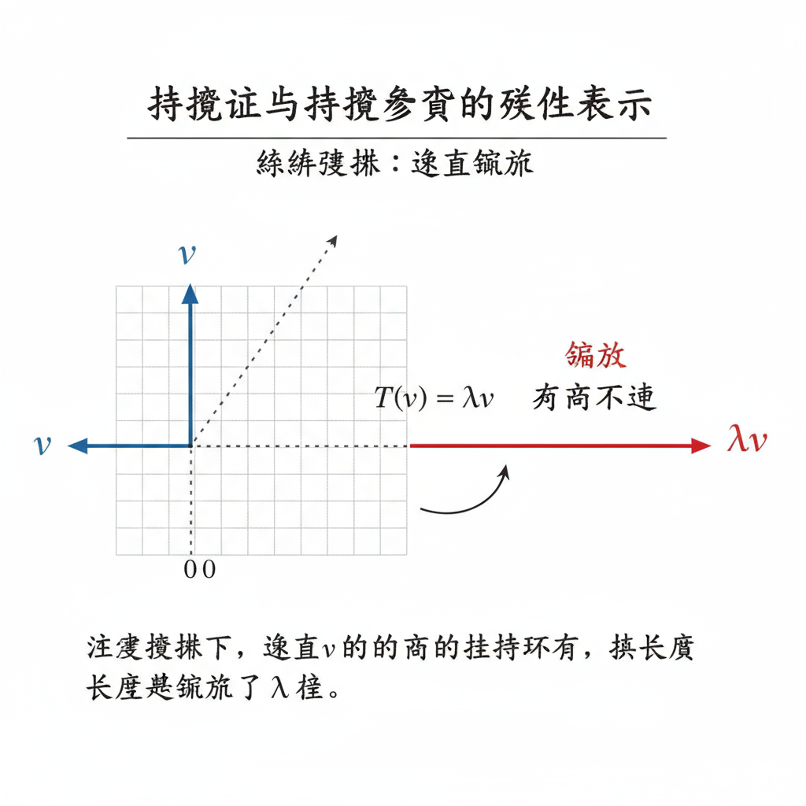
*图6.1：特征值与特征向量的几何意义，特征向量在变换后保持方向，仅发生长度缩放*

#### 6.1.2 特征多项式

**定义6.1.2（特征多项式）**  
矩阵 $A$ 的特征多项式定义为：
$$p_A(\lambda) = \det(\lambda I - A)$$

**定理6.1.1**  
$\lambda$ 是矩阵 $A$ 的特征值的充要条件是 $p_A(\lambda) = 0$。

特征值与特征向量存在性证明

**证明**：设 $\lambda$ 是 $A$ 的特征值，$\vec{v}$ 是对应的特征向量，则：
$$A\vec{v} = \lambda\vec{v} \Rightarrow A\vec{v} - \lambda\vec{v} = \vec{0} \Rightarrow (\lambda I - A)\vec{v} = \vec{0}$$

由于 $\vec{v} \neq \vec{0}$，齐次方程组 $(\lambda I - A)\vec{x} = \vec{0}$ 有非零解，因此：
$$\det(\lambda I - A) = 0$$

反之，如果 $\det(\lambda I - A) = 0$，则齐次方程组 $(\lambda I - A)\vec{x} = \vec{0}$ 有非零解，即存在非零向量 $\vec{v}$ 使得 $(\lambda I - A)\vec{v} = \vec{0}$，亦即 $A\vec{v} = \lambda\vec{v}$，所以 $\lambda$ 是特征值。

### 6.2 相似矩阵

#### 6.2.1 相似矩阵的定义

**定义6.2.1（相似矩阵）**  
设 $A$ 和 $B$ 都是 $n \times n$ 矩阵，如果存在可逆矩阵 $P$，使得：
$$B = P^{-1}AP$$
则称 $A$ 与 $B$ 相似，记为 $A \sim B$。

#### 6.2.2 相似矩阵的性质

相似矩阵性质证明

**性质1**：相似关系是等价关系
- **反身性**：$A \sim A$（取 $P = I$）
- **对称性**：若 $A \sim B$，则 $B \sim A$（$B = P^{-1}AP \Rightarrow A = PBP^{-1}$）
- **传递性**：若 $A \sim B$ 且 $B \sim C$，则 $A \sim C$

**性质2**：相似矩阵有相同的特征多项式
*证明*：
$$p_B(\lambda) = \det(\lambda I - B) = \det(\lambda I - P^{-1}AP) = \det(P^{-1}(\lambda I - A)P)$$
$$= \det(P^{-1})\det(\lambda I - A)\det(P) = \det(\lambda I - A) = p_A(\lambda)$$

**性质3**：相似矩阵有相同的特征值
*证明*：由性质2直接可得

### 6.3 矩阵的对角化

#### 6.3.1 可对角化条件

**定义6.3.1（可对角化）**  
如果矩阵 $A$ 相似于对角矩阵，则称 $A$ 可对角化。

**定理6.3.1（可对角化充要条件）**  
$n \times n$ 矩阵 $A$ 可对角化的充要条件是 $A$ 有 $n$ 个线性无关的特征向量。

**定理6.3.2（可对角化充分条件）**  
如果 $n \times n$ 矩阵 $A$ 有 $n$ 个不同的特征值，则 $A$ 可对角化。

#### 6.3.2 对角化过程

**步骤**：
1. 求特征多项式 $p_A(\lambda) = \det(\lambda I - A)$
2. 求特征值 $\lambda_1, \lambda_2, \ldots, \lambda_n$
3. 对每个特征值 $\lambda_i$，求特征向量 $\vec{v}_i$
4. 构造矩阵 $P = [\vec{v}_1, \vec{v}_2, \ldots, \vec{v}_n]$
5. 则 $P^{-1}AP = \text{diag}(\lambda_1, \lambda_2, \ldots, \lambda_n)$

对角化定理证明

**定理**：设 $A$ 有 $n$ 个线性无关的特征向量 $\vec{v}_1, \vec{v}_2, \ldots, \vec{v}_n$，对应的特征值分别为 $\lambda_1, \lambda_2, \ldots, \lambda_n$，则 $P^{-1}AP = \text{diag}(\lambda_1, \lambda_2, \ldots, \lambda_n)$。

*证明*：设 $P = [\vec{v}_1, \vec{v}_2, \ldots, \vec{v}_n]$，则：
$$AP = A[\vec{v}_1, \vec{v}_2, \ldots, \vec{v}_n] = [A\vec{v}_1, A\vec{v}_2, \ldots, A\vec{v}_n]$$
$$= [\lambda_1\vec{v}_1, \lambda_2\vec{v}_2, \ldots, \lambda_n\vec{v}_n] = P\text{diag}(\lambda_1, \lambda_2, \ldots, \lambda_n)$$

由于 $P$ 可逆（特征向量线性无关），两边左乘 $P^{-1}$ 得：
$$P^{-1}AP = \text{diag}(\lambda_1, \lambda_2, \ldots, \lambda_n)$$

### 6.4 实对称矩阵的对角化

#### 6.4.1 实对称矩阵的性质

**定理6.4.1（实对称矩阵基本性质）**  
实对称矩阵的特征值都是实数。

**定理6.4.2（实对称矩阵正交对角化）**  
实对称矩阵 $A$ 可以正交对角化，即存在正交矩阵 $Q$，使得：
$$Q^TAQ = \text{diag}(\lambda_1, \lambda_2, \ldots, \lambda_n)$$

#### 6.4.2 正交矩阵

**定义6.4.1（正交矩阵）**  
满足 $Q^TQ = QQ^T = I$ 的实矩阵 $Q$ 称为正交矩阵。

**性质**：正交矩阵的列向量构成标准正交基。

### 6.5 Jordan标准形简介

#### 6.5.1 Jordan块

**定义6.5.1（Jordan块）**  
形如：
$$J_k(\lambda) = \begin{pmatrix}
\lambda & 1 & 0 & \cdots & 0 \\
0 & \lambda & 1 & \cdots & 0 \\
\vdots & \vdots & \vdots & \ddots & \vdots \\
0 & 0 & 0 & \cdots & \lambda
\end{pmatrix}_{k \times k}$$
的矩阵称为 $k$ 阶Jordan块。

#### 6.5.2 Jordan标准形

**定理6.5.1（Jordan标准形定理）**  
每个复矩阵 $A$ 都相似于一个Jordan标准形，即存在可逆矩阵 $P$，使得：
$$P^{-1}AP = \text{diag}(J_{k_1}(\lambda_1), J_{k_2}(\lambda_2), \ldots, J_{k_m}(\lambda_m))$$

### 📝 考点总结

**重点内容**：
1. 特征值与特征向量的定义和计算
2. 相似矩阵的性质
3. 矩阵可对角化的条件和方法
4. 实对称矩阵的正交对角化

**常考题型**：
- 求矩阵的特征值和特征向量
- 判断矩阵是否可对角化
- 求解矩阵的对角化问题
- 实对称矩阵的正交对角化

---

## 第七章：二次型

### 7.1 二次型的定义

#### 7.1.1 二次型的标准形式

**定义7.1.1（二次型）**  
$n$ 元二次齐次多项式：
$$f(x_1, x_2, \ldots, x_n) = \sum_{i=1}^n \sum_{j=1}^n a_{ij}x_ix_j$$
称为 $n$ 元二次型，其中 $a_{ij}$ 为实数。

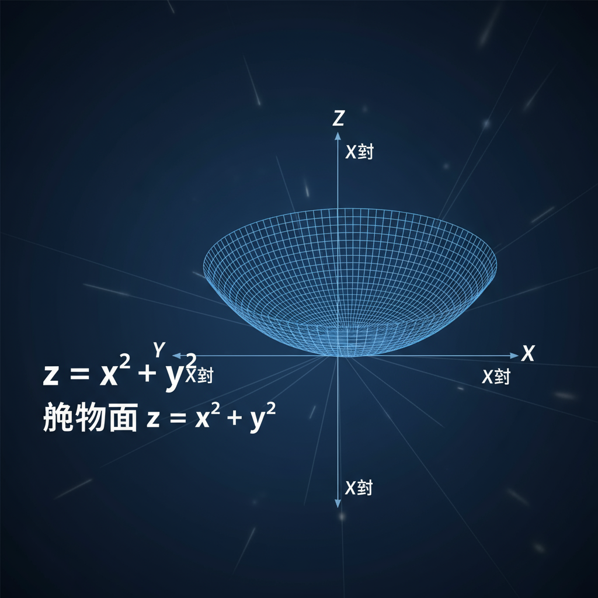
*图7.1：二次型 $z = x^2 + y^2$ 的抛物面图形，展示二次型的几何形状*

#### 7.1.2 二次型的矩阵表示

**定理7.1.1（二次型矩阵表示）**  
每个二次型 $f(\vec{x}) = \vec{x}^TA\vec{x}$，其中 $A$ 是对称矩阵，称为二次型的矩阵。

**证明**：设 $f(\vec{x}) = \sum_{i=1}^n \sum_{j=1}^n a_{ij}x_ix_j$，则：
$$\vec{x}^TA\vec{x} = \sum_{i=1}^n \sum_{j=1}^n x_i a_{ij} x_j = \sum_{i=1}^n \sum_{j=1}^n \frac{a_{ij} + a_{ji}}{2} x_ix_j$$

令 $b_{ij} = \frac{a_{ij} + a_{ji}}{2}$，则 $B = (b_{ij})$ 是对称矩阵，且：
$$\vec{x}^TB\vec{x} = f(\vec{x})$$

### 7.2 二次型的标准形

#### 7.2.1 线性变换

**定义7.2.1（线性变换）**  
设 $\vec{x} = P\vec{y}$，其中 $P$ 是可逆矩阵，则称此变换为线性变换。

**定理7.2.1（二次型标准形）**  
通过适当的线性变换 $\vec{x} = P\vec{y}$，二次型 $f(\vec{x}) = \vec{x}^TA\vec{x}$ 可以化为标准形：
$$f(\vec{y}) = \lambda_1y_1^2 + \lambda_2y_2^2 + \cdots + \lambda_ny_n^2$$

其中 $\lambda_1, \lambda_2, \ldots, \lambda_n$ 是矩阵 $A$ 的特征值。

#### 7.2.2 配方法

**步骤**：
1. 按某个变量配方
2. 对剩余变量重复上述过程
3. 得到标准形

**例题**：将二次型 $f(x_1, x_2, x_3) = x_1^2 + 2x_1x_2 + 2x_1x_3 + x_2^2 + 2x_2x_3 + x_3^2$ 化为标准形。

**解答**：
$$f = (x_1 + x_2 + x_3)^2 - x_2^2 - x_3^2 + x_2^2 + 2x_2x_3 + x_3^2$$
$$= (x_1 + x_2 + x_3)^2 + 2x_2x_3$$

令 $y_1 = x_1 + x_2 + x_3$，$y_2 = x_2$，$y_3 = x_3$，则：
$$f = y_1^2 + 2y_2y_3 = y_1^2 + y_2^2 - y_2^2 + 2y_2y_3 + y_3^2 - y_3^2$$
$$= y_1^2 + (y_2 + y_3)^2 - 2y_3^2$$

最终标准形为：$f = y_1^2 + y_2^2 - 2y_3^2$

### 7.3 惯性定理

#### 7.3.1 惯性定理

**定理7.3.1（惯性定理）**  
二次型的标准形中，正系数的个数、负系数的个数和零系数的个数是唯一确定的，与所取的线性变换无关。

**定义7.3.1（惯性指数）**  
二次型标准形中正系数的个数称为正惯性指数，负系数的个数称为负惯性指数。

#### 7.3.2 惯性指数与特征值

**定理7.3.2**  
对于实对称矩阵 $A$，其正惯性指数等于正特征值的个数，负惯性指数等于负特征值的个数。

### 7.4 正定二次型

#### 7.4.1 正定性的定义

**定义7.4.1（正定二次型）**  
对于二次型 $f(\vec{x}) = \vec{x}^TA\vec{x}$，如果对任意非零向量 $\vec{x}$，都有 $f(\vec{x}) > 0$，则称 $f$ 为正定二次型，$A$ 为正定矩阵。

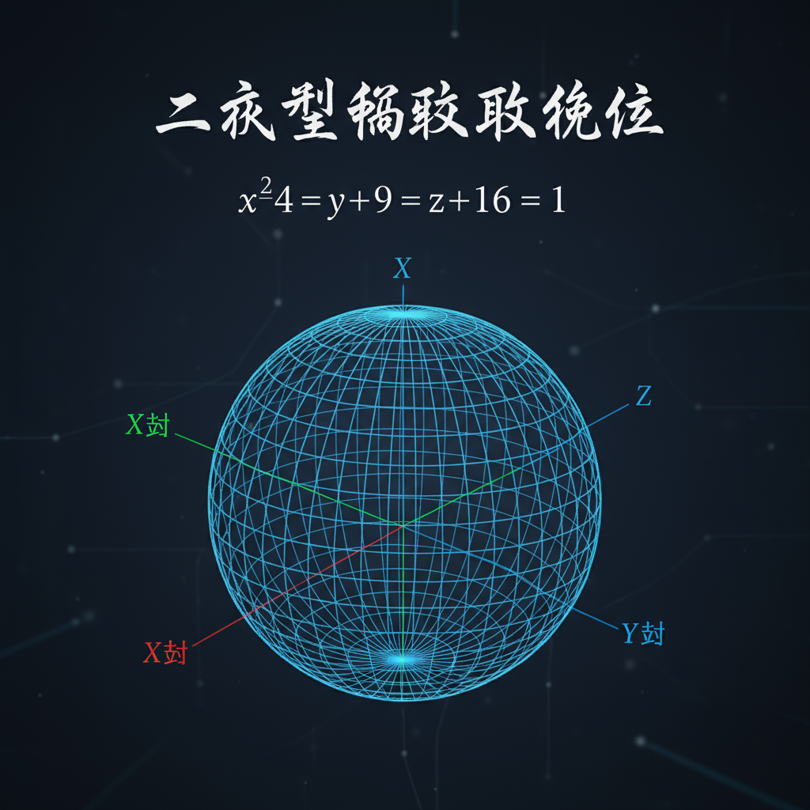
*图7.2：正定二次型 $\frac{x^2}{4} + \frac{y^2}{9} + \frac{z^2}{16} = 1$ 的椭球面图形*

**定义7.4.2（负定二次型）**  
如果对任意非零向量 $\vec{x}$，都有 $f(\vec{x}) < 0$，则称 $f$ 为负定二次型，$A$ 为负定矩阵。

#### 7.4.2 正定性的判定

**定理7.4.1（正定矩阵判定定理）**  
实对称矩阵 $A$ 正定的充要条件是：
1. $A$ 的所有特征值都大于0
2. $A$ 的所有顺序主子式都大于0
3. 存在可逆矩阵 $P$，使得 $A = P^TP$

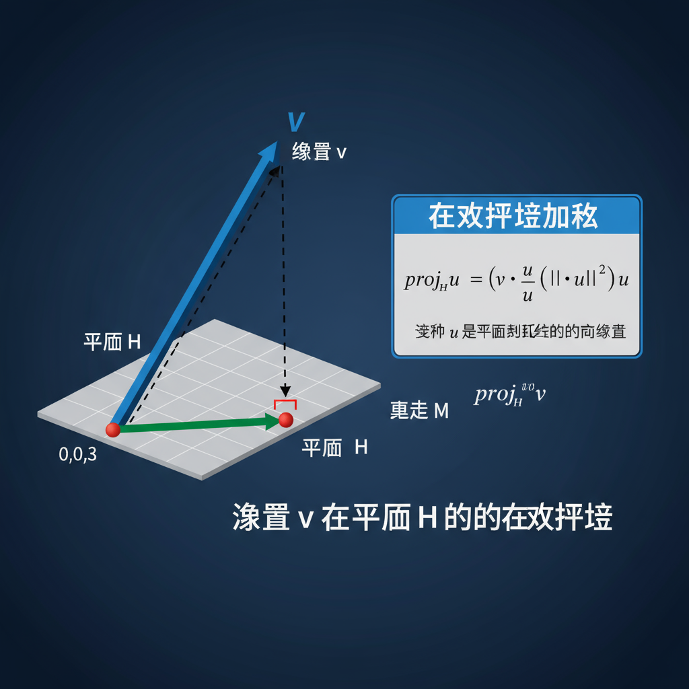
*图7.3：正交投影的几何概念，在二次型正定性判定中的应用*

正定矩阵判定定理证明

**证明**：
1. **特征值条件**：由于 $A$ 实对称，存在正交矩阵 $Q$，使得 $Q^TAQ = \text{diag}(\lambda_1, \lambda_2, \ldots, \lambda_n)$。对任意 $\vec{x} \neq \vec{0}$，令 $\vec{y} = Q^T\vec{x}$，则：
   $$f(\vec{x}) = \vec{x}^TA\vec{x} = \vec{y}^T\text{diag}(\lambda_1, \ldots, \lambda_n)\vec{y} = \sum_{i=1}^n \lambda_i y_i^2$$
   若所有 $\lambda_i > 0$，则 $f(\vec{x}) > 0$；反之若某个 $\lambda_k \leq 0$，取 $\vec{y}$ 的第 $k$ 个分量为1，其余为0，则 $f(\vec{x}) = \lambda_k \leq 0$。

2. **顺序主子式条件**：设 $A_k$ 是 $A$ 的 $k$ 阶顺序主子阵，则 $A_k$ 也正定。由数学归纳法可得。

3. **分解条件**：若 $A = P^TP$，则对任意 $\vec{x} \neq \vec{0}$，有 $P\vec{x} \neq \vec{0}$，所以：
   $$f(\vec{x}) = \vec{x}^TA\vec{x} = \vec{x}^TP^TP\vec{x} = (P\vec{x})^T(P\vec{x}) = \|P\vec{x}\|^2 > 0$$

#### 7.4.3 顺序主子式

**定义7.4.3（顺序主子式）**  
矩阵 $A = (a_{ij})_{n \times n}$ 的 $k$ 阶顺序主子式为：
$$\Delta_k = \begin{vmatrix} a_{11} & a_{12} & \cdots & a_{1k} \\ a_{21} & a_{22} & \cdots & a_{2k} \\ \vdots & \vdots & \ddots & \vdots \\ a_{k1} & a_{k2} & \cdots & a_{kk} \end{vmatrix}$$

**定理7.4.2（Silvester定理）**  
实对称矩阵 $A$ 正定的充要条件是所有顺序主子式都大于0。

### 📝 考点总结

**重点内容**：
1. 二次型的定义和矩阵表示
2. 二次型标准形的求法
3. 惯性定理及其应用
4. 正定二次型的判定

**常考题型**：
- 将二次型化为标准形
- 判断二次型的正定性
- 求二次型的惯性指数
- 利用顺序主子式判定正定性

---

## 📊 重要公式汇总

### 向量运算公式
- 向量内积：$\vec{a} \cdot \vec{b} = a_1b_1 + a_2b_2 + \cdots + a_nb_n$
- 向量长度：$\|\vec{a}\| = \sqrt{a_1^2 + a_2^2 + \cdots + a_n^2}$
- 柯西-施瓦茨不等式：$|\vec{a} \cdot \vec{b}| \leq \|\vec{a}\| \cdot \|\vec{b}\|$

### 矩阵运算公式
- 矩阵乘法：$C = AB$，其中 $c_{ij} = \sum_{k=1}^p a_{ik}b_{kj}$
- 转置性质：$(AB)^T = B^TA^T$
- 逆矩阵：$A^{-1} = \frac{1}{\det(A)}\text{adj}(A)$

### 行列式公式
- 2阶行列式：$\begin{vmatrix} a & b \\ c & d \end{vmatrix} = ad - bc$
- 行列式乘法：$\det(AB) = \det(A)\det(B)$
- 克拉默法则：$x_j = \frac{\det(A_j)}{\det(A)}$

### 特征值公式
- 特征方程：$\det(\lambda I - A) = 0$
- 特征值与行列式：$\det(A) = \lambda_1\lambda_2\cdots\lambda_n$
- 特征值与迹：$\text{tr}(A) = \lambda_1 + \lambda_2 + \cdots + \lambda_n$

### 二次型公式
- 二次型矩阵：$f(\vec{x}) = \vec{x}^TA\vec{x}$
- 正定条件：$A$ 正定 $\Leftrightarrow$ 所有特征值 $> 0$
- 顺序主子式：$A$ 正定 $\Leftrightarrow$ 所有 $\Delta_k > 0$

---

## 🎯 考试重点提示

### 高频考点
1. **矩阵运算**：加减乘、转置、逆矩阵
2. **线性方程组**：高斯消元法、解的存在性
3. **行列式计算**：各种计算方法的灵活运用
4. **特征值问题**：特征值、特征向量、对角化
5. **二次型**：标准形、正定性判定

### 解题技巧
1. **矩阵运算**：注意维数匹配，运算顺序
2. **行列式计算**：选择最简方法，避免复杂计算
3. **线性相关性**：利用定义和性质判定
4. **特征值问题**：先求特征多项式，再求特征向量
5. **二次型**：掌握配方法和正交变换法

### 常见错误
1. 矩阵乘法维数不匹配
2. 行列式计算符号错误
3. 特征向量求解不完整
4. 二次型正定性判定条件混淆
5. 线性变换性质理解偏差

---

*本笔记涵盖了线性代数的核心内容，结构清晰，重点突出，适合学习和复习使用。建议结合具体例题加深理解。*

**作者：MiniMax Agent**  
**完成时间：2025-11-02**