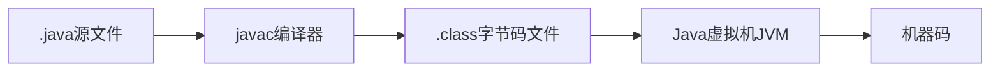
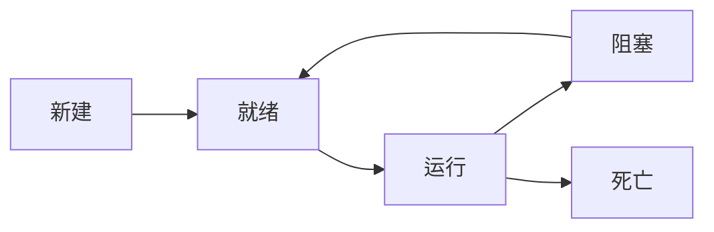

# Java课程笔记总结

## 目录
1. [Java基础概述](#1-java基础概述)
2. [Java语法基础](#2-java语法基础)
3. [面向对象编程](#3-面向对象编程)
4. [Java核心类库](#4-java核心类库)
5. [集合框架](#5-集合框架)
6. [异常处理](#6-异常处理)
7. [多线程](#7-多线程)
8. [IO流](#8-io流)
9. [反射机制](#9-反射机制)
10. [Lambda表达式与Stream API](#10-lambda表达式与stream-api)
11. [Java新特性](#11-java新特性)

---

## 1. Java基础概述

### 1.1 Java语言特点

| 特点 | 说明 |
|------|------|
| 面向对象 | 基于类和对象的编程思想 |
| 平台无关性 | "一次编写，到处运行" |
| 安全性 | 字节码验证、安全管理器 |
| 健壮性 | 强类型检查、异常处理机制 |
| 多线程 | 内置多线程支持 |
| 简单性 | 语法简洁，移除指针等复杂概念 |

### 1.2 Java运行机制

#### 编译过程


#### JVM架构
```
┌─────────────────┐
│   Class Loader  │ ← 类加载器
├─────────────────┤
│ Runtime Data    │ ← 运行时数据区
│ Area            │
├─────────────────┤
│ Execution       │ ← 执行引擎
│ Engine          │
├─────────────────┤
│ Native Method   │ ← 本地方法接口
│ Interface       │
└─────────────────┘
```

---

## 2. Java语法基础

### 2.1 数据类型

#### 基本数据类型
| 数据类型 | 关键字 | 内存大小 | 取值范围 | 默认值 |
|----------|--------|----------|----------|--------|
| 字节型 | byte | 1字节 | -128 ~ 127 | 0 |
| 短整型 | short | 2字节 | -32768 ~ 32767 | 0 |
| 整型 | int | 4字节 | -2³¹ ~ 2³¹-1 | 0 |
| 长整型 | long | 8字节 | -2⁶³ ~ 2⁶³-1 | 0L |
| 单精度浮点型 | float | 4字节 | ±3.4×10³⁸ | 0.0f |
| 双精度浮点型 | double | 8字节 | ±1.7×10³⁰⁸ | 0.0d |
| 字符型 | char | 2字节 | 0 ~ 65535 | '\u0000' |
| 布尔型 | boolean | 1位 | true, false | false |

#### 引用数据类型
- 类（class）
- 接口（interface）
- 数组（array）
- 枚举（enum）
- 注解（annotation）

### 2.2 运算符

#### 算术运算符
- `+` `-` `*` `/` `%` `++` `--`

#### 关系运算符
- `==` `!=` `>` `<` `>=` `<=`

#### 逻辑运算符
- `&&` `||` `!`

#### 位运算符
- `&` `|` `^` `~` `<<` `>>` `>>>`

<details>
<parameter name="details">
<summary>位运算详解</summary>

#### 左移运算符（<<）
- 语法：`a << b`
- 含义：将a的二进制表示向左移动b位
- 结果：$a \times 2^b$
- 示例：`8 << 2 = 32`（二进制：1000 → 100000）

#### 右移运算符（>>）
- 语法：`a >> b`
- 含义：将a的二进制表示向右移动b位
- 结果：$\lfloor a / 2^b \rfloor$（向下取整）
- 示例：`8 >> 2 = 2`（二进制：1000 → 10）

#### 无符号右移（>>>）
- 语法：`a >>> b`
- 含义：将a的二进制表示向右移动b位，左边补0
- 适用于负数处理
</details>

### 2.3 控制结构

#### 选择结构
```java
// if-else结构
if (condition1) {
    // 执行语句1
} else if (condition2) {
    // 执行语句2
} else {
    // 默认执行语句
}

// switch结构
switch (expression) {
    case value1:
        // 执行语句1
        break;
    case value2:
        // 执行语句2
        break;
    default:
        // 默认执行语句
        break;
}
```

#### 循环结构
```java
// for循环
for (initialization; condition; increment) {
    // 循环体
}

// while循环
while (condition) {
    // 循环体
}

// do-while循环
do {
    // 循环体
} while (condition);

// 增强for循环（foreach）
for (DataType element : arrayOrCollection) {
    // 处理元素
}
```

---

## 3. 面向对象编程

### 3.1 类与对象

#### 类定义
```java
[修饰符] class 类名 {
    // 属性（成员变量）
    [修饰符] 数据类型 属性名 = 初始值;
    
    // 构造方法
    [修饰符] 类名([参数列表]) {
        // 构造方法体
    }
    
    // 方法
    [修饰符] 返回值类型 方法名([参数列表]) {
        // 方法体
    }
}
```

#### 对象创建
```java
// 创建对象
类名 对象名 = new 构造方法();

// 访问属性和方法
对象名.属性名;
对象名.方法名();
```

### 3.2 封装

#### 访问修饰符
| 修饰符 | 同一类中 | 同一包中 | 不同包中的子类 | 不同包中的非子类 |
|--------|----------|----------|----------------|------------------|
| public | ✓ | ✓ | ✓ | ✓ |
| protected | ✓ | ✓ | ✓ | ✗ |
| default | ✓ | ✓ | ✗ | ✗ |
| private | ✓ | ✗ | ✗ | ✗ |

#### 封装实现
```java
public class Person {
    // 私有属性
    private String name;
    private int age;
    
    // 公共getter和setter方法
    public String getName() {
        return name;
    }
    
    public void setName(String name) {
        if (name != null && !name.trim().isEmpty()) {
            this.name = name;
        }
    }
    
    public int getAge() {
        return age;
    }
    
    public void setAge(int age) {
        if (age >= 0 && age <= 150) {
            this.age = age;
        }
    }
}
```

### 3.3 继承

#### 继承语法
```java
[修饰符] class 子类名 extends 父类名 {
    // 子类特有的属性和方法
}
```

#### 方法重写（Override）
- 子类重写父类方法
- 方法签名必须相同
- 返回值类型相同或协变返回类型
- 访问权限不能更严格
- 异常不能抛出更宽泛的异常

<details>
<parameter name="details">
<parameter name="summary">方法重写规则详解</summary>

#### 重写规则
1. **方法签名相同**：方法名和参数列表完全一致
2. **返回类型兼容**：子类的返回类型可以是父类返回类型的子类（协变返回类型）
3. **访问权限**：子类方法的访问权限不能比父类更严格
4. **异常处理**：子类方法不能抛出比父类方法更多的受检异常
5. **实例方法**：只有实例方法才能被重写
6. **静态方法**：静态方法不能被重写，只能被隐藏

#### 示例
```java
class Parent {
    protected Object method(String s) throws IOException {
        return s;
    }
}

class Child extends Parent {
    @Override
    public String method(String s) throws RuntimeException { // 允许
        return "Child: " + s;
    }
}
```
</details>

#### super关键字
```java
// 调用父类构造方法
super();

// 调用父类方法
super.方法名();

// 访问父类属性
super.属性名;
```

### 3.4 多态

#### 多态的实现条件
1. 继承关系
2. 子类重写父类方法
3. 父类引用指向子类对象

#### 多态示例
```java
class Animal {
    public void sound() {
        System.out.println("动物发出声音");
    }
}

class Dog extends Animal {
    @Override
    public void sound() {
        System.out.println("汪汪汪");
    }
}

class Cat extends Animal {
    @Override
    public void sound() {
        System.out.println("喵喵喵");
    }
}

public class PolymorphismDemo {
    public static void main(String[] args) {
        Animal animal1 = new Dog();
        Animal animal2 = new Cat();
        
        animal1.sound(); // 输出：汪汪汪
        animal2.sound(); // 输出：喵喵喵
    }
}
```

#### 动态绑定
- 运行时确定实际调用的方法
- 基于对象的实际类型而非引用类型

### 3.5 抽象类和接口

#### 抽象类
```java
[修饰符] abstract class 抽象类名 {
    // 抽象方法
    [修饰符] abstract 返回类型 方法名([参数列表]);
    
    // 具体方法
    [修饰符] 返回类型 具体方法名() {
        // 方法实现
    }
}
```

#### 接口
```java
[修饰符] interface 接口名 {
    // 常量（默认public static final）
    数据类型 常量名 = 常量值;
    
    // 抽象方法（默认public abstract）
    返回类型 方法名([参数列表]);
    
    // 默认方法（Java 8+）
    default 返回类型 方法名([参数列表]) {
        // 方法实现
    }
    
    // 静态方法（Java 8+）
    static 返回类型 方法名([参数列表]) {
        // 方法实现
    }
    
    // 私有方法（Java 9+）
    private 返回类型 私有方法名([参数列表]) {
        // 方法实现
    }
}
```

#### 抽象类 vs 接口
| 特征 | 抽象类 | 接口 |
|------|--------|------|
| 继承 | 单继承 | 多实现 |
| 属性 | 可以有实例变量 | 只能有常量 |
| 方法 | 可以有抽象和具体方法 | 只能有抽象方法（Java 8+可以有默认和静态方法） |
| 构造方法 | 可以有 | 不能有 |
| 访问修饰符 | 任意 | 只能是public |

---

## 4. Java核心类库

### 4.1 String类

#### String创建方式
```java
// 方式1：直接赋值
String str1 = "Hello";

// 方式2：使用构造方法
String str2 = new String("Hello");

// 方式3：字符数组创建
char[] chars = {'H', 'e', 'l', 'l', 'o'};
String str3 = new String(chars);

// 方式4：字节数组创建
byte[] bytes = {72, 101, 108, 108, 111};
String str4 = new String(bytes);
```

#### String常用方法
| 方法 | 功能 | 示例 |
|------|------|------|
| `length()` | 返回字符串长度 | `"Hello".length()` → 5 |
| `charAt(index)` | 返回指定索引的字符 | `"Hello".charAt(1)` → 'e' |
| `substring(begin, end)` | 截取子字符串 | `"Hello".substring(1, 4)` → "ell" |
| `indexOf(str)` | 查找字符串位置 | `"Hello".indexOf("ll")` → 2 |
| `equals(obj)` | 比较字符串内容 | `"Hello".equals("hello")` → false |
| `toLowerCase()` | 转换为小写 | `"Hello".toLowerCase()` → "hello" |
| `toUpperCase()` | 转换为大写 | `"hello".toUpperCase()` → "HELLO" |
| `trim()` | 去除首尾空格 | `" Hello ".trim()` → "Hello" |
| `replace(old, new)` | 替换字符 | `"Hello".replace("l", "L")` → "HeLLo" |
| `split(regex)` | 分割字符串 | `"a,b,c".split(",")` → ["a", "b", "c"] |

#### StringBuilder和StringBuffer
| 类 | 线程安全 | 性能 | 适用场景 |
|----|----------|------|----------|
| String | 是 | 较慢 | 字符串常量 |
| StringBuilder | 否 | 快 | 单线程字符串操作 |
| StringBuffer | 是 | 较慢 | 多线程字符串操作 |

```java
// StringBuilder示例
StringBuilder sb = new StringBuilder();
sb.append("Hello");
sb.append(" ");
sb.append("World");
String result = sb.toString(); // "Hello World"
```

### 4.2 Math类

#### 常用数学方法
```java
// 绝对值
Math.abs(-5); // 5

// 幂运算
Math.pow(2, 3); // 8.0

// 开方
Math.sqrt(16); // 4.0

// 三角函数
Math.sin(Math.PI / 2); // 1.0
Math.cos(0); // 1.0
Math.tan(Math.PI / 4); // 1.0

// 对数
Math.log(Math.E); // 1.0
Math.log10(100); // 2.0

// 随机数
Math.random(); // [0.0, 1.0)

Math.max(10, 20); // 20
Math.min(10, 20); // 10

Math.ceil(3.14); // 4.0（向上取整）
Math.floor(3.14); // 3.0（向下取整）
Math.round(3.14); // 3（四舍五入）
```

### 4.3 日期时间类

#### LocalDate（日期）
```java
// 获取当前日期
LocalDate today = LocalDate.now();

// 创建指定日期
LocalDate date = LocalDate.of(2023, 12, 25);

// 获取日期信息
int year = date.getYear();        // 年
int month = date.getMonthValue(); // 月
int day = date.getDayOfMonth();   // 日

// 日期计算
LocalDate tomorrow = today.plusDays(1);
LocalDate lastMonth = today.minusMonths(1);
```

#### LocalTime（时间）
```java
// 获取当前时间
LocalTime now = LocalTime.now();

// 创建指定时间
LocalTime time = LocalTime.of(14, 30, 45);

// 获取时间信息
int hour = time.getHour();
int minute = time.getMinute();
int second = time.getSecond();
```

#### LocalDateTime（日期时间）
```java
// 获取当前日期时间
LocalDateTime now = LocalDateTime.now();

// 创建指定日期时间
LocalDateTime dateTime = LocalDateTime.of(2023, 12, 25, 14, 30, 45);

// 格式化
DateTimeFormatter formatter = DateTimeFormatter.ofPattern("yyyy-MM-dd HH:mm:ss");
String formatted = now.format(formatter);

// 解析
LocalDateTime parsed = LocalDateTime.parse("2023-12-25 14:30:45", formatter);
```

---

## 5. 集合框架

### 5.1 集合框架体系

```
Collection<E>
├── List<E>（有序、可重复）
│   ├── ArrayList<E>
│   ├── LinkedList<E>
│   └── Vector<E>
└── Set<E>（无序、不可重复）
    ├── HashSet<E>
    ├── LinkedHashSet<E>
    └── TreeSet<E>

Map<K,V>
├── HashMap<K,V>
├── LinkedHashMap<K,V>
└── TreeMap<K,V>
```

### 5.2 Collection接口

#### List接口
```java
// ArrayList（动态数组）
List<String> arrayList = new ArrayList<>();
arrayList.add("元素1");
arrayList.add("元素2");
arrayList.add(1, "插入元素"); // 在指定位置插入

// LinkedList（双向链表）
List<String> linkedList = new LinkedList<>();
linkedList.addFirst("头部");
linkedList.addLast("尾部");
String first = linkedList.getFirst();
String last = linkedList.getLast();
```

#### Set接口
```java
// HashSet（基于哈希表）
Set<String> hashSet = new HashSet<>();
hashSet.add("元素1");
hashSet.add("元素2");
hashSet.add("元素1"); // 不会重复添加

// LinkedHashSet（保持插入顺序的HashSet）
Set<String> linkedHashSet = new LinkedHashSet<>();
linkedHashSet.add("A");
linkedHashSet.add("B");
linkedHashSet.add("A"); // 保持顺序

// TreeSet（基于红黑树，自动排序）
Set<Integer> treeSet = new TreeSet<>();
treeSet.add(3);
treeSet.add(1);
treeSet.add(2);
System.out.println(treeSet); // [1, 2, 3]
```

### 5.3 Map接口

#### HashMap
```java
Map<String, Integer> map = new HashMap<>();

// 添加元素
map.put("苹果", 5);
map.put("香蕉", 3);
map.put("橙子", 7);

// 获取元素
int appleCount = map.get("苹果"); // 5

// 遍历方式1：键值对
for (Map.Entry<String, Integer> entry : map.entrySet()) {
    System.out.println(entry.getKey() + ": " + entry.getValue());
}

// 遍历方式2：键
for (String key : map.keySet()) {
    System.out.println(key + ": " + map.get(key));
}

// 遍历方式3：值
for (Integer value : map.values()) {
    System.out.println("数量: " + value);
}
```

#### LinkedHashMap
```java
Map<String, String> linkedHashMap = new LinkedHashMap<>();
linkedHashMap.put("first", "第一");
linkedHashMap.put("second", "第二");
linkedHashMap.put("third", "第三");
// 保持插入顺序
```

#### TreeMap
```java
Map<String, Integer> treeMap = new TreeMap<>();
treeMap.put("c", 3);
treeMap.put("a", 1);
treeMap.put("b", 2);
// 自动按键排序：{a=1, b=2, c=3}
```

### 5.4 集合工具类

#### Collections类
```java
List<Integer> list = Arrays.asList(3, 1, 4, 1, 5, 9);

// 排序
Collections.sort(list); // [1, 1, 3, 4, 5, 9]

// 反转
Collections.reverse(list); // [9, 5, 4, 3, 1, 1]

// 洗牌
Collections.shuffle(list);

// 查找
int index = Collections.binarySearch(list, 4);

// 填充
Collections.fill(list, 0);

// 最大最小值
int max = Collections.max(list);
int min = Collections.min(list);

// 同步包装
List<String> synchronizedList = Collections.synchronizedList(new ArrayList<>());
Map<String, String> synchronizedMap = Collections.synchronizedMap(new HashMap<>());

// 不可变集合
List<String> unmodifiableList = Collections.unmodifiableList(list);
```

#### Arrays类
```java
int[] array = {3, 1, 4, 1, 5, 9};

// 排序
Arrays.sort(array);

// 二分查找
int index = Arrays.binarySearch(array, 4);

// 填充
Arrays.fill(array, 0);

// 转换为List
List<Integer> list = Arrays.asList(1, 2, 3);

// 转换为Stream
Arrays.stream(array).forEach(System.out::println);

// 数组复制
int[] newArray = Arrays.copyOf(array, array.length);
int[] subArray = Arrays.copyOfRange(array, 1, 4);
```

---

## 6. 异常处理

### 6.1 异常体系

```
Throwable
├── Error（错误）
│   ├── OutOfMemoryError
│   ├── StackOverflowError
│   └── ...
└── Exception（异常）
    ├── RuntimeException（运行时异常）
    │   ├── NullPointerException
    │   ├── ArrayIndexOutOfBoundsException
    │   ├── ArithmeticException
    │   └── ...
    └── IOException（受检异常）
        ├── FileNotFoundException
        ├── EOFException
        └── ...
```

### 6.2 异常处理语法

#### try-catch-finally
```java
try {
    // 可能抛出异常的代码
    int result = 10 / 0;
} catch (ArithmeticException e) {
    // 处理算术异常
    System.out.println("除数不能为0");
    e.printStackTrace();
} catch (NullPointerException e) {
    // 处理空指针异常
    System.out.println("对象为null");
} finally {
    // 无论如何都会执行的代码
    System.out.println("finally块执行");
}
```

#### 多重捕获
```java
try {
    // 可能抛出异常的代码
} catch (ArithmeticException | NullPointerException e) {
    // Java 7+支持多重捕获
    System.out.println("处理异常: " + e.getMessage());
}
```

#### 声明异常
```java
// 方法声明可能抛出的异常
public void readFile(String filename) throws IOException {
    FileReader reader = new FileReader(filename);
    BufferedReader br = new BufferedReader(reader);
    String line = br.readLine();
    br.close();
    reader.close();
}
```

### 6.3 自定义异常

#### 继承Exception（受检异常）
```java
public class MyException extends Exception {
    public MyException() {
        super();
    }
    
    public MyException(String message) {
        super(message);
    }
    
    public MyException(String message, Throwable cause) {
        super(message, cause);
    }
}
```

#### 继承RuntimeException（运行时异常）
```java
public class MyRuntimeException extends RuntimeException {
    public MyRuntimeException() {
        super();
    }
    
    public MyRuntimeException(String message) {
        super(message);
    }
}
```

#### 使用自定义异常
```java
public class UserService {
    public void register(String username) throws MyException {
        if (username == null || username.trim().isEmpty()) {
            throw new MyException("用户名不能为空");
        }
        if (username.length() < 3) {
            throw new MyException("用户名长度不能少于3个字符");
        }
        // 注册逻辑
    }
}
```

### 6.4 异常处理最佳实践

#### 异常处理原则
1. **不要捕获所有异常** - 只捕获能处理的异常
2. **不要忽略异常** - 至少要记录异常信息
3. **使用finally释放资源** - 确保资源正确释放
4. **抛出具体的异常** - 提供更多错误信息
5. **不要过度使用异常** - 控制流不要依赖异常

#### 资源管理
```java
// Java 7+ try-with-resources
try (FileReader reader = new FileFile("file.txt");
     BufferedReader br = new BufferedReader(reader)) {
    String line = br.readLine();
    // 使用资源
} catch (IOException e) {
    // 处理异常
} // 自动关闭资源
```

---

## 7. 多线程

### 7.1 线程创建方式

#### 方式1：继承Thread类
```java
class MyThread extends Thread {
    @Override
    public void run() {
        for (int i = 0; i < 5; i++) {
            System.out.println(getName() + ": " + i);
            try {
                Thread.sleep(1000); // 休眠1秒
            } catch (InterruptedException e) {
                e.printStackTrace();
            }
        }
    }
}

public class ThreadDemo {
    public static void main(String[] args) {
        MyThread thread1 = new MyThread();
        MyThread thread2 = new MyThread();
        
        thread1.setName("线程1");
        thread2.setName("线程2");
        
        thread1.start();
        thread2.start();
    }
}
```

#### 方式2：实现Runnable接口
```java
class MyRunnable implements Runnable {
    @Override
    public void run() {
        for (int i = 0; i < 5; i++) {
            System.out.println(Thread.currentThread().getName() + ": " + i);
            try {
                Thread.sleep(1000);
            } catch (InterruptedException e) {
                e.printStackTrace();
            }
        }
    }
}

public class RunnableDemo {
    public static void main(String[] args) {
        MyRunnable runnable = new MyRunnable();
        
        Thread thread1 = new Thread(runnable, "线程A");
        Thread thread2 = new Thread(runnable, "线程B");
        
        thread1.start();
        thread2.start();
    }
}
```

#### 方式3：实现Callable接口（Java 5+）
```java
import java.util.concurrent.*;

class MyCallable implements Callable<Integer> {
    @Override
    public Integer call() throws Exception {
        int sum = 0;
        for (int i = 1; i <= 100; i++) {
            sum += i;
        }
        return sum;
    }
}

public class CallableDemo {
    public static void main(String[] args) throws ExecutionException, InterruptedException {
        ExecutorService executor = Executors.newSingleThreadExecutor();
        
        Future<Integer> future = executor.submit(new MyCallable());
        
        System.out.println("计算结果: " + future.get());
        
        executor.shutdown();
    }
}
```

### 7.2 线程生命周期



#### 线程状态
- **新建（New）**：创建线程对象
- **就绪（Runnable）**：调用start()方法，等待CPU调度
- **运行（Running）**：获得CPU时间片，正在执行
- **阻塞（Blocked）**：等待锁、等待I/O、调用sleep()等
- **死亡（Dead）**：线程执行完毕或异常终止

### 7.3 线程控制方法

#### 线程调度
```java
// 休眠
Thread.sleep(1000); // 休眠1秒

// 等待
thread.join(); // 等待线程结束
thread.join(1000); // 等待最多1秒

// 中断
thread.interrupt(); // 中断线程

// 礼让
Thread.yield(); // 暂停当前线程，让其他线程执行
```

#### 线程优先级
```java
thread.setPriority(Thread.MIN_PRIORITY); // 最低优先级（1）
thread.setPriority(Thread.NORM_PRIORITY); // 普通优先级（5）
thread.setPriority(Thread.MAX_PRIORITY); // 最高优先级（10）
```

### 7.4 线程同步

#### synchronized关键字
```java
// 方法同步
public synchronized void method() {
    // 同步代码
}

// 代码块同步
public void method() {
    synchronized (this) {
        // 同步代码块
    }
}

// 静态方法同步
public static synchronized void staticMethod() {
    // 同步代码
}
```

#### Lock接口
```java
import java.util.concurrent.locks.Lock;
import java.util.concurrent.locks.ReentrantLock;

public class LockExample {
    private final Lock lock = new ReentrantLock();
    
    public void method() {
        lock.lock();
        try {
            // 同步代码
        } finally {
            lock.unlock(); // 必须在finally中释放锁
        }
    }
}
```

#### 线程间通信
```java
class SharedResource {
    private int count = 0;
    
    public synchronized void increment() throws InterruptedException {
        while (count >= 10) {
            wait(); // 等待消费者消费
        }
        count++;
        System.out.println("生产: " + count);
        notify(); // 通知消费者
    }
    
    public synchronized void decrement() throws InterruptedException {
        while (count <= 0) {
            wait(); // 等待生产者生产
        }
        count--;
        System.out.println("消费: " + count);
        notify(); // 通知生产者
    }
}
```

### 7.5 线程池

#### 创建线程池
```java
import java.util.concurrent.*;

// 创建固定大小的线程池
ExecutorService fixedPool = Executors.newFixedThreadPool(5);

// 创建单线程线程池
ExecutorService singlePool = Executors.newSingleThreadExecutor();

// 创建可缓存线程池
ExecutorService cachedPool = Executors.newCachedThreadPool();

// 创建定时任务线程池
ScheduledExecutorService scheduledPool = Executors.newScheduledThreadPool(5);

// 创建工作窃取线程池
ExecutorService workStealingPool = Executors.newWorkStealingPool();
```

#### 线程池使用
```java
// 提交Runnable任务
executor.execute(new Runnable() {
    @Override
    public void run() {
        // 任务逻辑
    }
});

// 提交Callable任务
Future<String> future = executor.submit(new Callable<String>() {
    @Override
    public String call() throws Exception {
        return "任务结果";
    }
});

// 获取结果
String result = future.get();

// 关闭线程池
executor.shutdown(); // 优雅关闭
executor.shutdownNow(); // 强制关闭
```

#### 自定义线程池
```java
ThreadPoolExecutor executor = new ThreadPoolExecutor(
    5, // 核心线程数
    10, // 最大线程数
    60L, // 空闲线程存活时间
    TimeUnit.SECONDS, // 时间单位
    new LinkedBlockingQueue<>(100), // 任务队列
    new ThreadFactoryBuilder().setNameFormat("pool-%d").build(), // 线程工厂
    new ThreadPoolExecutor.AbortPolicy() // 拒绝策略
);
```

---

## 8. IO流

### 8.1 IO流分类

#### 按流向分类
- **输入流**：从数据源读取数据
- **输出流**：向目标写入数据

#### 按处理单位分类
- **字节流**：以字节为单位处理数据（8位）
  - 抽象基类：InputStream、OutputStream
- **字符流**：以字符为单位处理数据（16位）
  - 抽象基类：Reader、Writer

### 8.2 字节流

#### FileInputStream和FileOutputStream
```java
// 字节输入流
try (FileInputStream fis = new FileInputStream("input.txt")) {
    int data;
    while ((data = fis.read()) != -1) {
        System.out.print((char) data);
    }
} catch (IOException e) {
    e.printStackTrace();
}

// 字节输出流
try (FileOutputStream fos = new FileOutputStream("output.txt")) {
    String content = "Hello, World!";
    fos.write(content.getBytes());
} catch (IOException e) {
    e.printStackTrace();
}
```

#### BufferedInputStream和BufferedOutputStream
```java
// 缓冲字节流（提高效率）
try (BufferedInputStream bis = new BufferedInputStream(new FileInputStream("input.txt"));
     BufferedOutputStream bos = new BufferedOutputStream(new FileOutputStream("output.txt"))) {
    
    byte[] buffer = new byte[1024];
    int bytesRead;
    while ((bytesRead = bis.read(buffer)) != -1) {
        bos.write(buffer, 0, bytesRead);
    }
} catch (IOException e) {
    e.printStackTrace();
}
```

### 8.3 字符流

#### FileReader和FileWriter
```java
// 字符输入流
try (FileReader fr = new FileReader("input.txt")) {
    int data;
    while ((data = fr.read()) != -1) {
        System.out.print((char) data);
    }
} catch (IOException e) {
    e.printStackTrace();
}

// 字符输出流
try (FileWriter fw = new FileWriter("output.txt")) {
    String content = "Hello, World!";
    fw.write(content);
} catch (IOException e) {
    e.printStackTrace();
}
```

#### BufferedReader和BufferedWriter
```java
// 缓冲字符流
try (BufferedReader br = new BufferedReader(new FileReader("input.txt"));
     BufferedWriter bw = new BufferedWriter(new FileWriter("output.txt"))) {
    
    String line;
    while ((line = br.readLine()) != null) {
        bw.write(line);
        bw.newLine(); // 写入换行符
    }
} catch (IOException e) {
    e.printStackTrace();
}
```

### 8.4 转换流

#### InputStreamReader和OutputStreamWriter
```java
// 字节流转字符流
try (InputStreamReader isr = new InputStreamReader(new FileInputStream("input.txt"), "UTF-8");
     OutputStreamWriter osw = new OutputStreamWriter(new FileOutputStream("output.txt"), "UTF-8")) {
    
    char[] buffer = new char[1024];
    int length;
    while ((length = isr.read(buffer)) != -1) {
        osw.write(buffer, 0, length);
    }
} catch (IOException e) {
    e.printStackTrace();
}
```

### 8.5 序列化

#### 对象序列化
```java
import java.io.*;

class Person implements Serializable {
    private static final long serialVersionUID = 1L;
    
    private String name;
    private int age;
    private transient String password; // transient关键字：不参与序列化
    
    public Person(String name, int age, String password) {
        this.name = name;
        this.age = age;
        this.password = password;
    }
    
    // getters and setters
}

// 序列化对象
try (ObjectOutputStream oos = new ObjectOutputStream(new FileOutputStream("person.dat"))) {
    Person person = new Person("张三", 25, "123456");
    oos.writeObject(person);
} catch (IOException e) {
    e.printStackTrace();
}

// 反序列化对象
try (ObjectInputStream ois = new ObjectInputStream(new FileInputStream("person.dat"))) {
    Person person = (Person) ois.readObject();
    System.out.println(person.getName() + ", " + person.getAge());
} catch (IOException | ClassNotFoundException e) {
    e.printStackTrace();
}
```

### 8.6 NIO（New IO）

#### Channel和Buffer
```java
import java.io.*;
import java.nio.*;
import java.nio.channels.*;
import java.nio.charset.StandardCharsets;

// 文件复制示例
try (FileChannel sourceChannel = new RandomAccessFile("source.txt", "r").getChannel();
     FileChannel targetChannel = new RandomAccessFile("target.txt", "rw").getChannel()) {
    
    // 分配缓冲区
    ByteBuffer buffer = ByteBuffer.allocate(1024);
    
    // 从源文件读取到缓冲区
    while (sourceChannel.read(buffer) > 0) {
        // 切换模式：写->读
        buffer.flip();
        
        // 从缓冲区写入目标文件
        targetChannel.write(buffer);
        
        // 清空缓冲区：读->写
        buffer.clear();
    }
} catch (IOException e) {
    e.printStackTrace();
}
```

---

## 9. 反射机制

### 9.1 Class类

#### 获取Class对象
```java
// 方式1：类.class
Class<String> class1 = String.class;

// 方式2：对象.getClass()
String str = "Hello";
Class<?> class2 = str.getClass();

// 方式3：Class.forName()
Class<?> class3 = Class.forName("java.lang.String");
```

#### Class对象常用方法
```java
Class<?> clazz = String.class;

// 获取类名
String className = clazz.getName(); // java.lang.String
String simpleName = clazz.getSimpleName(); // String

// 获取包名
Package packageName = clazz.getPackage();
String packageStr = packageName.getName(); // java.lang

// 获取修饰符
int modifiers = clazz.getModifiers();
boolean isPublic = Modifier.isPublic(modifiers);
boolean isAbstract = Modifier.isAbstract(modifiers);

// 获取父类
Class<?> superClass = clazz.getSuperclass();

// 获取接口
Class<?>[] interfaces = clazz.getInterfaces();

// 获取构造方法
Constructor<?>[] constructors = clazz.getConstructors();

// 获取方法
Method[] methods = clazz.getMethods();

// 获取字段
Field[] fields = clazz.getFields();
```

### 9.2 反射操作构造方法

#### 获取构造方法
```java
Class<?> clazz = Person.class;

// 获取所有public构造方法
Constructor<?>[] publicConstructors = clazz.getConstructors();

// 获取指定构造方法
Constructor<?> constructor = clazz.getConstructor(String.class, int.class);

// 获取所有构造方法（包括private）
Constructor<?>[] allConstructors = clazz.getDeclaredConstructors();
```

#### 创建对象
```java
// 使用public构造方法创建对象
Person person1 = (Person) constructor.newInstance("张三", 25);

// 使用private构造方法创建对象
Constructor<?> privateConstructor = clazz.getDeclaredConstructor(String.class);
privateConstructor.setAccessible(true); // 取消访问检查
Person person2 = (Person) privateConstructor.newInstance("李四");
```

### 9.3 反射操作方法

#### 获取方法
```java
Class<?> clazz = Person.class;

// 获取public方法（包括继承的）
Method[] publicMethods = clazz.getMethods();

// 获取所有声明的方法（不包括继承的）
Method[] declaredMethods = clazz.getDeclaredMethods();

// 获取指定方法
Method method = clazz.getMethod("getName");
Method methodWithParams = clazz.getMethod("setName", String.class);

// 获取private方法
Method privateMethod = clazz.getDeclaredMethod("privateMethod");
```

#### 调用方法
```java
Person person = new Person("张三", 25);

// 调用public方法
String name = (String) method.invoke(person);
methodWithParams.invoke(person, "王五");

// 调用private方法
privateMethod.setAccessible(true);
privateMethod.invoke(person);
```

### 9.4 反射操作字段

#### 获取字段
```java
Class<?> clazz = Person.class;

// 获取public字段（包括继承的）
Field[] publicFields = clazz.getFields();

// 获取所有字段（包括private）
Field[] allFields = clazz.getDeclaredFields();

// 获取指定字段
Field nameField = clazz.getField("name");
Field ageField = clazz.getDeclaredField("age");
```

#### 访问字段
```java
Person person = new Person("张三", 25);

// 获取字段值
Object value = nameField.get(person);
int age = (int) ageField.get(person);

// 设置字段值
nameField.set(person, "李四");
ageField.set(person, 30);

// 访问private字段
nameField.setAccessible(true);
nameField.set(person, "王五");
```

### 9.5 反射应用场景

#### 动态创建对象
```java
public class ObjectFactory {
    public static <T> T createObject(String className) throws Exception {
        Class<?> clazz = Class.forName(className);
        return (T) clazz.newInstance();
    }
}

// 使用
Person person = ObjectFactory.createObject("com.example.Person");
```

#### 动态调用方法
```java
public class MethodInvoker {
    public static Object invokeMethod(Object obj, String methodName, Object... args) 
            throws Exception {
        Class<?> clazz = obj.getClass();
        
        // 获取参数类型
        Class<?>[] paramTypes = new Class[args.length];
        for (int i = 0; i < args.length; i++) {
            paramTypes[i] = args[i].getClass();
        }
        
        // 获取方法
        Method method = clazz.getMethod(methodName, paramTypes);
        
        // 调用方法
        return method.invoke(obj, args);
    }
}

// 使用
MethodInvoker.invokeMethod(person, "setName", "张三");
String name = (String) MethodInvoker.invokeMethod(person, "getName");
```

---

## 10. Lambda表达式与Stream API

### 10.1 Lambda表达式

#### 语法格式
```java
// 完整语法
(parameters) -> expression

// 简写语法
(parameters) -> { statements; }

(parameters) -> expression

parameter -> expression

// 无参数
() -> expression

// 单个参数（可以省略括号）
parameter -> expression
```

#### 函数式接口
```java
// 自定义函数式接口
@FunctionalInterface
interface Calculator {
    int calculate(int a, int b);
}

// 使用Lambda表达式
Calculator addition = (a, b) -> a + b;
Calculator subtraction = (a, b) -> a - b;

int result1 = addition.calculate(5, 3); // 8
int result2 = subtraction.calculate(5, 3); // 2
```

#### Java内置函数式接口
| 接口 | 方法 | 说明 |
|------|------|------|
| `Predicate<T>` | `boolean test(T t)` | 断言，接收一个参数，返回布尔值 |
| `Function<T,R>` | `R apply(T t)` | 功能，接收一个参数，返回一个结果 |
| `Consumer<T>` | `void accept(T t)` | 消费者，接收一个参数，无返回值 |
| `Supplier<T>` | `T get()` | 供应者，无参数，返回一个结果 |
| `UnaryOperator<T>` | `T apply(T t)` | 一元操作符，接收一个参数，返回同类型结果 |
| `BinaryOperator<T>` | `T apply(T t1, T t2)` | 二元操作符，接收两个同类型参数，返回同类型结果 |

### 10.2 Stream API

#### 创建Stream
```java
// 从集合创建
List<String> list = Arrays.asList("a", "b", "c");
Stream<String> stream1 = list.stream(); // 串行流
Stream<String> stream2 = list.parallelStream(); // 并行流

// 从数组创建
String[] array = {"a", "b", "c"};
Stream<String> stream3 = Arrays.stream(array);

// 使用Stream.of()
Stream<String> stream4 = Stream.of("a", "b", "c");

// 使用Stream.iterate()（无限流）
Stream<Integer> stream5 = Stream.iterate(0, n -> n + 2).limit(5); // 0, 2, 4, 6, 8

// 使用Stream.generate()（无限流）
Stream<Double> stream6 = Stream.generate(Math::random).limit(5);
```

#### 中间操作
```java
List<Integer> numbers = Arrays.asList(1, 2, 3, 4, 5, 6, 7, 8, 9, 10);

// filter：过滤
numbers.stream()
    .filter(n -> n % 2 == 0) // 过滤偶数
    .forEach(System.out::println);

// map：映射
numbers.stream()
    .map(n -> n * 2) // 每个元素乘以2
    .forEach(System.out::println);

// flatMap：扁平化映射
List<List<Integer>> listOfLists = Arrays.asList(
    Arrays.asList(1, 2),
    Arrays.asList(3, 4),
    Arrays.asList(5, 6)
);

listOfLists.stream()
    .flatMap(List::stream) // 扁平化为一个流
    .forEach(System.out::println);

// distinct：去重
numbers.stream()
    .map(n -> n % 3) // 1, 2, 0, 1, 2, 0, 1, 2, 0, 1
    .distinct() // 去重：1, 2, 0
    .forEach(System.out::println);

// sorted：排序
numbers.stream()
    .sorted((a, b) -> b - a) // 降序
    .forEach(System.out::println);

// limit：限制数量
numbers.stream()
    .limit(5) // 取前5个元素
    .forEach(System.out::println);

// skip：跳过
numbers.stream()
    .skip(5) // 跳过前5个元素
    .forEach(System.out::println);
```

#### 终端操作
```java
List<Integer> numbers = Arrays.asList(1, 2, 3, 4, 5);

// forEach：遍历
numbers.stream().forEach(System.out::println);

// collect：收集
List<Integer> evenNumbers = numbers.stream()
    .filter(n -> n % 2 == 0)
    .collect(Collectors.toList());

// count：计数
long count = numbers.stream().filter(n -> n > 3).count();

// anyMatch：是否有任意元素匹配
boolean hasEven = numbers.stream().anyMatch(n -> n % 2 == 0);

// allMatch：是否所有元素匹配
boolean allPositive = numbers.stream().allMatch(n -> n > 0);

// noneMatch：是否没有元素匹配
boolean noNegative = numbers.stream().noneMatch(n -> n < 0);

// findFirst：找到第一个元素
Optional<Integer> first = numbers.stream().findFirst();

// findAny：找到任意一个元素
Optional<Integer> any = numbers.stream().findAny();

// reduce：归约
Optional<Integer> sum = numbers.stream().reduce((a, b) -> a + b);
int sumWithIdentity = numbers.stream().reduce(0, Integer::sum); // 带初始值
```

#### 数值Stream
```java
// IntStream
IntStream intStream = IntStream.range(1, 10); // 1到9
int sum = intStream.sum();

// LongStream
LongStream longStream = LongStream.rangeClosed(1, 100); // 1到100

// DoubleStream
DoubleStream doubleStream = DoubleStream.of(1.1, 2.2, 3.3);

// 转换为boxed Stream
Stream<Integer> boxedStream = IntStream.range(1, 10).boxed();
```

#### 收集器
```java
List<Integer> numbers = Arrays.asList(1, 2, 3, 4, 5, 6, 7, 8, 9, 10);

// 收集为List
List<Integer> list = numbers.stream()
    .filter(n -> n > 5)
    .collect(Collectors.toList());

// 收集为Set
Set<Integer> set = numbers.stream()
    .filter(n -> n % 2 == 0)
    .collect(Collectors.toSet());

// 收集为Map
Map<String, Integer> map = numbers.stream()
    .collect(Collectors.toMap(
        n -> "数字" + n, 
        n -> n * n
    ));

// 分组
Map<Integer, List<Integer>> groupedByParity = numbers.stream()
    .collect(Collectors.groupingBy(n -> n % 2));

// 分区
Map<Boolean, List<Integer>> partitioned = numbers.stream()
    .collect(Collectors.partitioningBy(n -> n > 5));

// 统计信息
IntSummaryStatistics stats = numbers.stream()
    .collect(Collectors.summarizingInt(n -> n));

System.out.println("平均值: " + stats.getAverage());
System.out.println("最大值: " + stats.getMax());
System.out.println("最小值: " + stats.getMin());
System.out.println("总数: " + stats.getCount());
```

---

## 11. Java新特性

### 11.1 Java 8新特性

#### 接口默认方法
```java
interface MyInterface {
    // 抽象方法
    void abstractMethod();
    
    // 默认方法（Java 8+）
    default void defaultMethod() {
        System.out.println("默认方法实现");
    }
    
    // 静态方法（Java 8+）
    static void staticMethod() {
        System.out.println("静态方法");
    }
}
```

#### Optional类
```java
import java.util.Optional;

// 创建Optional对象
Optional<String> optional1 = Optional.empty();
Optional<String> optional2 = Optional.of("value");
Optional<String> optional3 = Optional.ofNullable(getValue()); // 可能为null

// 使用Optional
String result = optional3
    .map(String::toUpperCase)
    .filter(s -> s.length() > 5)
    .orElse("默认值");

// 链式调用
optional3.ifPresent(System.out::println);
```

#### 新的日期时间API
```java
import java.time.*;

// LocalDate
LocalDate today = LocalDate.now();
LocalDate birthday = LocalDate.of(1990, Month.JANUARY, 1);

// Period
Period age = Period.between(birthday, today);
int years = age.getYears();

// Duration
Duration duration = Duration.between(
    LocalTime.now(),
    LocalTime.now().plusHours(2)
);

// DateTimeFormatter
DateTimeFormatter formatter = DateTimeFormatter.ofPattern("yyyy-MM-dd HH:mm:ss");
String formatted = LocalDateTime.now().format(formatter);
```

### 11.2 Java 11新特性

#### 字符串新方法
```java
// 判断是否为空或空白
"".isBlank(); // true
"  ".isBlank(); // true
"hello".isBlank(); // false

// 去除首尾空白
"  hello  ".strip(); // "hello"
"  hello  ".stripLeading(); // "hello  "
"  hello  ".stripTrailing(); // "  hello"

// 重复字符串
"abc".repeat(3); // "abcabcabc"

// 按行分割
String lines = "line1\nline2\nline3";
lines.lines().forEach(System.out::println);
```

#### 文件读写简化
```java
import java.nio.file.Files;
import java.nio.file.Paths;

// 读取文件所有行
List<String> lines = Files.readAllLines(Paths.get("file.txt"));

// 写入文件
Files.write(Paths.get("output.txt"), lines);

// 读取文件为字符串
String content = Files.readString(Paths.get("file.txt")); // Java 11+

// 写入字符串
Files.writeString(Paths.get("output.txt"), "Hello, World!"); // Java 11+
```

### 11.3 Java 17新特性

#### sealed类
```java
// 密封类
sealed class Shape permits Circle, Rectangle, Triangle {
    // 公共方法
    public abstract double area();
}

// 子类必须是final、sealed或non-sealed
final class Circle extends Shape {
    private final double radius;
    
    public Circle(double radius) {
        this.radius = radius;
    }
    
    @Override
    public double area() {
        return Math.PI * radius * radius;
    }
}

sealed class Rectangle extends Shape permits Square {
    protected final double width;
    protected final double height;
    
    public Rectangle(double width, double height) {
        this.width = width;
        this.height = height;
    }
    
    @Override
    public double area() {
        return width * height;
    }
}

// 允许进一步扩展
non-sealed class Square extends Rectangle {
    public Square(double side) {
        super(side, side);
    }
}
```

#### record类
```java
// 记录类（不可变数据载体）
public record Person(String name, int age, String email) {
    // 可以定义实例方法
    public String greet() {
        return "Hello, I'm " + name;
    }
    
    // 可以定义静态方法
    public static Person createDefault() {
        return new Person("Unknown", 0, "");
    }
}

// 使用
Person person = new Person("张三", 25, "zhangsan@example.com");
String name = person.name();
int age = person.age();
String greet = person.greet();
```

### 11.4 Java 21新特性

#### 字符串模板
```java
// 字符串模板（预览功能）
String name = "张三";
int age = 25;

// 模板表达式
String message = STR."Hello, my name is \{name} and I'm \{age} years old";

// 模板处理器
String formatted = STR."\{name} is \{age} years old, which means they were born in \{2023 - age}";
```

#### 序列集合
```java
import java.util.SequencedCollection;
import java.util.SequencedSet;
import java.util.SequencedMap;

// SequencedCollection
SequencedCollection<String> sequenced = new ArrayList<>();
sequenced.addFirst("first");
sequenced.addLast("last");

// SequencedSet
SequencedSet<Integer> sequencedSet = new LinkedHashSet<>();
sequencedSet.addFirst(1);
sequencedSet.addLast(10);

// SequencedMap
SequencedMap<String, Integer> sequencedMap = new LinkedHashMap<>();
sequencedMap.putFirst("first", 1);
sequencedMap.putLast("last", 10);
```

---

## 总结

这份Java课程笔记涵盖了Java编程的核心知识点，从基础语法到高级特性，包括：

1. **Java基础**：语言特点、运行机制、数据类型、运算符
2. **面向对象**：封装、继承、多态、抽象类和接口
3. **核心类库**：String、Math、日期时间等常用类
4. **集合框架**：List、Set、Map接口及其实现类
5. **异常处理**：异常体系、自定义异常、异常处理最佳实践
6. **多线程**：线程创建、同步、通信、线程池
7. **IO流**：字节流、字符流、序列化、NIO
8. **反射**：Class类、反射操作构造方法、字段、方法
9. **Lambda和Stream**：函数式编程、Stream API
10. **新特性**：Java 8/11/17/21的新功能

每个章节都包含了详细的代码示例和表格总结，便于理解和记忆。建议结合实际项目练习这些知识点，加深对Java编程的理解和掌握。

---

**作者：MiniMax Agent**  
**创建时间：2025-11-02**