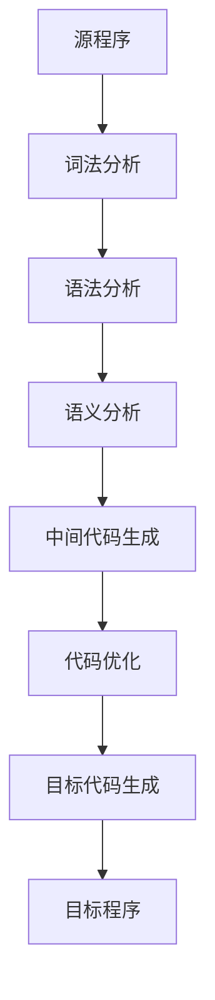

# 编译原理课程笔记总结

> 作者：MiniMax Agent  
> 创建时间：2025-11-02  
> 课程：编译原理（Compiler Principles）

---

## 📚 目录

1. [编译原理概述](#1-编译原理概述)
2. [词法分析](#2-词法分析)
3. [语法分析](#3-语法分析)
4. [语义分析](#4-语义分析)
5. [中间代码生成](#5-中间代码生成)
6. [代码优化](#6-代码优化)
7. [目标代码生成](#7-目标代码生成)
8. [符号表管理](#8-符号表管理)
9. [错误处理](#9-错误处理)
10. [考试重点总结](#10-考试重点总结)

---

## 1. 编译原理概述

### 1.1 编译过程

编译是将高级语言程序转换为机器语言程序的过程，主要分为以下几个阶段：



### 1.2 编译器的结构

| 组成部分 | 功能 | 输入 | 输出 |
|---------|------|------|------|
| 词法分析器 | 识别单词符号 | 字符流 | 记号流 |
| 语法分析器 | 分析语法结构 | 记号流 | 语法树 |
| 语义分析器 | 检查语义正确性 | 语法树 | 注释语法树 |
| 中间代码生成器 | 生成中间代码 | 注释语法树 | 中间代码 |
| 代码优化器 | 优化中间代码 | 中间代码 | 优化后中间代码 |
| 目标代码生成器 | 生成目标代码 | 优化后中间代码 | 目标代码 |

### 1.3 前后端分离

**前端（Frontend）**：与源语言相关
- 词法分析
- 语法分析  
- 语义分析
- 中间代码生成

**后端（Backend）**：与目标机相关
- 代码优化
- 目标代码生成

---

## 2. 词法分析

### 2.1 词法分析器的功能

词法分析器的主要任务：
1. 识别单词符号（Token）
2. 过滤空白符和注释
3. 报告词法错误
4. 建立符号表（可选）

### 2.2 单词符号的分类

| 类别 | 说明 | 例子 |
|------|------|------|
| 关键字 | 语言保留字 | if, while, int |
| 标识符 | 用户定义的变量名、函数名 | sum, max, calc |
| 常数 | 数值常量、字符串常量 | 123, 3.14, "hello" |
| 运算符 | 算术、关系、逻辑运算符 | +, -, ==, && |
| 界符 | 分隔符和特殊符号 | (, ), {, }, ; |

### 2.3 正则表达式

#### 2.3.1 基本概念

正则表达式是用来描述正则集（正则语言）的数学工具。

**基本运算**：
- **并**：$R_1 + R_2$ 或 $R_1 | R_2$
- **连接**：$R_1 R_2$
- **闭包**：$R^*$（0次或多次重复）

#### 2.3.2 正则表达式定义

```latex
digit = 0|1|2|3|4|5|6|7|8|9
letter = A|B|...|Z|a|b|...|z
identifier = letter(letter|digit)*
number = digit+ (.digit+)?
```

### 2.4 有限自动机（FA）

#### 2.4.1 确定有限自动机（DFA）

**定义**：$M = (Q, \Sigma, \delta, q_0, F)$

其中：
- $Q$：状态集合
- $\Sigma$：输入字母表
- $\delta$：状态转移函数 $Q \times \Sigma \rightarrow Q$
- $q_0$：初始状态
- $F$：终止状态集合

**转移函数**：
$$\delta(q, a) = q'$$

#### 2.4.2 非确定有限自动机（NFA）

**定义**：$M = (Q, \Sigma, \delta, q_0, F)$

其中：
- $\delta$：状态转移函数 $Q \times \Sigma^* \rightarrow 2^Q$

#### 2.4.3 DFA与NFA的关系

<details>
<summary><strong>定理2.1：NFA与DFA的等价性</strong></summary>

**定理**：对于每一个NFA，都存在一个DFA，使得两者识别相同的语言。

**证明思路**：
1. 从NFA构造子集构造法
2. 将NFA的ε-closure和move函数结合
3. 构造DFA的状态为NFA的状态子集
4. 证明两个自动机识别相同的语言

**构造算法**：
```
1. 计算初始状态ε-closure(q0)
2. 对每个未标记的状态子集T：
   a. 对每个输入符号a，计算move(T, a)
   b. 计算ε-closure(move(T, a))
   c. 如果是新的状态子集，加入DFA状态集合
3. 重复直到所有状态子集都被标记
4. 终止状态为包含NFA终止状态的状态子集
```
</details>

### 2.5 词法分析器的实现

#### 2.5.1 状态图法

基于正则表达式构造状态图，然后实现为代码。

#### 2.5.2 查表法

使用状态转移表来驱动词法分析器的运行。

**状态转移表示例**：

| 状态 | 字母 | 数字 | 空白 | 其他 |
|------|------|------|------|------|
| 0 | 1 | 2 | 0 | 错误 |
| 1 | 1 | 1 | 标识符 | 错误 |
| 2 | 2 | 2 | 常数 | 错误 |

### 2.6 考点重点

1. **正则表达式的构造**：给定语言描述，写出对应的正则表达式
2. **DFA的化简**：使用等价类方法化简DFA
3. **NFA转DFA**：子集构造法的具体实现
4. **词法分析器设计**：给定语言词法规则，设计词法分析器

---

## 3. 语法分析

### 3.1 语法分析概述

语法分析器根据词法分析器输出的记号流，按照语言的语法规则构建语法树。

### 3.2 上下文无关文法（CFG）

#### 3.2.1 文法的定义

**形式化定义**：文法 $G = (V_T, V_N, P, S)$

其中：
- $V_T$：终结符集合
- $V_N$：非终结符集合  
- $P$：产生式集合
- $S$：开始符号

#### 3.2.2 推导

**直接推导**：$\alpha A \beta \Rightarrow \alpha \gamma \beta$（其中 $A \rightarrow \gamma$）

**多步推导**：$\alpha \Rightarrow^* \beta$（经过0步或多步推导）

**最左推导**：每次都替换最左边的非终结符

**最右推导**：每次都替换最右边的非终结符

#### 3.2.3 语法树

语法树是推导过程的树形表示：
- 内部节点：非终结符
- 叶子节点：终结符
- 边的关系：产生式

### 3.3 自顶向下分析

#### 3.3.1 递归下降分析

**基本思想**：为每个非终结符编写一个递归函数。

**优点**：简单直观，易于实现
**缺点**：存在左递归问题，可能导致无限递归

#### 3.3.2 预测分析

**预测分析表**：$M[A, a]$ 表示当非终结符A面临输入符号a时应采用哪个产生式。

**LL(1)文法**：
- 第一个L：从左到右扫描输入
- 第二个L：最左推导
- 1：向前看1个符号

<details>
<summary><strong>定理3.1：LL(1)文法的判别条件</strong></summary>

**定理**：文法G是LL(1)的，当且仅当对于每个非终结符A的任何两个产生式：
$A \rightarrow \alpha | \beta$

满足以下条件：
1. **FIRST(α) ∩ FIRST(β) = ∅**
2. **如果β ⇒* ε，则FIRST(α) ∩ FOLLOW(A) = ∅**

**证明**：
- 条件1保证不会产生选择冲突
- 条件2保证ε产生式不会与其他产生式冲突

**计算FIRST集**：
1. 如果X是终结符，FIRST(X) = {X}
2. 如果X是非终结符且有产生式X→aα，FIRST(X)包含a
3. 如果X→ε，FIRST(X)包含ε
4. 如果X→Y1Y2...Yk，则FIRST(X)包含FIRST(Y1) - {ε}，如果ε∈FIRST(Y1)，则包含FIRST(Y2) - {ε}，以此类推

**计算FOLLOW集**：
1. 将$放入FOLLOW(S)
2. 如果A→αBβ，则FIRST(β) - {ε}放入FOLLOW(B)
3. 如果A→αB或A→αBβ且β⇒*ε，则FOLLOW(A)放入FOLLOW(B)
</details>

#### 3.3.3 消除左递归

**直接左递归消除**：
```
A → Aα | β
```
改写为：
```
A → βA'
A' → αA' | ε
```

**一般左递归消除**：
```
A → Aα1 | Aα2 | ... | Aαm | β1 | β2 | ... | βn
```
改写为：
```
A → β1A' | β2A' | ... | βnA'
A' → α1A' | α2A' | ... | αmA' | ε
```

### 3.4 自底向上分析

#### 3.4.1 移进-归约分析

**基本思想**：从输入串开始，逐步进行移进和归约操作，最终归约为开始符号。

**分析动作**：
- **移进（shift）**：将输入符号移入栈
- **归约（reduce）**：将栈顶的句柄归约为产生式左侧的非终结符
- **接受（accept）**：分析成功
- **报错（error）**：发现语法错误

#### 3.4.2 算符优先分析

**算符文法**：如果文法中没有形如 $A \rightarrow BC$ 的产生式（B和C都是非终结符），则称为算符文法。

**优先关系**：
- $a \lessdot b$：a的优先级低于b
- $a \doteq b$：a和b优先级相等  
- $a \gtrdot b$：a的优先级高于b

**算符优先分析表**：

| 终结符 | + | * | ( | ) | id | $ |
|--------|---|---|---|---|----|----|
| + | $\gtrdot$ | $\lessdot$ | $\lessdot$ | $\gtrdot$ | $\lessdot$ | $\gtrdot$ |
| * | $\gtrdot$ | $\gtrdot$ | $\lessdot$ | $\gtrdot$ | $\lessdot$ | $\gtrdot$ |
| ( | $\lessdot$ | $\lessdot$ | $\lessdot$ | $\doteq$ | $\lessdot$ | - |
| ) | $\gtrdot$ | $\gtrdot$ | - | $\gtrdot$ | - | $\gtrdot$ |
| id | $\gtrdot$ | $\gtrdot$ | - | $\gtrdot$ | - | $\gtrdot$ |
| $ | $\lessdot$ | $\lessdot$ | $\lessdot$ | - | $\lessdot$ | 接受 |

#### 3.4.3 LR分析

**LR分析器**：从左到右扫描，最右推导的逆过程。

**LR分析器结构**：
- 分析栈：状态栈和符号栈
- 状态转移表：ACTION表和GOTO表
- 输入缓冲区

**ACTION表**：
- ACTION[s, a] = si：移进，将状态i压栈
- ACTION[s, a] = rj：归约，用第j个产生式归约
- ACTION[s, a] = acc：接受
- ACTION[s, a] = err：出错

**GOTO表**：
- GOTO[s, A] = s'：状态s面临非终结符A时转移到状态s'

<details>
<summary><strong>定理3.2：LR分析的有效性和正确性</strong></summary>

**定理**：如果文法是LR(1)的，则LR分析器能够正确识别该文法所产生的所有句子。

**证明**：
1. **有效性**：LR分析器只进行有效的移进和归约
2. **正确性**：每次归约都对应一个句柄
3. **完备性**：LR(1)文法没有移进-归约冲突或归约-归约冲突

**LR(1)项目的定义**：
项目 $[A \rightarrow \alpha \cdot \beta, a]$ 表示：
- 当前状态位于产生式$A \rightarrow \alpha \beta$的$\alpha \cdot \beta$处
- 向前看符号是$a$

**项目集闭包计算**：
1. 将项目加入闭包
2. 如果项目 $[A \rightarrow \alpha \cdot B \beta, a]$ 在闭包中，则对每个产生式 $B \rightarrow \gamma$：
   - 将 $[B \rightarrow \cdot \gamma, FIRST(\beta a)]$ 加入闭包
3. 重复直到没有新项目加入

**GO函数**：
GO(I, X) = CLOSURE(J)
其中 J = { $[A \rightarrow \alpha X \cdot \beta, a]$ | $[A \rightarrow \alpha \cdot X \beta, a]$ ∈ I }
</details>

### 3.5 语法分析器比较

| 分析方法 | 适用文法 | 效率 | 实现复杂度 | 错误恢复 |
|----------|----------|------|------------|----------|
| 递归下降 | LL(1) | 高 | 低 | 困难 |
| 预测分析 | LL(1) | 高 | 中 | 中等 |
| 算符优先 | 算符文法 | 高 | 中 | 困难 |
| LR分析 | LR(1) | 高 | 高 | 容易 |

### 3.6 考点重点

1. **FIRST和FOLLOW集的计算**
2. **LL(1)文法的判别**
3. **消除左递归**
4. **LR分析表构造**
5. **算符优先关系构造**
6. **语法分析器的选择**

---

## 4. 语义分析

### 4.1 语义分析概述

语义分析器检查程序在语法正确的基础上，是否符合语言的语义规则。

### 4.2 属性文法

#### 4.2.1 属性文法的定义

属性文法是在上下文无关文法的基础上，为每个文法符号附加属性和语义规则。

**属性类型**：
- **综合属性（S属性）**：由子节点属性计算得到
- **继承属性（I属性）**：由父节点或兄弟节点属性计算得到

#### 4.2.2 依赖图

依赖图表示属性间的依赖关系：
- 边表示依赖关系
- 拓扑排序确定属性计算顺序

**S属性文法的计算顺序**：
1. 深度优先遍历语法树
2. 在归约时计算综合属性

**L属性文法的计算顺序**：
1. 深度优先遍历
2. 在访问节点时计算继承属性
3. 在离开节点时计算综合属性

### 4.3 符号表

#### 4.3.1 符号表的作用

- 记录标识符的信息（类型、作用域、存储位置等）
- 支持作用域的嵌套
- 支持重载和同名标识符

#### 4.3.2 符号表操作

| 操作 | 说明 | 实现方法 |
|------|------|----------|
| 插入 | 添加新的标识符 | 哈希表、树表、线性表 |
| 查找 | 查找标识符信息 | 从内向外查找 |
| 删除 | 删除标识符 | 作用域结束时删除 |
| 修改 | 修改标识符信息 | 查找后修改 |

#### 4.3.3 作用域管理

**静态作用域**：在编译时确定作用域
**动态作用域**：在运行时确定作用域

**作用域栈**：
```
作用域栈
┌─────────────┐
│  全局作用域  │
├─────────────┤
│  函数作用域  │
├─────────────┤
│  块作用域    │
└─────────────┘
```

### 4.4 类型检查

#### 4.4.1 类型系统

**类型**：一组值和一组操作的集合

**类型等价**：
- **结构等价**：类型结构相同
- **名字等价**：类型名字相同

#### 4.4.2 类型检查规则

| 表达式类型 | 检查规则 |
|------------|----------|
| 赋值表达式 | 左值类型 = 右值类型 |
| 算术表达式 | 两个操作数都是数值类型 |
| 关系表达式 | 两个操作数类型相同 |
| 函数调用 | 实参类型与形参类型匹配 |

### 4.5 中间代码

#### 4.5.1 三地址码

三地址码的形式：$x = y \ op \ z$

**常用三地址码**：
- 赋值：$x = y$
- 算术运算：$x = y \ op \ z$
- 条件跳转：$if\ x\ goto\ L$
- 无条件跳转：$goto\ L$
- 函数调用：$call\ f$
- 参数传递：$param\ x$

#### 4.5.2 语法树

语法树是中间代码的另一种表示形式：
- 叶子节点：常量、标识符
- 内部节点：运算符

### 4.6 考点重点

1. **属性文法的计算**
2. **符号表的设计和管理**
3. **类型检查规则**
4. **中间代码生成**

---

## 5. 中间代码生成

### 5.1 中间代码概述

中间代码是介于源语言和目标语言之间的表示形式，具有以下特点：
- 与源语言无关
- 与目标机器无关
- 便于优化
- 便于移植

### 5.2 中间代码表示

#### 5.2.1 逆波兰表示法（后缀表示）

**表达式转后缀**：
- 操作数按顺序输出
- 运算符按优先级输出
- 括号改变优先级

**例子**：
- 中缀：$(a + b) * c$
- 后缀：$a\ b\ +\ c\ *$

#### 5.2.2 三地址码

**基本形式**：$x = y\ op\ z$

**类型**：
- 赋值语句：$x = y$
- 算术运算：$x = y\ op\ z$
- 条件跳转：$if\ x\ goto\ L$
- 函数调用：$call\ p\ n$

#### 5.2.3 四元式

四元式形式：$(op, arg1, arg2, result)$

**例子**：
```
(+, a, b, t1)
(*, t1, c, t2)
```

#### 5.2.4 三元式

三元式形式：$(op, arg1, arg2)$

**引用方式**：
- 直接引用：$(+, a, b)$
- 间接引用：$(+, (0), (1))$ （引用前两个三元式的结果）

### 5.3 声明语句的翻译

#### 5.3.1 变量声明

**翻译模式**：
```
int x, y;
```
**中间代码**：
```
int x
int y
```

#### 5.3.2 数组声明

**翻译规则**：
```
int a[10][20];
```
**计算偏移量**：
$$offset = (i_1 \times n_2 + i_2) \times size$$

### 5.4 表达式的翻译

#### 5.4.1 算术表达式

**翻译算法**：
```
E → E1 + E2  { E.place = newtemp(); 
                emit(E.place = E1.place + E2.place) }
E → (E1)     { E.place = E1.place }
E → id       { E.place = id.place }
```

#### 5.4.2 关系表达式

**翻译规则**：
```
E → E1 < E2  { E.true = newlabel(); 
               E.false = newlabel();
               emit(if E1.place < E2.place goto E.true);
               emit(goto E.false) }
```

### 5.5 控制流语句的翻译

#### 5.5.1 条件语句

**if语句翻译**：
```
if E then S1 else S2
```

**中间代码结构**：
```
    if E goto L1
    goto L2
L1: S1的代码
L2: S2的代码
```

#### 5.5.2 循环语句

**while语句翻译**：
```
while E do S
```

**中间代码结构**：
```
L1: if E goto L2
    goto L3
L2: S的代码
    goto L1
L3:
```

### 5.6 函数调用的翻译

#### 5.6.1 函数调用过程

1. **参数传递**：将实参压栈
2. **保存返回地址**：保存调用后的执行地址
3. **跳转到函数入口**：执行函数体
4. **返回值**：将结果返回给调用者

#### 5.6.2 参数传递方式

| 传递方式 | 说明 | 例子 |
|----------|------|------|
| 传值 | 复制参数值 | C语言的int参数 |
| 传地址 | 传递参数地址 | C语言的指针参数 |
| 传引用 | 传递参数引用 | C++的引用参数 |

### 5.7 考点重点

1. **三地址码的生成**
2. **表达式的翻译**
3. **控制流语句的翻译**
4. **函数调用的翻译**
5. **数组访问的翻译**

---

## 6. 代码优化

### 6.1 代码优化概述

代码优化是在不改变程序语义的前提下，提高目标代码的执行效率。

### 6.2 优化的分类

#### 6.2.1 按优化范围分类

| 优化类型 | 作用范围 | 例子 |
|----------|----------|------|
| 局部优化 | 基本块内 | 常量传播、代数简化 |
| 循环优化 | 循环内 | 循环不变式外提、强度削弱 |
| 全局优化 | 整个函数 | 公共子表达式消除 |
| 过程间优化 | 整个程序 | 内联扩展 |

#### 6.2.2 按优化时机分类

| 阶段 | 说明 | 例子 |
|------|------|------|
| 源代码级 | 在源代码上优化 | 算法改进 |
| 编译器前端 | 在中间代码上优化 | 常量折叠 |
| 编译器后端 | 在目标代码上优化 | 指令调度 |

### 6.3 基本块

#### 6.3.1 基本块的定义

基本块是程序中顺序执行的语句序列，其中：
- 只有一个入口（第一个语句）
- 只有一个出口（最后一个语句）
- 所有语句都被执行

#### 6.3.2 基本块的划分

**划分算法**：
1. 找到所有入口语句
2. 从每个入口开始，跟踪控制流
3. 遇到分支语句时结束当前基本块

**入口语句的确定**：
- 程序的第一条语句
- 跳转语句的目标语句
- 条件跳转语句的下一条语句

### 6.4 数据流分析

#### 6.4.1 活跃变量分析

**定义**：变量v在程序点p是活跃的，如果存在从p到程序结束的路径，路径上v被使用且不被重新定义。

**活跃变量方程**：
$$in[B] = use[B] \cup (out[B] - def[B]$$
$$out[B] = \bigcup_{s \in succ[B]} in[s]$$

其中：
- $use[B]$：基本块B中使用且定义前使用的变量集合
- $def[B]$：基本块B中定义的变量集合
- $succ[B]$：基本块B的后继基本块集合

#### 6.4.2 可用表达式分析

**定义**：表达式e在程序点p是可用的，如果从入口到p的每条路径上都计算过e且路径上e的操作数没有被重新定义。

**可用表达式方程**：
$$out[B] = \bigcap_{p \in pred[B]} in[p]$$
$$in[B] = gen[B] \cup (out[B] - kill[B])$$

其中：
- $gen[B]$：基本块B生成的表达式集合
- $kill[B]$：基本块B"杀死"的表达式集合
- $pred[B]$：基本块B的前驱基本块集合

### 6.5 局部优化

#### 6.5.1 常量传播

**定义**：如果变量的值是常量，则用常量替换变量。

**传播规则**：
- 常量 + 常量 = 常量
- 常量 × 常量 = 常量
- 变量 = 常量 → 传播常量

#### 6.5.2 代数简化

**常用代数恒等式**：
- $x + 0 = x$
- $x \times 1 = x$
- $x \times 0 = 0$
- $x \times 2 = x + x$

#### 6.5.3 删除公共子表达式

**定义**：如果表达式E在某点之前已经被计算过，且E的操作数没有被重新定义，则可以使用之前的计算结果。

**检测方法**：
1. 进行可用表达式分析
2. 找到重复的表达式
3. 用临时变量替换重复表达式

### 6.6 循环优化

#### 6.6.1 循环不变式外提

**定义**：将循环内不随循环变化的表达式移到循环外。

**检测条件**：
- 表达式中所有变量在循环内都不被重新定义
- 表达式中没有函数调用（可能有副作用）

#### 6.6.2 强度削弱

**定义**：用较快的运算替换较慢的运算。

**例子**：
- $x \times 2 \rightarrow x + x$
- $x \div 2 \rightarrow x \gg 1$（右移）

#### 6.6.3 循环展开

**定义**：减少循环控制开销，增加指令级并行性。

**例子**：
```c
// 原始循环
for(i = 0; i < 100; i++)
    a[i] = b[i] + c[i];

// 循环展开
for(i = 0; i < 100; i += 4) {
    a[i] = b[i] + c[i];
    a[i+1] = b[i+1] + c[i+1];
    a[i+2] = b[i+2] + c[i+2];
    a[i+3] = b[i+3] + c[i+3];
}
```

### 6.7 目标代码优化

#### 6.7.1 寄存器分配

**图着色算法**：
1. 构造冲突图
2. 使用K着色算法分配寄存器
3. 溢出处理

**冲突图**：如果两个变量同时活跃，则它们冲突，不能分配同一个寄存器。

#### 6.7.2 指令调度

**基本块调度**：
- 重新排列指令顺序
- 避免数据冒险
- 增加指令级并行性

#### 6.7.3 窥孔优化

**定义**：对目标代码的局部片段进行优化。

**常见窥孔优化**：
- 删除冗余指令
- 合并相同的指令序列
- 常量传播
- 代数简化

### 6.8 考点重点

1. **基本块的划分**
2. **数据流方程的求解**
3. **局部优化技术**
4. **循环优化技术**
5. **寄存器分配算法**

---

## 7. 目标代码生成

### 7.1 目标代码生成概述

目标代码生成是将优化后的中间代码转换为特定机器的目标代码。

### 7.2 目标机器模型

#### 7.2.1 寄存器类型

| 寄存器类型 | 用途 | 数量 |
|------------|------|------|
| 通用寄存器 | 存储数据和地址 | R0-R7 |
| 程序计数器PC | 存储下一条指令地址 | 1 |
| 栈指针SP | 指向栈顶 | 1 |
| 基址指针BP | 指向当前栈帧 | 1 |
| 标志寄存器 | 存储运算结果标志 | 1 |

#### 7.2.2 寻址方式

| 寻址方式 | 格式 | 例子 |
|----------|------|------|
| 立即数寻址 | #constant | MOV R1, #5 |
| 寄存器寻址 | R | MOV R1, R2 |
| 直接寻址 | address | MOV R1, [1000] |
| 间接寻址 | (R) | MOV R1, (R2) |
| 变址寻址 | offset(R) | MOV R1, 4(R2) |

### 7.3 代码生成策略

#### 7.3.1 简单代码生成

**基本思想**：
- 为每个三地址码生成几条机器指令
- 使用临时变量保存中间结果
- 尽可能使用寄存器

#### 7.3.2 寄存器分配

**寄存器分配算法**：

<details>
<summary><strong>算法7.1：图着色寄存器分配</strong></summary>

**输入**：冲突图G = (V, E)，可用寄存器数量K

**输出**：寄存器分配方案

**算法步骤**：
1. 初始化：所有变量都未着色
2. 重复直到所有变量都被着色：
   a. 选择一个度数 < K 的未着色变量v
   b. 暂时移除v及其边
   c. 对剩余图递归着色
   d. 为v分配一个与邻居不同的颜色
3. 如果步骤2失败：
   a. 选择一个变量进行溢出
   b. 为该变量分配内存位置
   c. 在使用前加载到寄存器
   d. 在定义后存储到内存

**复杂度**：O(V²)
</details>

### 7.4 表达式的代码生成

#### 7.4.1 二元运算

**三地址码**：$x = y\ op\ z$

**目标代码**：
```
MOV R1, y
OP R1, z
MOV x, R1
```

#### 7.4.2 数组访问

**一维数组**：
- 地址计算：$base + i \times size$
- 目标代码：
```
MOV R1, base
MUL R2, i, size
ADD R1, R2
MOV R3, (R1)
MOV x, R3
```

**二维数组**：
- 地址计算：$base + (i \times n_2 + j) \times size$
- 目标代码：
```
MOV R1, i
MUL R1, n2
ADD R1, j
MUL R1, size
ADD R1, base
MOV R2, (R1)
MOV x, R2
```

### 7.5 控制流语句的代码生成

#### 7.5.1 条件跳转

**三地址码**：$if\ x\ goto\ L$

**目标代码**：
```
MOV R1, x
CMP R1, #0
JNE L
```

#### 7.5.2 循环语句

**while循环**：
```
L1: if E goto L2
    goto L3
L2: S的代码
    goto L1
L3:
```

**目标代码**：
```
L1: MOV R1, E
    CMP R1, #0
    JNE L2
    JMP L3
L2: S的代码
    JMP L1
L3:
```

### 7.6 函数调用的代码生成

#### 7.6.1 调用序列

**调用前**：
1. 保存返回地址
2. 保存调用者的栈指针
3. 分配栈空间

**调用后**：
1. 恢复栈指针
2. 恢复返回地址
3. 传递返回值

#### 7.6.2 参数传递

**栈传递参数**：
```
PUSH arg1
PUSH arg2
CALL func
ADD SP, 8  ; 清理参数
```

### 7.7 存储管理

#### 7.7.1 静态分配

**全局变量**：在编译时确定存储位置

**分配方式**：
- 数据段：初始化数据
- BSS段：未初始化数据

#### 7.7.2 栈分配

**栈帧结构**：
```
高地址
┌─────────────┐
│  返回地址   │
├─────────────┤
│  保存的BP   │
├─────────────┤
│  局部变量   │
├─────────────┤
│  参数       │
低地址
```

#### 7.7.3 堆分配

**动态内存分配**：
- malloc/free（C语言）
- new/delete（C++）
- 垃圾回收（Java）

### 7.8 错误处理

#### 7.8.1 运行时错误

| 错误类型 | 检测方法 | 处理方式 |
|----------|----------|----------|
| 数组越界 | 检查下标范围 | 抛出异常 |
| 除零错误 | 检查除数 | 抛出异常 |
| 空指针 | 检查指针 | 抛出异常 |

#### 7.8.2 错误恢复

**错误恢复策略**：
- 同步点恢复
- 错误处理函数
- 异常机制

### 7.9 考点重点

1. **目标代码生成策略**
2. **寄存器分配算法**
3. **数组访问的代码生成**
4. **函数调用的代码生成**
5. **存储管理策略**

---

## 8. 符号表管理

### 8.1 符号表概述

符号表是编译器中用于记录标识符信息的数据结构。

### 8.2 符号表的内容

#### 8.2.1 标识符信息

| 信息类型 | 说明 | 例子 |
|----------|------|------|
| 名字 | 标识符的字符串 | sum, max |
| 类型 | 标识符的数据类型 | int, float, array[10] |
| 作用域 | 标识符的有效范围 | 全局、局部、块 |
| 存储类别 | 标识符的存储方式 | auto, static, extern |
| 存储地址 | 标识符在内存中的地址 | 1000, SP+4 |
| 其他属性 | 常量值、函数参数等 | const value = 100 |

### 8.3 符号表操作

#### 8.3.1 基本操作

| 操作 | 功能 | 时间复杂度 |
|------|------|------------|
| Insert(name, info) | 插入新的标识符 | O(1) - O(n) |
| Lookup(name) | 查找标识符信息 | O(1) - O(n) |
| Delete(name) | 删除标识符 | O(1) - O(n) |
| Update(name, info) | 更新标识符信息 | O(1) - O(n) |

#### 8.3.2 作用域操作

**EnterScope()**：进入新的作用域
**ExitScope()**：退出当前作用域
**Find(name)**：从内向外查找标识符

### 8.4 符号表实现

#### 8.4.1 线性表实现

**实现方式**：使用数组或链表

**优点**：实现简单
**缺点**：查找效率低O(n)

#### 8.4.2 哈希表实现

**实现方式**：使用哈希函数

**优点**：查找效率高O(1)
**缺点**：需要处理冲突

**哈希函数**：
$$hash(name) = \sum_{i=0}^{n-1} name[i] \times p^i \mod\ m$$

#### 8.4.3 树表实现

**实现方式**：使用二叉搜索树或平衡树

**优点**：有序存储，支持范围查询
**缺点**：实现复杂

### 8.5 嵌套作用域

#### 8.5.1 作用域栈

**实现方式**：使用栈结构管理作用域

```
作用域栈
┌─────────────┐  ← 栈顶
│  块作用域    │  ← 当前作用域
├─────────────┤
│  函数作用域  │
├─────────────┤
│  文件作用域  │
└─────────────┘  ← 栈底
```

#### 8.5.2 符号表栈

**实现方式**：为每个作用域维护一个符号表

**操作**：
- EnterScope()：创建新的符号表并压栈
- ExitScope()：弹出符号表
- Lookup(name)：从栈顶向下查找

### 8.6 符号表与语法树

#### 8.6.1 符号表条目

每个语法树节点对应一个或多个符号表条目：
- 变量声明：变量条目
- 函数声明：函数条目
- 类型定义：类型条目

#### 8.6.2 属性计算

符号表信息用于计算语法树节点的属性：
- 类型检查
- 地址计算
- 存储分配

### 8.7 考点重点

1. **符号表的设计**
2. **作用域管理**
3. **符号表操作算法**
4. **嵌套作用域处理**

---

## 9. 错误处理

### 9.1 错误处理概述

编译器需要检测和报告程序中的错误，并尽可能从错误中恢复。

### 9.2 错误分类

#### 9.2.1 按错误阶段分类

| 阶段 | 错误类型 | 例子 |
|------|----------|------|
| 词法分析 | 词法错误 | 非法字符、字符串未结束 |
| 语法分析 | 语法错误 | 缺少分号、括号不匹配 |
| 语义分析 | 语义错误 | 类型不匹配、未定义变量 |
| 代码生成 | 代码生成错误 | 目标代码错误 |

#### 9.2.2 按错误严重性分类

| 严重性 | 说明 | 处理方式 |
|--------|------|----------|
| 致命错误 | 编译无法继续 | 停止编译 |
| 严重错误 | 部分功能无法实现 | 继续编译但生成警告 |
| 警告 | 不影响功能 | 继续编译，生成警告信息 |

### 9.3 错误检测

#### 9.3.1 词法错误检测

**检测方法**：
- 非法字符
- 字符串常量未结束
- 字符常量未结束

**错误恢复**：
- 跳过非法字符
- 插入缺失的引号
- 报告错误位置

#### 9.3.2 语法错误检测

**检测方法**：
- 期望的符号未出现
- 出现不应该出现的符号
- 语法结构不正确

**常见语法错误**：
- 缺少分号
- 括号不匹配
- 缺少右花括号
- 运算符不匹配

#### 9.3.3 语义错误检测

**检测方法**：
- 类型检查
- 作用域检查
- 定义检查

**常见语义错误**：
- 未定义变量
- 类型不匹配
- 重定义变量
- 函数参数不匹配

### 9.4 错误恢复

#### 9.4.1 恐慌模式恢复

**基本思想**：跳过输入符号直到找到同步点

**同步点**：
- 分号
- 关键字
- 括号
- 结束符

**实现方法**：
```
if (error) {
    while (current_token not in sync_tokens) {
        advance();
    }
    continue;
}
```

#### 9.4.2 短语级恢复

**基本思想**：在预测点进行局部修正

**实现方法**：
- 插入缺失的符号
- 删除多余的符号
- 替换错误的符号

#### 9.4.3 错误产生式

**基本思想**：为常见的错误模式编写产生式

**例子**：
```
stmt → expr ;
     | error ;
```

### 9.5 错误报告

#### 9.5.1 错误信息格式

```
filename:line:column: message
```

**例子**：
```
test.c:10:15: error: undeclared identifier 'x'
    int y = x + 1;
              ^
```

#### 9.5.2 错误上下文

**显示错误周围的代码**：
```
test.c:10:15: error: undeclared identifier 'x'
    int y = x + 1;
              ^
```

### 9.6 错误处理策略

#### 9.6.1 编译时错误处理

**策略**：
1. 尽可能多地检测错误
2. 避免级联错误
3. 提供有用的错误信息
4. 允许从错误中恢复

#### 9.6.2 运行时错误处理

**策略**：
1. 运行时检查
2. 异常处理
3. 错误恢复机制

### 9.7 考点重点

1. **错误分类和检测**
2. **错误恢复策略**
3. **错误报告格式**
4. **同步点选择**

---

## 10. 考试重点总结

### 10.1 各章节重点

#### 10.1.1 词法分析重点

**必考内容**：
1. **正则表达式构造**
   - 给定语言描述，写出正则表达式
   - 正则表达式的等价变换

2. **DFA/NFA**
   - NFA转DFA（子集构造法）
   - DFA的化简（等价类方法）
   - 正则表达式到NFA的转换

**常考题型**：
- 构造识别特定语言的DFA
- 化简给定的DFA
- 判断两个正则表达式的等价性

#### 10.1.2 语法分析重点

**必考内容**：
1. **FIRST和FOLLOW集计算**
   - 掌握计算规则
   - 能够快速准确地计算

2. **LL(1)文法判别**
   - 判断是否为LL(1)文法
   - 消除左递归

3. **LR分析**
   - 项目集规范族构造
   - LR分析表构造
   - LR分析过程

**常考题型**：
- 计算给定文法的FIRST和FOLLOW集
- 判断文法是否为LL(1)
- 构造LR分析表并给出分析过程

#### 10.1.3 语义分析重点

**必考内容**：
1. **属性文法**
   - S属性文法和L属性文法
   - 属性计算顺序

2. **符号表**
   - 符号表操作
   - 作用域管理

3. **类型检查**
   - 类型检查规则
   - 类型等价

#### 10.1.4 代码生成重点

**必考内容**：
1. **三地址码生成**
   - 表达式翻译
   - 控制流语句翻译

2. **目标代码生成**
   - 寄存器分配
   - 数组访问翻译

### 10.2 考试技巧

#### 10.2.1 时间分配

| 章节 | 建议时间 | 重要程度 |
|------|----------|----------|
| 词法分析 | 20分钟 | ⭐⭐⭐ |
| 语法分析 | 30分钟 | ⭐⭐⭐⭐⭐ |
| 语义分析 | 15分钟 | ⭐⭐⭐ |
| 代码生成 | 25分钟 | ⭐⭐⭐⭐ |
| 其他 | 10分钟 | ⭐⭐ |

#### 10.2.2 解题步骤

**词法分析题**：
1. 理解语言描述
2. 写出正则表达式
3. 构造状态图
4. 转换为DFA（如果需要）

**语法分析题**：
1. 计算FIRST和FOLLOW集
2. 检查LL(1)条件
3. 构造预测分析表
4. 给出分析过程

**代码生成题**：
1. 理解三地址码
2. 分配寄存器
3. 生成目标代码
4. 检查正确性

#### 10.2.3 常见错误

**词法分析**：
- 正则表达式写错
- DFA状态转移错误
- 化简不彻底

**语法分析**：
- FIRST集计算错误
- FOLLOW集计算错误
- LR分析表构造错误

**代码生成**：
- 寄存器分配不合理
- 地址计算错误
- 指令选择不当

### 10.3 重要公式汇总

#### 10.3.1 FIRST集计算规则

1. 如果X是终结符，FIRST(X) = {X}
2. 如果X→ε，FIRST(X)包含ε
3. 如果X→Y1Y2...Yn，FIRST(X)包含FIRST(Y1) - {ε}，如果ε∈FIRST(Y1)，则包含FIRST(Y2) - {ε}，以此类推

#### 10.3.2 FOLLOW集计算规则

1. 将$放入FOLLOW(S)
2. 如果A→αBβ，则FIRST(β) - {ε}放入FOLLOW(B)
3. 如果A→αB或A→αBβ且β⇒*ε，则FOLLOW(A)放入FOLLOW(B)

#### 10.3.3 活跃变量方程

$$in[B] = use[B] \cup (out[B] - def[B]$$
$$out[B] = \bigcup_{s \in succ[B]} in[s]$$

#### 10.3.4 可用表达式方程

$$out[B] = \bigcap_{p \in pred[B]} in[p]$$
$$in[B] = gen[B] \cup (out[B] - kill[B])$$

#### 10.3.5 数组地址计算

一维数组：$address = base + i \times size$

二维数组：$address = base + (i \times n_2 + j) \times size$

### 10.4 必背概念

1. **DFA**：确定有限自动机
2. **NFA**：非确定有限自动机
3. **LL(1)**：从左到右扫描，最左推导，向前看1个符号
4. **LR**：从左到右扫描，最右推导
5. **S属性**：综合属性
6. **L属性**：继承属性
7. **三地址码**：x = y op z的形式
8. **基本块**：只有一个入口和一个出口的语句序列

---

## 📖 结语

编译原理是计算机科学的核心课程，涵盖了从词法分析到目标代码生成的完整编译过程。通过系统学习本笔记的内容，能够全面掌握编译器的设计原理和实现技术。

**学习建议**：
1. 理论与实践相结合
2. 多做练习题巩固知识
3. 理解算法原理而非死记硬背
4. 关注各阶段之间的联系

**复习重点**：
- 词法分析：DFA构造和化简
- 语法分析：FIRST/FOLLOW集计算，LR分析
- 语义分析：属性文法，符号表
- 代码生成：三地址码，目标代码生成

祝学习顺利，考试成功！

---

*本笔记总结涵盖了编译原理课程的核心知识点，适合作为学习和复习的参考资料。如有疑问，建议结合教材和习题进行深入学习。*