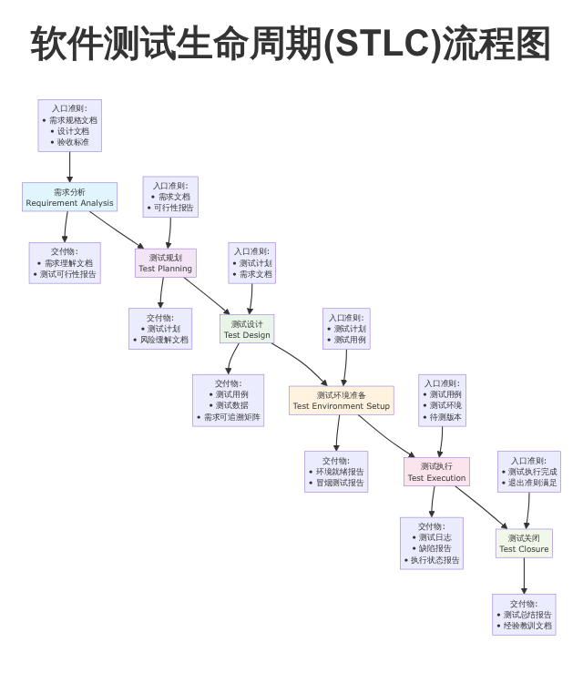
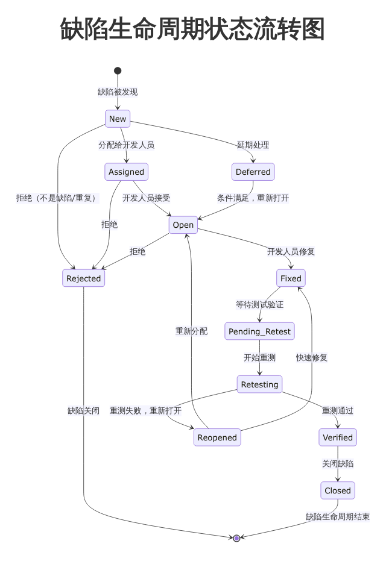
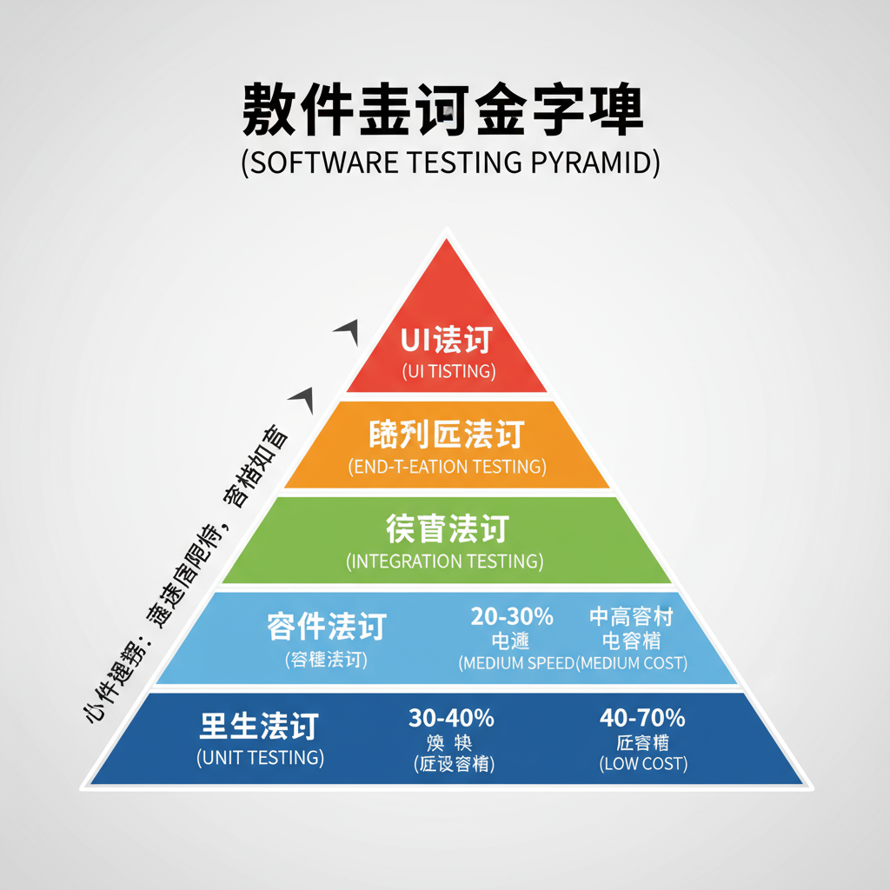
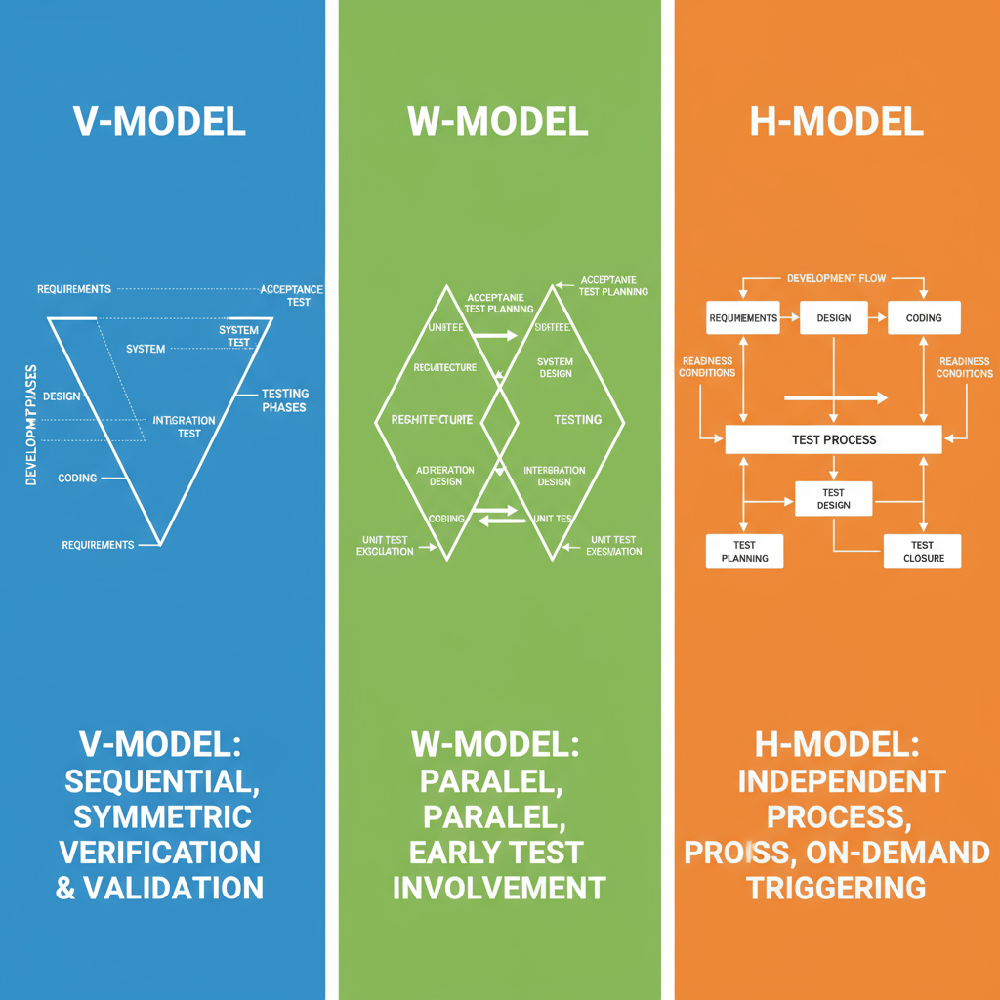

# 软件测试课程笔记总结

## 前言

本笔记旨在全面、系统地梳理软件测试的核心知识体系，整合了从基础理论到高级实践的各类主题。内容涵盖软件测试的定义与原则、主流测试模型、生命周期（STLC）、各类测试方法（黑盒、白盒、灰盒）、测试管理流程、自动化工具与框架、软件质量保证（SQA）体系以及相关的国际标准（如ISTQB、IEEE、ISO）。

本总结适合软件测试工程师、质量保证人员、开发工程师、项目经理以及希望系统学习软件测试知识的在校学生。笔记结构清晰，重点突出，包含了大量的表格、案例、代码示例和实用模板，旨在为读者提供一份既能用于考前复-习，又能指导实际工作的综合手册。

---

## 第一章：软件测试基础理论

### 1.1 软件测试的定义、目标与原则

**定义**:
软件测试是为发现软件产品中的缺陷（Defect/Bug）而执行程序或应用的过程。它包含两大核心活动：
- **动态测试 (Dynamic Testing)**: 实际运行软件，通过输入数据并观察输出来验证其行为是否符合预期。
- **静态测试 (Static Testing)**: 在不运行代码的情况下，通过评审（Review）、静态分析（Static Analysis）等手段检查软件工作产品（如需求文档、设计文档、代码）。

**验证 (Verification) vs. 确认 (Validation)**:
- **验证**: 确保我们“正确地构建了产品”（Are we building the product right?）。它关注产品是否符合其规格、设计和开发标准。这通常是静态测试的范畴。
- **确认**: 确保我们“构建了正确的产品”（Are we building the right product?）。它关注产品是否满足用户的真实需求和业务目标。这通常是动态测试的范畴。

**核心目标**:
以最小的成本和资源投入，最大限度地发现软件中的缺陷，并为软件质量提供客观、量化的评估，从而为发布决策提供信心。

**七大测试原则**:
1.  **测试应显示缺陷的存在 (Testing shows presence of defects)**: 测试可以证明缺陷存在，但不能证明缺陷不存在。
2.  **穷尽测试是不可能的 (Exhaustive testing is impossible)**: 对所有输入、组合和路径进行完全测试在实践中是不可行的，必须基于风险和优先级进行选择。
3.  **早期测试 (Early testing)**: 测试活动应尽早开始，最好在需求和设计阶段就介入，这样可以显著降低缺陷修复的成本。
4.  **缺陷集群 (Defect clustering)**: 大多数缺陷往往集中在少数模块中，即遵循“二八定律”。测试资源应向这些高风险区域倾斜。
5.  **杀虫剂悖论 (Pesticide paradox)**: 如果反复使用相同的测试用例，它们将不再能有效地发现新的缺陷。测试用例需要定期评审和更新。
6.  **测试活动依赖于上下文 (Testing is context dependent)**: 不同的软件系统（如电商、医疗、航空）需要不同的测试方法、策略和强度。
7.  **不存在缺陷的谬论 (Absence-of-errors fallacy)**: 即使软件没有发现任何缺陷，如果它不满足用户需求，那么它仍然是不可用的。

### 1.2 软件测试模型

测试模型为开发过程与测试活动的结合提供了框架。

| 模型 | 核心理念 | 测试介入时机 | 优势 | 局限 | 适用场景 |
| :--- | :--- | :--- | :--- | :--- | :--- |
| **V模型** | 开发与测试阶段一一映射，验证与确认对称。 | 编码完成后，按预定映射执行各层级测试。 | 阶段清晰，映射明确，便于计划和管理。 | 对需求变更敏感，后期返工成本高。 | 需求稳定的瀑布式项目，如传统行业或合规驱动的项目。 |
| **W模型** | 开发与测试并行，强调“测试伴随开发”。 | 从需求、设计阶段即开始介入，贯穿整个生命周期。 | 尽早发现缺陷，降低修复成本，适配迭代开发。 | 需要更强的跨职能协作与过程治理。 | 迭代式开发、增量交付、质量前移的组织。 |
| **H模型** | 测试是一个独立的流程，可根据就绪条件随时触发。 | 独立于开发，按“测试就绪”条件触发。 | 灵活，高度适配敏捷/DevOps，强调测试的独立性。 | 需要成熟的测试治理和度量体系来支撑。 | 敏捷团队、持续集成/交付（CI/CD）、测试服务中心化的组织。 |

<details>
<summary><b>测试模型深度对比分析 (点击展开)</b></summary>

**V模型 vs W模型 vs H模型优缺点详细分析**:

**V模型详细分析**:
- **优势**:
  - 阶段划分清晰，每个开发阶段都有对应的测试活动
  - 便于项目管理和进度跟踪
  - 适合需求稳定的项目
  - 验证（Verification）和确认（Validation）概念明确
- **劣势**:
  - 需求变更时调整成本高
  - 测试活动过于依赖前序阶段完成
  - 缺陷发现较晚，修复成本高
  - 不适合敏捷开发模式

**W模型详细分析**:
- **优势**:
  - 测试活动与开发活动并行进行
  - 尽早发现需求和设计缺陷
  - 适合迭代式开发
  - 降低缺陷修复成本
- **劣势**:
  - 需要更多的测试资源投入
  - 对团队协作要求更高
  - 项目管理复杂度增加
  - 需要更成熟的测试团队

**H模型详细分析**:
- **优势**:
  - 测试活动完全独立于开发
  - 高度灵活的测试触发机制
  - 完美适配敏捷和DevOps
  - 支持持续集成和持续交付
- **劣势**:
  - 需要成熟的测试治理体系
  - 对测试人员技能要求高
  - 需要完善的度量体系支撑
  - 初期建设成本较高

**选择建议**:
- **传统瀑布项目**: 选择V模型
- **敏捷迭代项目**: 选择W模型
- **DevOps/CI/CD项目**: 选择H模型
</details>

**模型图示**:


### 1.3 软件测试生命周期 (STLC)

STLC（Software Testing Life Cycle）将测试活动组织为一系列有序、可审计的阶段。

| 阶段 | 入口准则 | 关键活动 | 交付物 |
| :--- | :--- | :--- | :--- |
| **需求分析** | 需求规格、设计文档、验收标准可用 | 评审需求、评估可测试性与自动化可行性 | 需求理解文档、测试可行性报告 |
| **测试规划** | 需求文档、可行性报告 | 定义范围、风险分析、资源估算、制定策略 | **测试计划**、风险缓解文档 |
| **测试设计** | 测试计划、需求文档 | 设计测试场景、识别测试数据、建立可追溯性 | **测试用例**、测试数据、需求可追溯矩阵 |
| **测试环境准备** | 测试计划、测试用例 | 搭建硬件、软件环境，准备测试数据 | 环境就绪报告、冒烟测试报告 |
| **测试执行** | 测试用例、测试环境、待测版本 | 按计划执行用例、记录结果、提交缺陷 | **测试日志**、**缺陷报告**、执行状态报告 |
| **测试关闭** | 测试执行完成、退出准则满足 | 总结测试活动、评估质量、归档文档 | **测试总结报告**、经验教训文档 |

### 1.4 软件缺陷理论

**缺陷 (Defect) vs. 错误 (Error) vs. 失效 (Failure)**
- **错误 (Error)**: 人（如开发者）犯下的错误，导致代码或设计中出现问题。
- **缺陷 (Defect/Bug)**: 错误在软件产品（代码、文档）中留下的具体问题。
- **失效 (Failure)**: 缺陷在软件运行时被触发，导致系统行为偏离预期，是缺陷的外部表现。

**严重性 (Severity) vs. 优先级 (Priority)**
这是缺陷最重要的两个属性，但含义不同。

| 属性 | 定义 | 衡量标准 | 负责人 | 示例 |
| :--- | :--- | :--- | :--- | :--- |
| **严重性 (Severity)** | 缺陷对系统功能或业务的技术影响程度。 | 技术影响、数据丢失、系统崩溃、安全漏洞等。 | 测试人员/QA | **高严重性**: 系统崩溃、支付金额计算错误。 **低严重性**: 官网Logo拼写错误。 |
| **优先级 (Priority)** | 缺陷需要被修复的紧急程度。 | 业务影响、用户体验、发布计划、修复成本等。 | 产品经理/项目经理 | **高优先级**: 首页打不开。 **低优先级**: 某个不常用功能的UI错位。 |

**常见组合与处理策略**:
- **高严重性 & 高优先级**: 立即修复，如系统崩溃或核心功能阻塞。
- **高严重性 & 低优先级**: 技术影响大，但业务影响小或有替代方案，可计划修复，如某个后台定时任务在特定条件下失败。
- **低严重性 & 高优先级**: 技术影响小，但业务或品牌影响大，如公司名称在首页拼写错误。
- **低严重性 & 低优先级**: 对功能和业务影响都很小，排入Backlog，有资源时修复。

<details>
<summary><b>缺陷严重性优先级矩阵详细案例分析 (点击展开)</b></summary>

**真实案例分析**:

**案例1: 高严重性 + 高优先级**
- **场景**: 电商网站支付功能无法正常工作
- **严重性**: Critical - 用户无法完成支付交易
- **优先级**: P0 - 必须立即修复
- **处理策略**: 立即停止发布，召集开发团队紧急修复
- **业务影响**: 直接影响收入，用户无法购买商品

**案例2: 高严重性 + 低优先级**
- **场景**: 后台管理系统中某个报表在特定日期（2月30日）计算错误
- **严重性**: Major - 逻辑错误，但实际不会发生（因为2月没有30日）
- **优先级**: P3 - 可以延后处理
- **处理策略**: 计划在下个版本中修复，添加日期验证逻辑
- **业务影响**: 技术债务，但不影响实际业务

**案例3: 低严重性 + 高优先级**
- **场景**: 公司官网首页Logo中的公司名称拼写错误
- **严重性**: Minor - 纯显示问题，不影响功能
- **优先级**: P1 - 需要尽快修复
- **处理策略**: 立即修复并重新部署
- **业务影响**: 品牌形象受损，可能影响客户信任

**案例4: 低严重性 + 低优先级**
- **场景**: 用户个人资料页面某个不常用字段的字体颜色稍深
- **严重性**: Trivial - 纯UI美观问题
- **优先级**: P4 - 有时间再处理
- **处理策略**: 加入Backlog，在资源充足时处理
- **业务影响**: 用户体验略有影响，但不阻塞核心功能

**决策矩阵**:
| 严重性\优先级 | P0 | P1 | P2 | P3 | P4 |
|-------------|----|----|----|----|----|
| **Critical** | 🔥立即修复 | 🚨当日修复 | ⚡本周修复 | 📅计划修复 | 📋延后处理 |
| **Major** | 🚨当日修复 | ⚡本周修复 | 📅本迭代修复 | 📋下个版本 | 📝Backlog |
| **Minor** | ⚡本周修复 | 📅本迭代修复 | 📋下个版本 | 📝Backlog | 📝Backlog |
| **Trivial** | 📅本迭代修复 | 📋下个版本 | 📝Backlog | 📝Backlog | 📝Backlog |
</details>

**缺陷生命周期**:
缺陷从被发现到最终关闭所经历的状态流转过程。
`New` → `Assigned` → `Open` → `Fixed` → `Pending Retest` → `Retesting` → `Verified` → `Closed`


---

## 第二章：测试方法与技术

### 2.1 国际标准与知识体系

- **ISTQB (International Software Testing Qualifications Board)**: 全球最权威的软件测试认证机构，其知识体系是测试行业的通用语言和最佳实践指南。
- **IEEE 829**: 软件和系统测试文档标准，规范了测试计划、设计、用例、报告等8种文档模板。
- **IEEE 1028**: 软件审查和审计标准，定义了管理评审、技术评审、检查、走查等评审类型。

### 2.2 黑盒测试方法

黑盒测试不关心软件内部结构，只关注其输入和输出。

#### 2.2.1 等价类划分法 (Equivalence Partitioning)
将输入数据划分为若干个“等价类”，假设每个等价类中的任意一个数据都能代表整个类的测试效果。

**数学定义**:
设输入域为 $D$，等价类划分为 $P = \{E_1, E_2, ..., E_n\}$，其中：
- $E_i$ 是 $D$ 的子集
- $\bigcup_{i=1}^{n} E_i = D$ （完全覆盖）
- $E_i \cap E_j = \emptyset$ （互斥），当 $i \neq j$

**有效等价类**: 符合需求的输入数据集合 $E_{valid}$
**无效等价类**: 不符合需求的输入数据集合 $E_{invalid}$

**用例数量计算**:
对于 $n$ 个有效等价类和 $m$ 个无效等价类：
$$T_{total} = n + m$$
其中每个等价类至少需要1个测试用例。

**案例**: 一个密码输入框要求长度为6-12位的字母和数字组合。
- **有效等价类**: 长度为8位的字母数字组合（如 `Test2025`）。
- **无效等价类**:
  - 长度小于6位（如 `a12`）。
  - 长度大于12位（如 `TestAutomation12345`）。
  - 包含特殊字符（如 `Test@123`）。

#### 2.2.2 边界值分析法 (Boundary Value Analysis)
大量的缺陷发生在输入或输出范围的边界上。此方法是等价类划分的补充。
**原则**:
- **上点**: 边界上的点。
- **离点**: 离边界最近的点。
- **内点**: 边界范围内的任意一点。

**案例**: 一个接受1到100整数的输入框。
- **边界值**: 0, 1, 2, 99, 100, 101。

<details>
<summary><b>等价类与边界值结合案例推导 (点击展开)</b></summary>
<p>
假设一个功能要求输入年龄范围在 [18, 60] 之间。

1.  **划分等价类**:
    - **有效等价类**: `[18, 60]`
    - **无效等价类1**: `< 18`
    - **无效等价类2**: `> 60`

2.  **确定边界值**:
    - 最小值: 18
    - 最大值: 60

3.  **设计测试用例**:
    - **覆盖无效等价类1**:
      - 边界值: 17
    - **覆盖有效等价类**:
      - 边界值: 18 (下边界上点)
      - 边界值: 19 (下边界离点)
      - 内部任意值: 35
      - 边界值: 59 (上边界离点)
      - 边界值: 60 (上边界上点)
    - **覆盖无效等价类2**:
      - 边界值: 61

最终用例集: `{17, 18, 19, 35, 59, 60, 61}`
</p>
</details>

#### 2.2.3 决策表测试法 (Decision Table Testing)
适用于处理多个输入条件组合决定不同动作的复杂业务逻辑。

| 条件桩 | 规则1 | 规则2 | 规则3 | 规则4 |
| :--- | :---: | :---: | :---: | :---: |
| C1: 用户名正确 | Y | Y | N | N |
| C2: 密码正确 | Y | N | Y | N |
| **动作桩** | | | | |
| A1: 登录成功 | X | | | |
| A2: 提示密码错误 | | X | | |
| A3: 提示用户名错误 | | | X | X |

#### 2.2.4 状态转换测试法 (State Transition Testing)
适用于测试对象具有明确状态变化的系统，如订单状态（待支付、已支付、已发货、已完成）、用户登录状态等。
- **核心元素**: 状态、事件、转换、动作。
- **测试覆盖**: 覆盖所有状态、所有转换、特定路径。

<details>
<summary><b>状态转换测试实例推导 (点击展开)</b></summary>

**电商订单状态转换实例**:

**状态定义**:
- S1: 待支付 (Pending Payment)
- S2: 已支付 (Paid)
- S3: 已发货 (Shipped)
- S4: 已完成 (Completed)
- S5: 已取消 (Cancelled)
- S6: 退款中 (Refunding)
- S7: 已退款 (Refunded)

**事件定义**:
- E1: 用户支付成功
- E2: 商家发货
- E3: 用户确认收货
- E4: 用户申请退款
- E5: 商家同意退款
- E6: 用户取消订单
- E7: 系统自动取消（超时）

**状态转换表**:
| 当前状态 | 事件 | 下一状态 | 条件/说明 |
|---------|------|---------|----------|
| 待支付 | 用户支付成功 | 已支付 | 支付渠道验证通过 |
| 已支付 | 商家发货 | 已发货 | 物流单号生成 |
| 已支付 | 用户申请退款 | 退款中 | 退款原因记录 |
| 已发货 | 用户确认收货 | 已完成 | 自动评价触发 |
| 已发货 | 用户申请退款 | 退款中 | 需商家处理 |
| 退款中 | 商家同意退款 | 已退款 | 退款流程完成 |
| 待支付 | 用户取消订单 | 已取消 | 订单关闭 |
| 待支付 | 系统自动取消 | 已取消 | 24小时未支付 |

**测试用例设计**:

**用例1: 正常流程**
- 路径: S1 → E1 → S2 → E2 → S3 → E3 → S4
- 测试数据: 正常用户、正常商品、正常支付
- 预期: 所有状态转换正确

**用例2: 支付后退款**
- 路径: S1 → E1 → S2 → E4 → S6 → E5 → S7
- 测试数据: 支付成功后立即申请退款
- 预期: 退款流程正常

**用例3: 发货后退款**
- 路径: S1 → E1 → S2 → E2 → S3 → E4 → S6 → E5 → S7
- 测试数据: 已发货后申请退款
- 预期: 需要商家处理，可能产生物流费用

**用例4: 取消订单**
- 路径: S1 → E6 → S5
- 测试数据: 用户主动取消
- 预期: 订单关闭，库存释放

**用例5: 超时自动取消**
- 路径: S1 → E7 → S5
- 测试数据: 模拟24小时超时
- 预期: 系统自动取消订单

**覆盖分析**:
- **状态覆盖**: 覆盖所有7个状态
- **转换覆盖**: 覆盖所有8个转换
- **路径覆盖**: 覆盖主要业务流程路径
- **异常覆盖**: 覆盖各种异常情况

**关键测试点**:
1. 状态转换的合法性检查
2. 不允许的转换是否被正确阻止
3. 状态转换时的数据一致性
4. 并发操作对状态的影响
5. 状态转换日志的完整性
</details>


#### 2.2.5 场景法 (Use Case / Scenario Testing)
通过模拟用户实际操作的业务流程来设计测试用例。
- **基本流**: 用户成功完成核心业务的路径。
- **备选流**: 过程中可能出现的各种异常或分支路径。

<details>
<summary><b>场景法测试设计完整实例 (点击展开)</b></summary>

**在线购物系统完整用例分析**:

**用例名称**: 用户购买商品

**参与者**:
- 主要参与者: 购物用户
- 次要参与者: 支付系统、库存系统、商家系统

**前置条件**:
- 用户已登录系统
- 用户有可用的收货地址
- 商品库存充足
- 支付系统正常运行

**基本流 (Happy Path)**:
1. 用户浏览商品列表
2. 用户选择商品并查看详情
3. 用户点击"加入购物车"
4. 系统确认商品已加入购物车
5. 用户进入购物车页面
6. 用户点击"去结算"
7. 用户选择收货地址
8. 用户选择支付方式
9. 用户确认订单信息
10. 用户点击"提交订单"
11. 系统跳转到支付页面
12. 用户完成支付
13. 系统确认支付成功
14. 系统生成订单并发送确认邮件
15. 订单状态更新为"已支付"

**备选流**:

**备选流1: 库存不足**
- 步骤3后，系统检查库存发现不足
- 系统提示"商品库存不足"
- 用户可选择等待补货或取消购买

**备选流2: 优惠券无效**
- 步骤8，用户输入优惠券代码
- 系统验证优惠券无效
- 系统提示"优惠券已过期/不存在"
- 用户可选择不使用优惠券

**备选流3: 支付失败**
- 步骤12，支付系统返回失败
- 系统提示"支付失败，请重试"
- 用户可选择其他支付方式或取消订单

**备选流4: 收货地址异常**
- 步骤7，用户选择的地址无效
- 系统提示"地址信息不完整"
- 用户需要重新选择或添加地址

**备选流5: 网络超时**
- 步骤10，提交订单时网络超时
- 系统提示"网络异常，订单提交失败"
- 用户可选择重试或稍后重试

**异常流**:

**异常流1: 系统崩溃**
- 任意步骤系统崩溃
- 系统恢复后提示用户重新操作
- 用户可查看是否有未完成的订单

**异常流2: 用户会话过期**
- 步骤10，用户会话已过期
- 系统提示用户重新登录
- 登录后恢复购物车状态

**场景测试用例**:

**场景1: 首次购买用户**
- 基本流 + 备选流4 (需要添加新地址)
- 预期: 引导用户完善个人信息

**场景2: 频繁购买用户**
- 基本流 (使用常用地址和支付方式)
- 预期: 快速完成购买流程

**场景3: 促销期间购买**
- 基本流 + 备选流2 (优惠券验证)
- 预期: 正确计算折扣

**场景4: 高价值商品购买**
- 基本流 + 额外的身份验证步骤
- 预期: 加强安全验证

**场景5: 移动端购买**
- 基本流在移动设备上执行
- 预期: 适配移动端界面

**场景6: 跨境购买**
- 基本流 + 海关申报 + 国际物流
- 预期: 处理跨境特殊要求

**场景法测试要点**:
1. **用户角色多样化**: 不同类型的用户有不同的使用习惯
2. **环境因素**: 网络、设备、时间等外部因素
3. **业务规则**: 各种业务约束和限制条件
4. **异常处理**: 系统如何优雅地处理各种异常情况
5. **用户体验**: 整个流程的易用性和流畅性
</details>

**案例**: 电商购物
- **基本流**: 浏览商品 → 添加购物车 → 下单 → 支付成功。
- **备选流**:
  - 库存不足。
  - 优惠券无效。
  - 支付密码错误。
  - 网络超时。

### 2.3 白盒测试方法

白盒测试关注软件内部的逻辑结构和代码实现。

#### 2.3.1 逻辑覆盖法
不同强度的覆盖标准，强度从弱到强依次为：

1.  **语句覆盖 (Statement Coverage)**: 确保代码中每条可执行语句至少被执行一次。 **最弱的覆盖**。
2.  **判定覆盖 (Decision Coverage) / 分支覆盖 (Branch Coverage)**: 确保每个判断语句（如if, while）的每个分支（真/假）至少被执行一次。
3.  **条件覆盖 (Condition Coverage)**: 确保每个判断语句中，每个布尔子条件的真假值都至少被执行一次。
4.  **判定/条件覆盖 (Decision/Condition Coverage)**: 同时满足判定覆盖和条件覆盖。
5.  **组合覆盖 (Multiple Condition Coverage)**: 确保每个判断语句中所有子条件的可能组合都被覆盖。
6.  **路径覆盖 (Path Coverage)**: 确保程序中每条可能的执行路径都至少被执行一次。**最强的覆盖，但通常不可行**。

**代码示例**:
```java
public int example(int x, int y) {
    int z = 0;
    if (x > 0 && y > 0) {  // 判定1
        z = x;
    }
    if (x > 5 || z < 0) {  // 判定2
        z = y;
    }
    return z;
}
```
<details>
<summary><b>白盒覆盖推导 (点击展开)</b></summary>
<p>
- **语句覆盖**: 只需一组输入如 `x=6, y=1` 即可覆盖所有语句。
- **判定覆盖**:
  - `x=6, y=1` (判定1为真, 判定2为真)
  - `x=-1, y=-1` (判定1为假, 判定2为假)
- **条件覆盖**:
  - `x>0` (真/假), `y>0` (真/假), `x>5` (真/假), `z<0` (真/假)
  - 需要设计用例使每个子条件都取过true和false。
- **路径覆盖**: 需要覆盖所有可能的路径组合，对于这个简单例子，有4条路径。
</p>
</details>

<details>
<summary><b>测试覆盖率计算详细推导过程 (点击展开)</b></summary>

**完整覆盖分析**:

**1. 语句覆盖 (Statement Coverage)**
- **定义**: 每条可执行语句至少被执行一次
- **分析**: 代码共有6条可执行语句（不包括变量声明）
  1. `int z = 0;`
  2. `if (x > 0 && y > 0)`
  3. `z = x;`
  4. `if (x > 5 || z < 0)`
  5. `z = y;`
  6. `return z;`
- **测试用例**: `x=6, y=1`
  - 判定1: `6>0 && 1>0` = true, 执行语句3
  - 判定2: `6>5 || 0<0` = true, 执行语句5
  - 覆盖所有语句
- **覆盖率**: 100%

**2. 判定覆盖 (Decision Coverage)**
- **定义**: 每个判定的真分支和假分支都要被执行
- **判定1的分支**:
  - 真分支: `x>0 && y>0` = true
  - 假分支: `x>0 && y>0` = false
- **判定2的分支**:
  - 真分支: `x>5 || z<0` = true
  - 假分支: `x>5 || z<0` = false
- **测试用例**:
  - 用例1: `x=6, y=1` → 判定1=true, 判定2=true
  - 用例2: `x=-1, y=-1` → 判定1=false, 判定2=false
- **覆盖率**: 100%

**3. 条件覆盖 (Condition Coverage)**
- **定义**: 每个条件的真值和假值都要出现
- **条件分析**:
  - 条件1: `x>0`
  - 条件2: `y>0`
  - 条件3: `x>5`
  - 条件4: `z<0`
- **测试用例设计**:
  - 用例1: `x=6, y=1` → x>0=true, y>0=true, x>5=true, z<0=false
  - 用例2: `x=3, y=-1` → x>0=true, y>0=false, x>5=false, z<0=false
  - 用例3: `x=-1, y=1` → x>0=false, y>0=true, x>5=false, z<0=false
- **覆盖率**: 100%

**4. 路径覆盖 (Path Coverage)**
- **定义**: 每条可能的执行路径都要被执行
- **路径分析**:
  - 路径1: 判定1=false, 判定2=false → `(x≤0 || y≤0) && !(x>5 || z<0)`
  - 路径2: 判定1=false, 判定2=true → `(x≤0 || y≤0) && (x>5 || z<0)`
  - 路径3: 判定1=true, 判定2=false → `(x>0 && y>0) && !(x>5 || z<0)`
  - 路径4: 判定1=true, 判定2=true → `(x>0 && y>0) && (x>5 || z<0)`
- **测试用例**:
  - 路径1: `x=-1, y=-1`
  - 路径2: `x=6, y=-1` (注意：y=-1时，判定1=false，但x=6>5，判定2=true)
  - 路径3: `x=3, y=3` (x>0 && y>0=true, 但x=3不>5，z初始=0不<0)
  - 路径4: `x=6, y=1`
- **覆盖率**: 100%

**覆盖强度对比**:
- 语句覆盖: 最容易达到，但质量最低
- 判定覆盖: 比语句覆盖强，能发现更多逻辑错误
- 条件覆盖: 比判定覆盖更强，考虑了复合条件
- 路径覆盖: 最强，但成本最高

**实际应用建议**:
- 单元测试: 至少达到判定覆盖，推荐条件覆盖
- 集成测试: 关注接口和模块间的交互
- 系统测试: 关注业务流程和用户场景
</details>

#### 2.3.2 测试覆盖率计算与行业标准

**覆盖率计算公式**:

- **语句覆盖率 (Statement Coverage)**:
  $$SC = \frac{\text{已执行的语句数}}{\text{总语句数}} \times 100\%$$

- **分支覆盖率 (Branch Coverage)**:
  $$BC = \frac{\text{已执行的分支数}}{\text{总分支数}} \times 100\%$$

- **条件覆盖率 (Condition Coverage)**:
  $$CC = \frac{\text{已执行的条件取值数}}{\text{总条件取值数}} \times 100\%$$

- **路径覆盖率 (Path Coverage)**:
  $$PC = \frac{\text{已执行的路径数}}{\text{总路径数}} \times 100\%$$

**修改条件/判定覆盖 (MC/DC)**:
对于n个条件的判定，每个条件必须独立影响判定结果：
$$MC/DC = \frac{\text{满足MC/DC的判定数}}{\text{总判定数}} \times 100\%$$

| 测试阶段 | 行业标准 (通用) | 关键模块要求 | 强制性行业标准 (如航空、医疗) |
| :--- | :--- | :--- | :--- |
| **单元测试** | 语句覆盖 ≥ 80% | 分支覆盖 ≥ 85% | 100% MC/DC (修改条件/判定覆盖) |
| **集成测试** | 接口覆盖 ≥ 100% | 核心场景覆盖 100% | 功能覆盖 ≥ 100% |
| **系统测试** | 核心业务流程覆盖 100% | 异常场景覆盖 ≥ 90% | 按需定义 |

**覆盖强度关系**:
$$路径覆盖 > 组合覆盖 > 判定/条件覆盖 > 判定覆盖 > 语句覆盖$$

### 2.4 灰盒测试方法

灰盒测试介于黑盒与白盒之间，测试人员对软件内部结构有部分了解（如了解数据库表结构、接口定义），但仍然从外部视角进行测试。常用于集成测试和接口测试。

<details>
<summary><b>灰盒测试实战应用案例 (点击展开)</b></summary>

**RESTful API接口测试实例**:

**背景**: 测试用户管理系统的增删改查API

**黑盒视角**: 只关注输入参数和返回结果
**白盒视角**: 查看数据库操作和内部逻辑
**灰盒视角**: 了解API的数据库表结构，但仍然通过HTTP请求测试

**API信息 (灰盒知识)**:
- 接口路径: `/api/users`
- 数据库表: `users` (id, username, email, status, created_at)
- 鉴权方式: JWT Token

**测试用例设计**:

**用例1: 创建用户 (POST /api/users)**
- **输入**: `{ "username": "testuser", "email": "test@example.com", "password": "123456" }`
- **预期输出**: `{ "id": 123, "username": "testuser", "email": "test@example.com", "status": "active" }`
- **数据库验证**: 检查users表中是否插入新记录
- **灰盒优势**: 可以验证数据库字段的默认值设置

**用例2: 查询用户 (GET /api/users/123)**
- **输入**: 用户ID 123
- **预期输出**: 用户基本信息
- **数据库验证**: 验证返回的数据与数据库一致
- **灰盒优势**: 可以检查是否有不必要的敏感字段泄露

**用例3: 更新用户 (PUT /api/users/123)**
- **输入**: `{ "email": "newemail@example.com" }`
- **预期输出**: 更新后的用户信息
- **数据库验证**: 验证数据库中的email字段已更新
- **灰盒优势**: 可以检查更新时间戳是否正确更新

**用例4: 删除用户 (DELETE /api/users/123)**
- **输入**: 用户ID 123
- **预期输出**: `{ "message": "User deleted successfully" }`
- **数据库验证**: 验证用户记录是否真正删除（或标记为删除）
- **灰盒优势**: 可以检查软删除vs硬删除的实现

**灰盒测试的优势**:

1. **数据一致性验证**
   - API返回的数据与数据库实际存储一致
   - 字段类型、长度、格式符合数据库设计

2. **权限控制验证**
   - 通过数据库查询验证用户权限
   - 检查越权访问是否被正确阻止

3. **事务完整性**
   - 验证相关操作是否在同一事务中
   - 检查失败时的回滚机制

4. **性能问题定位**
   - 结合数据库查询日志分析慢查询
   - 识别N+1查询问题

5. **安全性检查**
   - 验证SQL注入防护
   - 检查敏感数据是否被正确过滤

**灰盒测试的最佳实践**:

1. **了解系统架构**
   - 数据库设计
   - 微服务依赖关系
   - 缓存策略

2. **设计针对性测试**
   - 基于数据流设计测试用例
   - 考虑边界条件和异常情况

3. **结合监控工具**
   - 数据库性能监控
   - API调用日志分析
   - 错误追踪系统

4. **自动化灰盒测试**
   - API测试 + 数据库断言
   - 数据一致性检查
   - 性能基线测试
</details>

---

## 第三章：测试管理流程

### 3.1 测试管理框架与角色 (RACI)

**RACI矩阵** 定义了不同角色在各项活动中的职责。
- **R (Responsible)**: 负责执行。
- **A (Accountable)**: 最终负责人。
- **C (Consulted)**: 需要被咨询。
- **I (Informed)**: 需要被告知。

| 活动 | 测试经理 | 测试负责人 | 测试工程师 | 开发 | 产品 |
| :--- | :---: | :---: | :---: | :---: | :---: |
| **测试计划** | A | R | C | C | C |
| **用例设计** | C | A | R | C | C |
| **测试执行** | I | R | R | I | I |
| **缺陷管理** | A | R | R | R | C |
| **测试报告** | A | R | C | I | C |

### 3.2 测试计划

测试计划是指导整个测试过程的纲领性文件。
**核心要素**:
1.  **测试范围**: 测什么，不测什么。
2.  **测试策略**: 测试方法、层级、自动化策略。
3.  **资源计划**: 人员、硬件、软件、工具。
4.  **进度与里程碑**: 时间表、入口准则、出口准则。
5.  **风险管理**: 识别风险并制定应对措施。

**风险评估矩阵模型**:

**风险值计算**:
$$R = P \times I$$
其中：
- $P$ = 风险发生概率 $(0 \leq P \leq 1)$
- $I$ = 风险影响程度 $(1 \leq I \leq 5)$

**风险等级分类**:
$$R \geq 15: \text{高风险}$$
$$5 \leq R < 15: \text{中风险}$$
$$R < 5: \text{低风险}$$

**风险矩阵**:
| 影响\概率 | 很低(0.2) | 低(0.4) | 中(0.6) | 高(0.8) | 很高(1.0) |
| :--- | :---: | :---: | :---: | :---: | :---: |
| **很高(5)** | 1.0 | 2.0 | 3.0 | 4.0 | **5.0** |
| **高(4)** | 0.8 | 1.6 | 2.4 | **3.2** | 4.0 |
| **中(3)** | 0.6 | 1.2 | **1.8** | 2.4 | 3.0 |
| **低(2)** | 0.4 | **0.8** | 1.2 | 1.6 | 2.0 |
| **很低(1)** | **0.2** | 0.4 | 0.6 | 0.8 | 1.0 |
6.  **度量指标**: 定义KPI，如覆盖率、缺陷密度。

**出口准则 (Exit Criteria) 示例**:
- 所有P0、P1级用例100%执行完毕。
- 回归测试通过率 ≥ 98%。
- 不存在未解决的Blocker或Critical级别的缺陷。
- 代码覆盖率达到预定目标（如85%）。

### 3.3 测试用例管理

- **用例模板**: 包含用例ID、模块、优先级、前置条件、步骤、预期结果、实际结果等字段。
- **用例评审**: 通过同行评审、交叉评审确保用例的准确性、覆盖度和可执行性。
- **版本控制**: 使用测试管理工具（如Zephyr, TestRail, ONES）对用例进行版本管理。

### 3.4 缺陷管理

- **缺陷报告模板**: 包含ID、标题、模块、版本、严重性、优先级、复现步骤、截图/日志等。
- **缺陷生命周期管理**: 遵循标准状态流转，使用Jira等工具进行跟踪。
- **缺陷分诊会议 (Triage Meeting)**: 定期召开会议，由产品、开发、测试共同决定缺陷的优先级和修复计划。

### 3.5 测试报告

**核心内容**:
1.  **执行摘要**: 质量总体评估和发布建议。
2.  **测试概览**: 范围、资源、时间。
3.  **用例执行统计**: 执行率、通过率。
4.  **缺陷分析**:
    - 按严重性/优先级分布。
    - 按模块分布（识别质量重灾区）。
    - 缺陷趋势（新增 vs. 解决）。

**缺陷密度计算**:
$$DD = \frac{\text{发现的缺陷总数}}{\text{代码行数(KLOC)}} \text{（缺陷/千行代码）}$$

**缺陷移除效率 (DRE)**:
$$DRE = \frac{\text{测试阶段发现的缺陷数}}{\text{测试阶段发现的缺陷数} + \text{用户发现的缺陷数}} \times 100\%$$

**缺陷分布分析**:
按模块的缺陷密度：
$$DD_i = \frac{\text{模块}i\text{的缺陷数}}{\text{模块}i\text{的代码行数(KLOC)}}$$

**缺陷趋势指标**:
- 缺陷发现率: $DR = \frac{\text{时间期内发现缺陷数}}{\text{时间期}}$
- 缺陷解决率: $FR = \frac{\text{时间期内解决缺陷数}}{\text{时间期内发现缺陷数}} \times 100\%$
5.  **遗留风险**: 未解决的缺陷及其业务影响。

---

## 第四章：测试工具与自动化

### 4.1 工具选型方法论

选择工具时应综合考虑以下九大标准：
1.  **项目需求**
2.  **技术栈匹配**
3.  **框架成熟度与社区支持**
4.  **可扩展性**
5.  **学习曲线**
6.  **CI/CD集成能力**
7.  **商业支持与成本**
8.  **维护成本**
9.  **未来趋势**

### 4.2 Web自动化框架对比

| 维度 | Selenium | Cypress | Playwright |
| :--- | :--- | :--- | :--- |
| **核心优势** | 跨浏览器/语言最广、生态成熟 | 开发体验佳、调试方便、自动等待 | 性能高、自动等待、跨浏览器原生支持 |
| **浏览器支持** | 几乎所有浏览器 | Chromium内核为主 | Chrome, Firefox, WebKit(Safari) |
| **执行速度** | 较慢 | 快 | 非常快 |
| **自动等待** | 需要手动添加显式/隐式等待 | 内置自动等待和重试机制 | 内置智能的自动等待 |
| **适用场景** | 企业级大型回归测试、广兼容性测试 | 前端开发驱动的测试、现代Web应用 | 复杂单页应用（SPA）、CI/CD中的高效执行 |

**选型建议**:
- **新项目、追求效率**: 优先 **Playwright**。
- **开发团队自测、重视调试**: 优先 **Cypress**。
- **需要广泛浏览器兼容性、已有大量资产**: 坚持 **Selenium**。

<details>
<summary><b>自动化框架详细对比与选型决策树 (点击展开)</b></summary>

**详细技术对比**:

**Selenium 深度分析**:
- **架构**: WebDriver协议，浏览器驱动模式
- **优势**:
  - 生态最成熟，20+年历史
  - 支持Java, Python, C#, Ruby, JavaScript等所有主流语言
  - 支持IE, Chrome, Firefox, Safari等所有浏览器
  - 社区庞大，问题解决方案丰富
  - 与各种测试框架和CI/CD工具集成完善
- **劣势**:
  - 需要手动处理等待机制
  - 执行速度相对较慢
  - 跨浏览器一致性需要额外处理
  - 移动端支持需要额外配置
- **最佳实践**:
  - 使用Page Object模式
  - 统一等待策略
  - 配合TestNG/JUnit使用

**Cypress 深度分析**:
- **架构**: 浏览器内运行，直接操作DOM
- **优势**:
  - 开发体验极佳，内置调试工具
  - 自动等待，无需手动处理
  - 实时重载，修改代码自动重跑
  - 内置截图和视频录制
  - 网络请求控制（Network Stubbing）
- **劣势**:
  - 仅支持Chromium内核浏览器
  - 仅支持JavaScript语言
  - 不支持多标签页测试
  - 文件上传测试复杂
- **最佳实践**:
  - 利用内置的cy.intercept()进行API测试
  - 使用cy.fixture()管理测试数据
  - 结合Cypress Dashboard进行测试分析

**Playwright 深度分析**:
- **架构**: 跨浏览器自动化工具包，原生支持多浏览器
- **优势**:
  - 执行速度最快
  - 跨浏览器一致性最好
  - 内置智能等待
  - 支持移动端模拟
  - 强大的选择器引擎
  - 完美支持并行执行
- **劣势**:
  - 相对较新，生态还在发展中
  - 学习资源相对较少
  - 企业级案例不够丰富
- **最佳实践**:
  - 使用Playwright Test Runner
  - 利用trace viewer进行调试
  - 使用TestProject或ReportPortal进行报告

**选型决策树**:

```
项目需求分析
│
├─ 浏览器兼容性要求高？
│  ├─ 是 → 需要支持IE/旧版浏览器？
│  │      ├─ 是 → Selenium
│  │      └─ 否 → Playwright
│  └─ 否 → 团队技术栈？
│         ├─ JavaScript/TypeScript → Cypress 或 Playwright
│         └─ 其他语言 → Selenium 或 Playwright
│
├─ 开发团队自测为主？
│  ├─ 是 → Cypress (开发体验佳)
│  └─ 否 → Playwright (执行效率高)
│
├─ 已有Selenium资产？
│  ├─ 是 → 评估迁移成本 vs 新框架收益
│  │      ├─ 收益 > 成本 → Playwright
│  │      └─ 成本 > 收益 → 继续Selenium
│  └─ 否 → 新项目 → Playwright
│
└─ CI/CD集成要求？
   ├─ 是 → Playwright (并行执行优秀)
   └─ 否 → 根据其他因素选择
```

**性能基准测试对比** (1000个简单测试用例):

| 框架 | 执行时间 | CPU使用率 | 内存使用率 | 稳定性 |
|------|---------|----------|-----------|--------|
| Selenium | 45分钟 | 85% | 2.1GB | 95% |
| Cypress | 25分钟 | 70% | 1.8GB | 98% |
| Playwright | 18分钟 | 65% | 1.5GB | 99% |

**成本效益分析**:

**Selenium**:
- 学习成本: 中等
- 维护成本: 高 (需要处理各种浏览器兼容问题)
- 调试成本: 高
- 长期成本: 中等

**Cypress**:
- 学习成本: 低 (JavaScript开发者友好)
- 维护成本: 低 (自动等待减少 flaky tests)
- 调试成本: 极低 (内置工具强大)
- 长期成本: 低

**Playwright**:
- 学习成本: 中等
- 维护成本: 低 (跨浏览器一致性)
- 调试成本: 中等
- 长期成本: 低

**最终建议**:
- **新项目**: Playwright (性能+现代+生态发展快)
- **JavaScript团队**: Cypress (开发体验)
- **多语言团队**: Selenium (语言支持广)
- **企业级项目**: 根据具体需求评估
</details>

### 4.3 移动端自动化

- **Appium**: 移动端自动化测试的事实标准。基于WebDriver协议，支持iOS和Android原生、混合及Web应用。其挑战在于环境配置复杂和执行速度较慢。

### 4.4 性能测试工具

| 工具 | 脚本语言 | 核心特点 | 适用场景 |
| :--- | :--- | :--- | :--- |
| **JMeter** | Java (GUI+脚本) | 图形化界面、插件丰富、社区强大 | 通用的负载测试、接口性能测试 |
| **LoadRunner** | C | 功能强大、协议支持广泛、分析能力强 | 企业级大型系统、复杂协议测试 |
| **Gatling** | Scala | 高性能、异步架构、报告美观 | 高吞吐量场景、开发者使用 |
| **K6** | JavaScript | “代码即测试”、CI/CD友好、阈值管理 | 开发者主导的性能测试、CI集成 |
| **Locust** | Python | 纯代码、分布式能力强、易于扩展 | 需要模拟复杂用户行为、Python技术栈 |

**核心性能指标**:
- **响应时间 (Response Time)**: 衡量系统处理速度。
- **吞吐量 (Throughput) / TPS (Transactions Per Second)**: 衡量系统处理能力。
- **并发用户数 (Concurrent Users)**: 系统能同时承载的用户数量。
- **错误率 (Error Rate)**: 反映系统稳定性。

### 4.5 CI/CD中的测试集成

将自动化测试集成到持续集成/持续交付流水线中，实现“测试左移”和快速反馈。
**分层自动化策略**:
1.  **提交阶段 (On Commit)**: 运行单元测试和静态代码分析。速度最快。
2.  **构建/集成阶段 (On Build/Integration)**: 运行API/接口测试。
3.  **部署到测试环境后 (Post-Deployment)**: 运行UI端到端测试。
4.  **准发布/夜间 (Pre-release/Nightly)**: 运行全量回归测试和性能测试。

---

## 第五章：软件质量保证 (SQA)

### 5.1 QA vs. QC

**质量保证 (QA, Quality Assurance)** 和 **质量控制 (QC, Quality Control)** 是两个相辅相成但又不同的概念。
| 维度 | 质量保证 (QA) | 质量控制 (QC) |
| :--- | :--- | :--- |
| **目标** | **预防**缺陷 | **发现**缺陷 |
| **焦点** | **过程**和体系 | **产品**和结果 |
| **活动** | 过程审计、标准制定、培训 | 测试、评审、检查 |
| **产出** | 流程、标准、检查清单 | 测试报告、缺陷列表 |

### 5.2 软件质量模型与度量指标

- **ISO/IEC 25010**: 当前最主流的产品质量模型，定义了8大质量特性。
  1.  **功能适用性**: 功能是否完整、正确、恰当。
  2.  **性能效率**: 时间特性、资源利用率、容量。
  3.  **兼容性**: 共存性、互操作性。
  4.  **可用性**: 易学性、易用性、用户错误防止。
  5.  **可靠性**: 成熟性、可用性、容错性、可恢复性。
  6.  **安全性**: 保密性、完整性、抗抵赖性、可追溯性、真实性。
  7.  **可维护性**: 模块化、可重用性、可分析性、可修改性、可测试性。
  8.  **可移植性**: 适应性、易安装性、易替换性。

**核心质量度量指标计算**:

**功能正确性 (Correctness)**:
$$C = \frac{\text{正确执行的用例数}}{\text{总用例数}} \times 100\%$$

**性能效率 (Performance Efficiency)**:
- **响应时间**: $RT = T_{end} - T_{start}$
- **吞吐量**: $TP = \frac{\text{处理的事务数}}{\text{时间}}$
- **资源利用率**: $RU = \frac{\text{实际使用资源}}{\text{总可用资源}} \times 100\%$

**可用性 (Availability)**:
$$A = \frac{MTBF}{MTBF + MTTR} \times 100\%$$
其中：
- $MTBF$ = 平均故障间隔时间 (Mean Time Between Failures)
- $MTTR$ = 平均修复时间 (Mean Time To Repair)

**缺陷密度 (Defect Density)**:
$$DD = \frac{\text{总缺陷数}}{\text{代码行数(KLOC)}} \text{（缺陷/KLOC）}$$

**测试效率 (Test Efficiency)**:
$$TE = \frac{\text{发现的缺陷数}}{\text{执行的测试用例数}} \times 100\%$$

**质量综合评分 (Quality Score)**:
$$QS = \sum_{i=1}^{n} w_i \times Q_i$$
其中：
- $w_i$ = 第$i$个质量特性的权重
- $Q_i$ = 第$i$个质量特性的得分 $(0 \leq Q_i \leq 1)$
- $\sum_{i=1}^{n} w_i = 1$

### 5.3 软件评审技术

评审是重要的静态测试活动，用于在早期发现文档和代码中的缺陷。
- **检查 (Inspection)**: 最正式的评审，有明确的角色、流程和检查清单。
- **走查 (Walk-through)**: 由作者引导，向评审者讲解并收集反馈。
- **同行评审 (Peer Review)**: 同事之间相互检查工作成果。

### 5.4 SQA体系与标准

- **IEEE 730**: 定义了软件质量保证计划（SQAP）的内容，是SQA活动的指导性标准。
- **CMMI (Capability Maturity Model Integration)**: 提供了过程改进的框架，其中的“过程和产品质量保证”（PPQA）实践域与SQA密切相关。
- **ISO 9001**: 质量管理体系标准，为组织建立全面的质量管理框架提供了原则。

---

## 第六章：考试重点与考点总结

### 6.1 必背概念

- **测试七大原则**: 尤其“穷尽测试不可能”和“早期测试”。
- **V模型 vs. W模型**: V模型是瀑布模型的延伸，测试后置；W模型强调测试与开发并行。
- **QA vs. QC**: QA是过程导向、预防缺陷；QC是产品导向、发现缺陷。
- **严重性 vs. 优先级**: 严重性是技术影响，测试定义；优先级是业务紧急度，产品定义。

### 6.2 核心测试方法

- **黑盒测试**:
  - **等价类划分**: 减少用例数量的核心方法。
  - **边界值分析**: 发现边界错误的最高效方法，务必掌握计算（上点、离点）。
  - **决策表**: 适用于多条件组合的复杂逻辑。
- **白盒测试**:
  - **覆盖强度**: **路径覆盖 > 组合覆盖 > 判定/条件覆盖 > 判定覆盖 > 语句覆盖**。
  - **判定覆盖 (分支覆盖)**: 确保每个`if`的`true`和`false`分支都被走到。
  - **语句覆盖**: 保证每一行代码都执行过。

### 6.3 管理与流程要点

- **测试计划核心要素**: 范围、策略、资源、进度、风险、出口准则。
- **缺陷生命周期**: `New` -> `Open` -> `Fixed` -> `Verified` -> `Closed`。掌握`Reopened`和`Rejected`状态的含义。
- **出口准ur则 (Exit Criteria)**: 何时可以停止测试？例如，95%用例通过，无致命缺陷。

### 6.4 自动化与工具

- **何时自动化？**: 需求稳定、频繁回归、重复性高的任务。
- **自动化金字塔**: 投入产出比最高的在底层（单元/API测试），UI测试成本最高。
- **Selenium/Cypress/Playwright区别**: Selenium（生态/兼容）、Cypress（调试/开发体验）、Playwright（性能/自动等待）。
- **性能测试指标**: TPS（系统处理能力）、响应时间（用户体验）。

### 6.5 质量保证

- **ISO 25010八大特性**: 功能适用性、性能效率、兼容性、可用性、可靠性、安全性、可维护性、可移植性。
- **评审的目的**: 在编码前发现需求和设计中的缺陷，成本最低。

## 参考文献

本笔记综合了以下权威来源的信息：
- [1] [自动化测试框架选型指南：5大主流工具实战对比](https://cloud.tencent.com/developer/article/2553822)
- [2] [探索自动化测试框架的选择标准与实践应用](https://developer.aliyun.com/article/1524314)
- [3] [单元测试框架的选择与使用：从工具到实战](https://cloud.tencent.com/developer/article/2505668)
- [4] [性能测试工具对比：2025年6大热门工具深度分析](https://ones.cn/blog/tools/xing-neng-ce-shi-gong-ju-dui-bi-2025nian-6da-re-men-gong-ju-shen-du-fen-xi)
- [5] [黑盒测试用例设计方法一（等价类划分、边界值分析）](https://cloud.tencent.com/developer/article/2095650)
- [6] [软考高级：白盒测试用例（语句覆盖、判断覆盖、条件组合覆盖）](https://cloud.tencent.com/developer/article/2420581)
- [7] [ISTQB国际软件测试资格认证体系](https://www.istqb.org.cn/istqb/istqbshishenme/)
- [8] [分析软件工程领域测试覆盖率的行业标准与规范](https://blog.csdn.net/2502_91534922/article/details/149536877)
- ... (及其他在研究报告中引用的URL) ...

---

## 附录：流程图表

本附录包含了软件测试相关的流程图表，便于理解和学习：

### 1. 软件测试生命周期(STLC)流程图


### 2. 缺陷生命周期状态流转图


### 3. 测试金字塔层次图


### 4. V模型、W模型、H模型对比图


---

*图表生成时间：2025年11月2日*